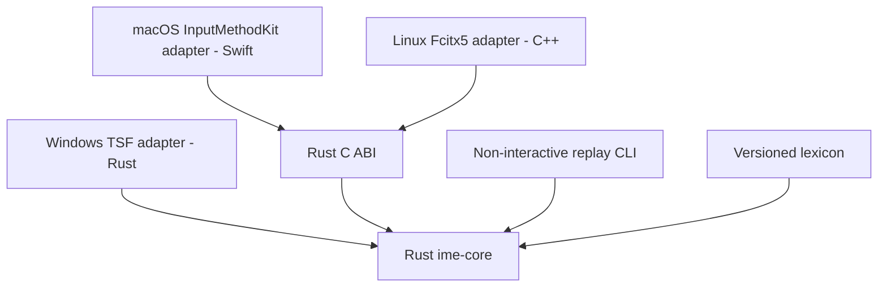

# bopomofo implementation plan

## Goal

從零實作一個跨 Windows、Linux、macOS 的 Zhuyin IME。共用輸入引擎以 Rust 實作，各平台透過 native adapter 接入系統輸入法介面。

「從零」指自行實作組字狀態、Zhuyin parser、詞庫索引、斷詞與候選排序；不使用 `chewing`、`librime` 或其他現成輸入引擎。可以使用系統 API、FFI binding、測試工具，以及授權允許使用與散布的詞庫資料。

本次只建立文件，不建立程式碼、不安裝輸入法，也不修改系統設定。以下實作項目均尚未完成。

## Context

- Repository：`/Users/narumi/src/bopomofo`。
- 現有內容為根目錄文件與 `docs/architecture.md`；根目錄 `AGENTS.md` 定義 repository guidance，尚無 Cargo workspace、程式碼或測試。
- `LICENSE` 為 GNU AGPL v3 文件；實作前確認各套件的 license metadata，不自行更換專案授權。
- 目前環境為 macOS，已確認有 Rust、Cargo、Swift、Clang；尚未驗證 InputMethodKit build 或 native IME 行為。
- 尚未確認 Windows／Linux native runner、最低 OS 版本、詞庫來源與詞頻資料。

## Scope

### 第一個跨平台版本

- Traditional Chinese、標準 Dachen keyboard layout。
- Zhuyin 聲母、介音、韻母與五種聲調；支援省略第一聲符號的標準輸入操作。
- 單字與詞組候選、連續組字、以詞頻為基礎的斷詞與排序。
- 候選翻頁、選字、組字內移動與修改、Backspace、Escape、Enter。
- native preedit、candidate presentation、文字 commit 與基本輸入模式切換。
- 完全離線執行；不傳送按鍵、組字內容或已提交文字。

### Non-Goals

- 第一版不包含其他 keyboard layout、Pinyin、手寫、語音或 Simplified Chinese conversion。
- 不做雲端同步、LLM 選字、上下文語意模型、個人化學習或使用者詞庫。
- 不做 reconversion、讀取完整文件、跨應用程式共用 composition 或自訂跨平台 candidate window。
- Linux 第一版只接 Fcitx5；IBus 另立計畫。
- 不使用全域 keyboard hook、clipboard injection 或模擬按鍵代替正式 IME API。

## Architecture

完整架構與責任邊界見 [docs/architecture.md](docs/architecture.md)。以下為實作計畫摘要，不代表已完成或通過 native 驗證。



### Rust core

- 每個 input context 各自持有一個 `Engine`；只讀詞庫可以共用，composition 不可共用。
- 核心處理標準化 `KeyEvent`，輸出是否 consumed、preedit、cursor、candidates 與 commit text。
- activate、deactivate、focus loss、reset 與 candidate selection 使用明確事件，不偽裝成一般按鍵。
- 核心不依賴 GUI、OS handle、網路或檔案路徑；詞庫在初始化時載入，按鍵處理路徑不做 I/O。
- 相同詞庫與事件序列必須產生相同結果；排序相同時使用固定 tie-break rule。
- 音節位置與文字 offset 分開表示。輸出的文字 offset 使用 UTF-8 byte offset，必須位於合法 char boundary；adapter 負責轉成平台要求的單位。
- 提供不改變狀態的 key probe；Windows TSF 的 test callback 不得造成重複輸入。

### Platform adapters

| 平台 | 接入方式 | 邊界 |
| --- | --- | --- |
| macOS | Swift、InputMethodKit、Rust static library | 使用 C ABI；管理 input context、marked text、native candidates 與 `.app` bundle。 |
| Windows | Rust、`windows` crate、TSF COM DLL | 管理 COM lifetime、edit session、composition、candidate UI 與註冊資訊。 |
| Linux | C++、Fcitx5 addon、Rust library | 使用 C ABI；由 Fcitx5 處理桌面協定與 candidate UI，不直接實作 Wayland／X11 protocol。 |

- 平台層只處理事件轉換、生命週期、顯示與提交；不另外實作一套選字規則。
- FFI 使用 opaque handle、明確的 buffer ownership、配對的 allocation/free API 與 error code；不跨 ABI 傳 Rust 型別。
- Rust panic 不得越過 FFI／COM 邊界；失敗時取消本次 composition 並讓 host 保持可用。
- 不記錄輸入內容；診斷只保留錯誤類型與不含文字的狀態資訊。

### 規劃目錄

```text
bopomofo/
├── Cargo.toml                  # Rust workspace
├── rust-toolchain.toml         # 固定 Rust toolchain
├── crates/
│   ├── ime-core/               # 組字狀態、parser、詞庫、斷詞與排序
│   ├── ime-ffi/                # macOS／Linux 共用 C ABI
│   └── ime-cli/                # 非互動 replay、詞庫建置與驗證
├── platforms/
│   ├── macos/                  # Swift + InputMethodKit host
│   ├── windows/                # Rust + TSF adapter
│   └── linux/
│       └── fcitx5/             # C++ + Fcitx5 addon
├── fixtures/                   # 自製且可散布的詞庫與事件序列
├── data/                       # 資料來源紀錄與建置產物規則
│   └── SOURCES.md              # 來源、版本、checksum 與授權
├── docs/
│   ├── architecture.md         # 架構與責任邊界
│   ├── input-spec.md           # 按鍵行為與預期輸出
│   ├── platform-support.md     # SDK、OS／架構與 build 前提
│   └── native-validation.md    # native 驗證結果與發布限制
├── AGENTS.md                   # Repository guidance
├── .gitignore
├── README.md
├── LICENSE
└── PLAN.md                     # 實作期間保留
```

此為目標結構，目前只有根目錄檔案與 `docs/architecture.md`。先建立 core 與 replay 工具；其他 crate／目錄在對應階段才建立，不預先建立空的抽象層。

- `ime-core` 統一處理輸入與選字規則，不依賴平台 API。
- `platforms` 只負責事件轉換、生命週期、顯示與文字提交。
- `fixtures` 提供 core 與各平台共用的預期輸出案例。

## Plan

順序：P0 → P1 → P2 → P3 → P4 → P5 → P6 → P7。P1 的 macOS integration spike 必須早於完整 decoder，避免最後才發現系統整合問題。

### P0 — 固定輸入規格與外部前提

- [ ] 建立 `docs/input-spec.md`，定義各 composition state 的按鍵行為；驗收：每條規則都有可重播的輸入與預期 preedit／commit 範例。
  - 明定 Space 在第一聲結束、選字與 commit 的差異，以及 Enter、Escape、Backspace、Shift、Caps Lock 的行為。
  - 候選選取模式必須明確進入，避免數字選字鍵與 Dachen 聲調鍵衝突。
  - 明定空 composition 的按鍵透傳、快捷鍵透傳、focus loss、失活及不完整音節的處理；不得繞過 host 對敏感欄位或停用輸入法的限制。
  - 限制單次 composition 為最多 64 個音節；超限時保留既有內容、拒絕新增音節並回報狀態，不靜默丟棄既有輸入或自動 commit。
- [ ] 建立 `data/SOURCES.md` 並調查可用字音、詞組與詞頻資料；驗收：選定資料有來源 URL、版本、checksum、授權、署名及可進行的轉換／散布範圍。
  - 自製最小測試詞庫，讓開發不依賴尚未核准的外部資料。
  - 授權不明的資料不得匯入或散布；正式詞庫未解決前，功能原型可繼續，產品品質與散布驗收保持 blocked。
- [ ] 建立 `docs/platform-support.md`，查閱 TSF、InputMethodKit、Fcitx5 官方 API 並列出所需 SDK、架構、build command 與驗證方式；驗收：每個 target 標明 available 或 blocked 及缺少的條件，不宣稱未驗證版本已受支援。

### P1 — Workspace、事件契約與 macOS integration spike

- [ ] 建立 Cargo workspace、固定已驗證的 Rust toolchain、core skeleton 與非互動 replay CLI；驗收：CLI 讀取 fixture 後輸出穩定結果，format、Clippy 與 unit tests 通過。
- [ ] 定義 `Engine`、事件、output snapshot、reset 與只讀 key probe；驗收：測試證明 probe 不改變狀態，不同 input context 互不影響。
- [ ] 建立最小 C ABI 與 Swift InputMethodKit host，先處理固定 fixture text，不實作完整候選引擎；驗收：本機可產生 bundle，FFI ownership、重複建立／釋放與錯誤回傳測試通過。
- [ ] 為 integration spike 準備安裝／移除腳本及 native smoke-test 文件；驗收：腳本可檢查 bundle 與路徑、預設不覆寫其他輸入法，文件包含 marked text、commit、取消及切換焦點的預期結果。
  - 實際安裝、啟用與 native UI 操作列入 External Handoff；未驗證前不得將 spike 標為 native integration 已通過。

### P2 — Zhuyin parser 與單字輸入

- [ ] 實作 Dachen mapping、音節 parser 與 canonical representation；驗收：五種聲調、可獨立成音節的聲母、ㄦ、合法／非法組合及中間刪除都有 table-driven tests。
- [ ] 實作 composition state machine，查詢自製詞庫並產生單字候選；驗收：P0 的單字 fixture 全數通過，空狀態透傳與選字鍵衝突規則一致。
- [ ] 增加非互動 replay regression suite；驗收：支援組字、選字、翻頁、取消、commit、按鍵重複及快捷鍵，預期結果不依賴 GUI 或 host OS。

### P3 — 詞庫管線、詞組與斷詞

- [ ] 建立詞庫 importer 與資料驗證；驗收：能檢出非法音節、缺失欄位、重複紀錄與無效頻率，並對每份詞組資料保存明確的讀音對應。
  - 同一份已固定版本的來源，必須能重建相同排序與 checksum 的輸出。
  - 初期使用有版本的文字格式，在初始化時建立 in-memory index；沒有量測證據前不加入 binary format 或 mmap。
- [ ] 實作以音節序列查詢的詞組索引及 dynamic-programming decoder；驗收：能找出最佳 segmentation，提供單字 fallback，未知讀音不被靜默刪除。
  - 先用可解釋的詞頻分數與固定 tie-break rule；不加入尚無語料支持的語意模型。
  - 候選數量與搜尋範圍必須有界，不列舉所有可能斷詞組合。
- [ ] 實作詞組候選、選取 span 鎖定與其餘區段重新計算；驗收：cursor 移動、刪除、改選及重新斷詞不修改未被編輯觸及的鎖定 span；編輯觸及鎖定 span 時先解鎖，顯示文字不假設一個音節必定對應一個 Unicode scalar。

### P4 — macOS MVP

- [ ] 將完整 core 接入 InputMethodKit host；驗收：adapter contract tests 與 bundle build 通過，並準備 native marked text、candidate、commit 的重播案例。
- [ ] 實作 UTF-8／UTF-16 range conversion、candidate 更新與 input context lifecycle；驗收：測試包含非 BMP Han character、emoji、combining sequence、stale callback 及重複 reset，不產生非法 range 或重複 commit。
- [ ] 完成 macOS 安裝、更新、移除與還原指引；驗收：所有寫入路徑明列，能回復前一版，不自動修改使用者目前選取的 input source。
  - 此階段的產品驗收仍需 External Handoff 的 macOS native checks。

### P5 — Windows TSF adapter

- [ ] 實作 Rust TSF adapter 的 COM lifecycle、key sink、edit session 與 composition；驗收：具備 native build／test 指令，並用共用 fixture 定義 adapter contract tests。
- [ ] 實作 native candidate presentation 與 UTF-16 offset conversion；驗收：測試涵蓋 key probe 不改變狀態、候選選取、焦點切換、composition cancellation 與 stale callback。
- [ ] 準備 Windows native CI workflow、註冊／解除註冊及 smoke-test 腳本；驗收：檔案與操作文件完整，清楚區分 x64、x86、ARM64 的支援狀態，不把 DLL cross-compilation 當成 TSF 驗證。
  - 目前沒有已確認可用的 Windows runner。實際編譯與執行結果待 runner 可用後附上；native gate 不得預先標記通過。

### P6 — Linux Fcitx5 adapter

- [ ] 實作薄層 Fcitx5 addon，轉換按鍵、preedit、candidate 與 commit；驗收：addon 不包含另一套 parser／decoder，共用 fixture 的預期輸出與 core 一致。
- [ ] 準備 Rust library 與 C++ addon 的 build／link／install 流程；驗收：明列 Fcitx5 development dependencies、C ABI header 與 library version 的一致性檢查。
- [ ] 準備 Linux native CI workflow 與 smoke-test 文件；驗收：分開列出 X11、Wayland、GTK、Qt、browser、Electron 的待驗證項目，不把單一桌面測試結果推論到所有組合。
  - 目前沒有已確認可用的 Linux native runner 或桌面 session。實際 build／desktop 結果依 External Handoff 補入。

### P7 — 穩定性、效能與可交付證據

- [ ] 為 parser、state machine、decoder 與 FFI 加入 property tests 及有界 fuzz smoke tests；驗收：非法輸入不造成 panic 越界、非法 offset、重複 commit 或不可恢復的 state，所有失敗案例加入 regression fixture。
- [ ] 建立 release-mode replay benchmark；驗收：記錄 CPU、OS、詞庫版本、資料集及量測方式，分開報告初始化時間、記憶體與按鍵處理延遲。
  - 初始目標：在最多 64 音節的具代表性 replay corpus 上，core key handling p95 < 5 ms；不包含平台 UI rendering。
  - 未取得可散布且具代表性的詞庫時，此項效能結論保持未驗證，不以極小 fixture 代替正式結果。
- [ ] 建立持續保留的 `docs/native-validation.md`；驗收：每個 OS／架構／應用程式組合標明 passed、failed 或 unverified，附可重現步驟、build ID 與結果來源。
- [ ] 整理架構、build、資料授權、安裝、移除及故障還原文件；驗收：`docs/architecture.md` 與實作一致，可用固定來源重建 artifact，所有尚未執行的 native checks 和發布限制均有明確交接。

## Validation Commands

建立 workspace 後，所有可在目前 host 編譯的 Rust target 必須通過：

```bash
cargo fmt --all -- --check
cargo clippy --workspace --all-targets -- -D warnings
cargo test --workspace --all-targets
```

平台特定依賴與程式碼須正確使用 target gating，讓 core tests 不必安裝其他 OS 的 SDK。上述指令不取代 Swift／C++ build、Windows native build 或任何 native IME 驗證。

各平台的實際 build、replay、FFI 與 benchmark 指令在對應工具建立後記入文件；目前不虛構尚不存在的可執行命令。

## Risks

- **資料來源與品質：** 合法字音表不等於完整詞庫；沒有可靠詞頻，斷詞品質無法只靠演算法保證。先完成資料來源與小型 regression corpus。
- **生命週期與文字索引：** native callback、edit session 及 offset 單位不同。用單一 core 契約、平台邊界轉換及重播測試控制差異。
- **跨平台驗證：** 現有環境只能確認 macOS development tools。Windows／Linux 未實測項目保持 unverified，阻擋相應平台的發布聲明。
- **操作品質：** 自動測試能驗證規則，不能證明選字符合使用者習慣。native 操作與主觀品質驗收需另行交接。

## Rollback / Recovery

- 開發版使用獨立且固定的 input source／service identifier，不覆蓋系統或第三方 IME。
- 安裝工具只修改本專案登記的路徑；安裝前保留前一版 artifact，不廣泛清除共用目錄。
- 故障時先切回系統輸入法，再停用／移除本專案，必要時還原前一版。
- 詞庫 artifact 必須帶版本與 checksum；格式不相容或內容無效時拒絕載入，不以錯誤資料繼續處理輸入。
- 本計畫不包含發布或自動更新服務。簽章、notarization、憑證及外部發布需另行授權。

## External Handoff

以下不是目前 agent 可自行完成的核取項目。日後若取得可用 runner、桌面操作工具與授權，才轉成對應的可執行任務。

| Responsible role | Prerequisite | Action / expected result | Unverified behavior / release restriction |
| --- | --- | --- | --- |
| macOS tester | 可安裝的 bundle、啟用 input source 的授權與桌面操作環境 | 在 native text app、browser、Electron app 驗證 marked text、候選、commit、切換焦點、縮放與多螢幕；記錄結果 | 目前尚未執行 native UI checks；通過前不得宣稱 macOS 版本可正式使用。 |
| Windows tester / CI owner | Windows SDK、相應架構 runner、TSF 測試環境 | 執行 native build／tests、註冊與移除；在代表性 app 驗證 composition、candidate、快捷鍵及焦點切換 | 未測架構與 app 類型不列入支援；x64 通過不代表 x86 app 或 ARM64 通過。 |
| Linux tester / CI owner | Fcitx5 development environment，以及實際 X11／Wayland desktop session | 執行 addon build／load，依 GTK、Qt、browser、Electron matrix 驗證輸入與移除 | headless unit tests 不等於 desktop integration；未測組合不得列為支援。 |
| Release owner | 可重現 artifact、授權紀錄、native validation 結果及帳號／憑證 | 決定發布平台，完成必要簽章、notarization、散布與來源碼提供要求 | 未取得授權不執行外部發布；不要求在聊天中提供秘密資訊。 |

## Completion Checklist

以下檢查的是實作計畫的交付證據，不代表尚未執行的 native acceptance 已通過。

- [ ] 核心 parser、composition、decoder、選字與 commit 均為自研 Rust 實作；未依賴現成輸入引擎。
- [ ] P0–P7 的 agent 可執行任務均附上有效證據；失敗、blocked 或缺少環境的檢查未被標成通過。
- [ ] 共用 fixture、Unicode 邊界、事件透傳、重複 callback 與 FFI ownership 測試通過。
- [ ] 可執行的 Rust quality gates、platform build 與 benchmark 已記錄結果；不可執行的 native checks 已明確交接。
- [ ] 詞庫的來源、授權、署名與可重現建置已確認；未解決的資料限制持續阻擋產品散布。
- [ ] `docs/native-validation.md` 已保留所有 native 結果、未驗證項目與發布限制，不以完成本計畫代替產品驗收。

所有任務與完成檢查均有有效證據，且未解決交接事項已保留後，才刪除本 `PLAN.md`。不得提前刪除或將文件建立視為實作完成。
