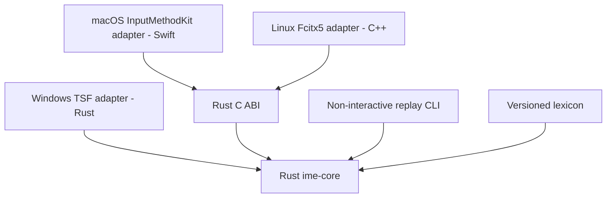

# bopomofo implementation plan

## Goal

從零實作一個跨 Windows、Linux、macOS 的 Zhuyin IME。共用輸入引擎以 Rust 實作，各平台透過 native adapter 接入系統輸入法介面。

「從零」指自行實作組字狀態、Zhuyin parser、詞庫索引、斷詞與候選排序；不使用 `chewing`、`librime` 或其他現成輸入引擎。可以使用系統 API、FFI binding、測試工具，以及授權允許使用與散布的詞庫資料。

目前依 Goal 指示執行本計畫。可在本機完成的程式碼、build 與 contract checks 均在此追蹤；不安裝、註冊或啟用輸入法，也不修改系統設定。未通過的 native、正式資料與效能 gates 保持未完成。

## Context

- Repository：`/Users/narumi/src/bopomofo`。
- 已建立 Cargo workspace、Rust core／FFI／CLI、三平台 adapter 原始碼與自製 fixtures；根目錄 `AGENTS.md` 定義 repository guidance。
- Rust 1.92.0 已固定，`rustfmt`／Clippy 可正常執行。實際檢查與限制將保留於 `docs/native-validation.md`。
- `LICENSE` 為 GNU AGPL v3 文件；實作前確認各套件的 license metadata，不自行更換專案授權。
- 目前環境為 macOS arm64，已通過 InputMethodKit 開發 bundle build 與獨立 Swift／C ABI tests；尚未安裝或驗證 native IME 行為。
- OrbStack Docker 提供 Linux arm64 headless build／contract tests。Windows 僅有 Rust cross-check，native SDK／runner 與各平台 desktop matrix 仍未驗證。
- 正式詞庫與詞頻仍受資料權利及代表性限制；目前只使用自製 fixture，不將其視為產品詞庫。

## Scope

### 第一個跨平台版本

- Traditional Chinese、標準 Dachen keyboard layout。
- Zhuyin 聲母、介音、韻母與五種聲調；支援省略第一聲符號的標準輸入操作。
- 單字與詞組候選、連續組字、以詞頻為基礎的斷詞與排序。
- 候選翻頁、選字、組字內移動與修改、Backspace、Escape、Enter。
- native preedit、candidate presentation、文字 commit 與基本輸入模式切換。
- 完全離線執行；不傳送按鍵、組字內容或已提交文字。

### Non-Goals

- 第一版不包含其他 keyboard layout、Pinyin、手寫、語音或 Simplified Chinese conversion。
- 不做雲端同步、LLM 選字、上下文語意模型、個人化學習或使用者詞庫。
- 不做 reconversion、讀取完整文件、跨應用程式共用 composition 或自訂跨平台 candidate window。
- Linux 第一版只接 Fcitx5；IBus 另立計畫。
- 不使用全域 keyboard hook、clipboard injection 或模擬按鍵代替正式 IME API。

## Architecture

完整架構與責任邊界見 [docs/architecture.md](docs/architecture.md)。以下為實作計畫摘要，不代表已完成或通過 native 驗證。



### Rust core

- 每個 input context 各自持有一個 `Engine`；只讀詞庫可以共用，composition 不可共用。
- 核心處理標準化 `KeyEvent`，輸出是否 consumed、preedit、cursor、candidates 與 commit text。
- activate、deactivate、focus loss、reset 與 candidate selection 使用明確事件，不偽裝成一般按鍵。
- 核心不依賴 GUI、OS handle、網路或檔案路徑；詞庫在初始化時載入，按鍵處理路徑不做 I/O。
- 相同詞庫與事件序列必須產生相同結果；排序相同時使用固定 tie-break rule。
- 音節位置與文字 offset 分開表示。輸出的文字 offset 使用 UTF-8 byte offset，必須位於合法 char boundary；adapter 負責轉成平台要求的單位。
- 提供不改變狀態的 key probe；Windows TSF 的 test callback 不得造成重複輸入。

### Platform adapters

| 平台 | 接入方式 | 邊界 |
| --- | --- | --- |
| macOS | Swift、InputMethodKit、Rust static library | 使用 C ABI；管理 input context、marked text、native candidates 與 `.app` bundle。 |
| Windows | Rust、`windows` crate、TSF COM DLL | 管理 COM lifetime、edit session、composition、candidate UI 與註冊資訊。 |
| Linux | C++、Fcitx5 addon、Rust library | 使用 C ABI；由 Fcitx5 處理桌面協定與 candidate UI，不直接實作 Wayland／X11 protocol。 |

- 平台層只處理事件轉換、生命週期、顯示與提交；不另外實作一套選字規則。
- FFI 使用 opaque handle、明確的 buffer ownership、配對的 allocation/free API 與 error code；不跨 ABI 傳 Rust 型別。
- Rust panic 不得越過 FFI／COM 邊界；失敗時取消本次 composition 並讓 host 保持可用。
- 不記錄輸入內容；診斷只保留錯誤類型與不含文字的狀態資訊。

### 規劃目錄

```text
bopomofo/
├── .github/workflows/checks.yml # CI build／contract checks
├── Cargo.toml                  # Rust workspace
├── Cargo.lock                  # 固定 dependency versions
├── rust-toolchain.toml         # 固定 Rust toolchain
├── crates/
│   ├── ime-core/               # 組字狀態、parser、詞庫、斷詞與排序
│   ├── ime-ffi/                # macOS／Linux 共用 C ABI
│   └── ime-cli/                # 非互動 replay、詞庫建置與驗證
├── platforms/
│   ├── macos/                  # Swift + InputMethodKit host
│   ├── windows/                # Rust + TSF adapter
│   └── linux/
│       └── fcitx5/             # C++ + Fcitx5 addon
├── fixtures/                   # 自製且可散布的詞庫與事件序列
├── data/                       # 資料來源紀錄與建置產物規則
│   └── SOURCES.md              # 來源、版本、checksum 與授權
├── docs/
│   ├── architecture.md         # 架構與責任邊界
│   ├── input-spec.md           # 按鍵行為與預期輸出
│   ├── platform-support.md     # SDK、OS／架構與 build 前提
│   ├── native-validation.md    # build／native 結果與發布限制
│   ├── macos.md                # InputMethodKit build／管理／smoke tests
│   ├── windows.md              # TSF build／註冊／限制
│   ├── linux.md                # Fcitx5 build／管理／protocol gap
│   └── benchmarks/fixture-64.json # 人工 stress-case report
├── AGENTS.md                   # Repository guidance
├── .gitattributes              # 固定文字檔 LF，維持 checksum
├── .gitignore
├── README.md
├── LICENSE
└── PLAN.md                     # 實作期間保留
```

Core、FFI、CLI 與平台目錄已依階段建立，未先建立空的抽象層。平台 build 輸出不納入 Git。

- `ime-core` 統一處理輸入與選字規則，不依賴平台 API。
- `platforms` 只負責事件轉換、生命週期、顯示與文字提交。
- `fixtures` 提供 core 與各平台共用的預期輸出案例。

## Plan

順序：P0 → P1 → P2 → P3 → P4 → P5 → P6 → P7。P1 的 macOS integration spike 必須早於完整 decoder，避免最後才發現系統整合問題。

### P0 — 固定輸入規格與外部前提

- [x] 建立 `docs/input-spec.md`，定義各 composition state 的按鍵行為；證據：規則表、Mermaid state diagram、八份 JSONL fixture 與 `crates/ime-core/tests/engine.rs`。
  - `cargo test -p ime-cli --test repository_fixtures` 通過，逐份比對手寫預期值與重播穩定性。
  - 明定 Space 在第一聲結束、選字與 commit 的差異，以及 Enter、Escape、Backspace、Shift、Caps Lock 的行為。
  - 候選選取模式必須明確進入，避免數字選字鍵與 Dachen 聲調鍵衝突。
  - 明定空 composition 的按鍵透傳、快捷鍵透傳、focus loss、失活及不完整音節的處理；不得繞過 host 對敏感欄位或停用輸入法的限制。
  - 限制單次 composition 為最多 64 個音節；超限時保留既有內容、拒絕新增音節並回報狀態，不靜默丟棄既有輸入或自動 commit。
- [x] 建立 `data/SOURCES.md` 並調查字音、詞組與詞頻來源；證據：固定版本、URL、checksum、license、attribution 與轉換限制已記錄。
  - 本階段選用 `fixture-local-v1` 自製資料；正式 phrase／frequency 來源尚未解決，並未匯入候選資料。
  - 自製最小測試詞庫，讓開發不依賴尚未核准的外部資料。
  - 授權不明的資料不得匯入或散布；正式詞庫未解決前，功能原型可繼續，產品品質與散布驗收保持 blocked。
- [x] 建立 `docs/platform-support.md`，查閱 TSF、InputMethodKit、Fcitx5 官方 API；證據：官方連結、local SDK typecheck、SDK／架構與 native 限制均已記錄。

### P1 — Workspace、事件契約與 macOS integration spike

- [x] 建立 Cargo workspace、固定 Rust 1.92.0 與非互動 replay CLI；證據：`cargo fmt --all -- --check`、workspace Clippy 與 debug／release tests 通過，各 80 tests。
- [x] 定義 `Engine`、事件、output snapshot、reset 與只讀 key probe；證據：core API、context isolation、probe simulation 與 20,000-event bounded property smoke tests 通過。
- [x] 在完整 decoder 接入前完成 C ABI 與 Swift InputMethodKit spike；證據：最初 bundle build 通過，`uv run --no-project --offline python` ctypes 驗證 key `1` 的 preedit `測試` 與 Enter 的一次性 commit。
  - 固定文字 spike 已由正式 core 取代，未保留假輸入路徑。
  - Rust FFI tests 驗證重複建立／釋放、ownership、非法 JSON／UTF-8、失敗不改狀態與一次性 Unicode commit。
- [x] 準備 macOS 管理腳本與 native smoke-test 文件；證據：Bash syntax、16 sandbox dry-run cases、bundle／identifier／signature／checksum／path checks 通過。
  - 實際安裝、啟用與 native UI 操作列入 External Handoff；未驗證前不得將 spike 標為 native integration 已通過。

### P2 — Zhuyin parser 與單字輸入

- [x] 實作 Dachen mapping、音節 parser 與 canonical representation；證據：parser table tests 包含完整 mapping、五聲、ㄦ、apical syllables、合法／非法組合、slot 刪除與全表 round-trip。
- [x] 實作 composition state machine 與單字候選；證據：五聲、Space、Enter、Escape、候選模式、數字衝突、shortcut／mode 與 64-syllable limit 測試通過。
- [x] 增加非互動 replay regression suite；證據：`fixtures/{basic,tones,modes,editing,limit-64,gestures,reselection,aliases}.jsonl` 由 CLI 自動比對，重播兩次輸出一致。

### P3 — 詞庫管線、詞組與斷詞

- [x] 建立 versioned TSV importer／normalizer 與資料驗證；證據：lexicon tests 與 CLI atomic-export tests 通過，含非法音節、欄位、重複、頻率及 resource caps。
  - `build-lexicon` 連續匯出兩次 bytes 一致，fixture 正規化產物 SHA-256 為 `7f57031c86bb4c3d909b4e24a08e54d771bba4cc7d06a7c164e121fb62be37d6`。
  - 外部資料尚未取得完整權利證據，不實作或執行未核准來源的轉換。
  - 同一份已固定版本的來源，必須能重建相同排序與 checksum 的輸出。
  - 初期使用有版本的文字格式，在初始化時建立 in-memory index；沒有量測證據前不加入 binary format 或 mmap。
- [x] 實作詞組索引與 dynamic-programming decoder；證據：non-greedy 最佳路徑、fixed-point frequency、deterministic ties、unknown fallback 與 64-syllable 有界搜尋測試通過。
  - 先用可解釋的詞頻分數與固定 tie-break rule；不加入尚無語料支持的語意模型。
  - 候選數量與搜尋範圍必須有界，不列舉所有可能斷詞組合。
- [x] 實作詞組候選、鎖定與重新計算；證據：無關 span 保留、overlap 解鎖、不同長度改選、插入／刪除平移、Unicode 多 scalar 與 cursor mapping 測試通過。

### P4 — macOS MVP

- [x] 將完整 core 接入 InputMethodKit host；證據：CLT arm64 bundle build、125 pure Swift 與 96 actual C ABI assertions 通過，native smoke cases 已列入 `docs/macos.md`。
- [x] 實作 UTF-8／UTF-16 conversion、candidate tokens 與 lifecycle；證據：非 BMP、emoji、combining sequence、過期／重複 callback、重複 reset、context isolation 與單次 commit 測試通過。
  - `internal_error` 與未知 output status 會拒絕 host effects，並由 controller 丟棄 context。
- [x] 完成 macOS 安裝、更新、移除與還原指引；證據：`docs/macos.md` 明列 current-user 路徑、backup／rollback 與 input-source 限制，腳本預設 dry-run，未執行 `--apply`。
  - 此階段的產品驗收仍需 External Handoff 的 macOS native checks。

### P5 — Windows TSF adapter

- [ ] 實作並驗證 Rust TSF adapter 的 COM lifecycle、key sink、edit session 與 composition。
  - 原始碼、native build／test scripts、16 portable tests 與 x64／x86／ARM64 type check／Clippy 已通過。
  - 首次 CI 的 19 Windows unit tests 已通過；DLL loader test 失敗於 `0x8007007E`。已補上 workflow 的 host DLL build 前置步驟，待重驗；未將此失敗標為通過。
- [ ] 驗證 Windows native candidate presentation 與 UTF-16 conversion。
  - UI-element interfaces、native LISTBOX fallback、portable Unicode／probe／lifecycle tests 與三架構 cross-check 已完成。
  - Native candidate、edit-session ordering 與 UI-less host 行為仍需 Windows runner／desktop 證據。
- [x] 準備 Windows CI、註冊／解除註冊與 smoke-test 文件；證據：三架構狀態已分列，YAML syntax 與 PowerShell 7.5.0 Linux AST parsing 通過；沒有執行註冊腳本。
  - 已取得推送 `narumi/feat/offline-zhuyin-ime` 與執行 GitHub Actions native checks 的授權；CI 結果另行記錄，不包含任何 IME 安裝／註冊／啟用授權。

### P6 — Linux Fcitx5 adapter

- [ ] 完成 Fcitx5 addon 的端到端候選契約。
  - 薄層 addon、八份共用 fixture（342 records）、checksum、Unicode、lifecycle、Sensitive-only transition、modifier remap 與 Shift／Enter alias tests 通過。
  - **仍有已知 blocker：** Fcitx5 5.1.7 與已查核的 5.1.14 D-Bus `SelectCandidate(index)` 沒有 generation。舊 UI index 可能選到新清單；captured CandidateWord tests 不能證明此路徑安全。
  - 已加入 headless gap model 並保留 native gate，不自行更改 protocol、停用 click 或加入 custom candidate window。
- [x] 建立 Rust／C++ build／link／install 流程；證據：Ubuntu 24.04 arm64、Fcitx5 5.1.7 clean build、ABI gate、4/4 CTests、安裝／移除 dry-run 與 C++ ASan／UBSan 4/4 tests 通過。
  - Rust static library 未使用 sanitizer instrumentation，不將 C++ 結果當成 Rust sanitizer 證據。
- [x] 準備 Linux CI、SDK dependencies 與 smoke-test matrix；證據：Docker image 固定 base digest，`docs/linux.md` 分列 X11／Wayland／GTK／Qt／browser／Electron 與已知 protocol gap。
  - 已取得 arm64 headless build environment；尚無已授權的 desktop session。Headless 結果不代表 native 桌面通過。

### P7 — 穩定性、效能與可交付證據

- [x] 加入 property tests 與有界 fuzz smoke tests；證據：全表音節 round-trip、小型 lock layout 枚舉、20,000-event state-machine smoke、FFI malformed JSON／UTF-8 與 ownership tests 通過。
  - Review 發現的雙 Shift chord、held-key alias、不同長度 span 改選、Sensitive transition 與 modifier remap 問題已修正，並有回歸測試。
- [ ] 完成具代表性的 release-mode replay benchmark gate。
  - 工具與人工 64-syllable stress report 已完成，原始數值保留在 `docs/benchmarks/fixture-64.json`。
  - 正式可散布詞庫與適用 corpus 仍缺完整證據，不將 39-entry fixture 的結果視為此 gate 通過。
  - 初始目標：在最多 64 音節的具代表性 replay corpus 上，core key handling p95 < 5 ms；不包含平台 UI rendering。
  - 未取得可散布且具代表性的詞庫時，此項效能結論保持未驗證，不以極小 fixture 代替正式結果。
- [x] 建立 `docs/native-validation.md`；證據：保留 source/build IDs、artifact hashes、commands、實際通過的檢查、unverified native matrix 與已知 Fcitx blocker。
- [x] 整理架構、build、資料授權、管理與還原文件；證據：README／三平台指南／SOURCES／native-validation 的 paths、links、YAML／PowerShell syntax 與 8 份 Mermaid diagrams 已檢查，build inputs 與限制均有交接。

## Validation Commands

建立 workspace 後，所有可在目前 host 編譯的 Rust target 必須通過：

```bash
cargo fmt --all -- --check
cargo clippy --workspace --all-targets -- -D warnings
cargo test --workspace --all-targets
```

平台特定依賴與程式碼須正確使用 target gating，讓 core tests 不必安裝其他 OS 的 SDK。上述指令不取代 Swift／C++ build、Windows native build 或任何 native IME 驗證。

各平台的實際 build、replay、FFI 與 benchmark 指令在對應工具建立後記入文件；目前不虛構尚不存在的可執行命令。

## Risks

- **資料來源與品質：** 合法字音表不等於完整詞庫；沒有可靠詞頻，斷詞品質無法只靠演算法保證。先完成資料來源與小型 regression corpus。
- **生命週期與文字索引：** native callback、edit session 及 offset 單位不同。用單一 core 契約、平台邊界轉換及重播測試控制差異。
- **跨平台驗證：** 已確認 macOS build 與 Linux headless checks；Windows native execution、各平台 desktop matrix 與 Fcitx index-only selection gap 仍阻擋相應發布聲明。
- **操作品質：** 自動測試能驗證規則，不能證明選字符合使用者習慣。native 操作與主觀品質驗收需另行交接。

## Rollback / Recovery

- 開發版使用獨立且固定的 input source／service identifier，不覆蓋系統或第三方 IME。
- 安裝工具只修改本專案登記的路徑；安裝前保留前一版 artifact，不廣泛清除共用目錄。
- 故障時先切回系統輸入法，再停用／移除本專案，必要時還原前一版。
- 詞庫 artifact 必須帶版本與 checksum；格式不相容或內容無效時拒絕載入，不以錯誤資料繼續處理輸入。
- 本計畫不包含發布或自動更新服務。簽章、notarization、憑證及外部發布需另行授權。

## External Handoff

以下不是目前 agent 可自行完成的核取項目。日後若取得可用 runner、桌面操作工具與授權，才轉成對應的可執行任務。

| Responsible role | Prerequisite | Action / expected result | Unverified behavior / release restriction |
| --- | --- | --- | --- |
| macOS tester | 可安裝的 bundle、啟用 input source 的授權與桌面操作環境 | 在 native text app、browser、Electron app 驗證 marked text、候選、commit、切換焦點、縮放與多螢幕；記錄結果 | 目前尚未執行 native UI checks；通過前不得宣稱 macOS 版本可正式使用。 |
| Windows tester / CI owner | Windows SDK、相應架構 runner、TSF 測試環境 | 執行 native build／tests、註冊與移除；在代表性 app 驗證 composition、candidate、快捷鍵及焦點切換 | 未測架構與 app 類型不列入支援；x64 通過不代表 x86 app 或 ARM64 通過。 |
| Linux tester / CI owner | Fcitx5 development environment，以及實際 X11／Wayland desktop session | 執行 addon build／load，依 GTK、Qt、browser、Electron matrix 驗證輸入與移除 | headless unit tests 不等於 desktop integration；未測組合不得列為支援。 |
| Release owner | 可重現 artifact、授權紀錄、native validation 結果及帳號／憑證 | 決定發布平台，完成必要簽章、notarization、散布與來源碼提供要求 | 未取得授權不執行外部發布；不要求在聊天中提供秘密資訊。 |

## Completion Checklist

以下檢查的是實作計畫的交付證據，不代表尚未執行的 native acceptance 已通過。

- [x] 核心 parser、composition、decoder、選字與 commit 均為自研 Rust 實作；workspace dependencies 不含現成輸入引擎。
- [ ] P0–P7 的 agent 可執行任務均附上有效證據；失敗、blocked 或缺少環境的檢查未被標成通過。
- [ ] 端到端共用 fixture、Unicode、事件透傳、callback 與 FFI ownership 驗證完整。
  - 本機 core／FFI／portable adapter tests 通過；Windows native callbacks 與 Fcitx stale UI protocol 路徑仍未通過，不能以 headless／type check 取代。
- [ ] 可執行的 Rust quality gates、platform build 與 benchmark 已記錄結果；不可執行的 native checks 已明確交接。
- [ ] 詞庫的來源、授權、署名與可重現建置已確認；未解決的資料限制持續阻擋產品散布。
- [x] `docs/native-validation.md` 已保留實際結果、未驗證項目、已知 blocker 與發布限制，不以文件完成代替產品驗收。

所有任務與完成檢查均有有效證據，且未解決交接事項已保留後，才刪除本 `PLAN.md`。不得提前刪除或將文件建立視為實作完成。
