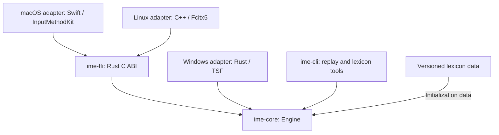
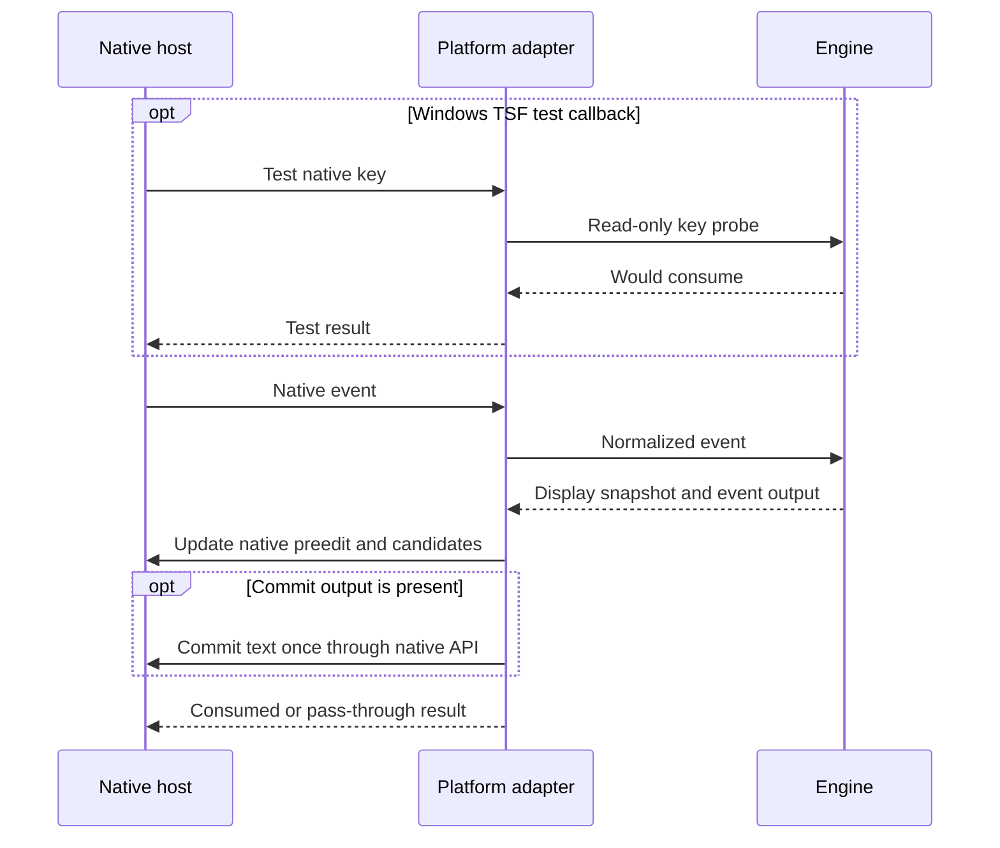
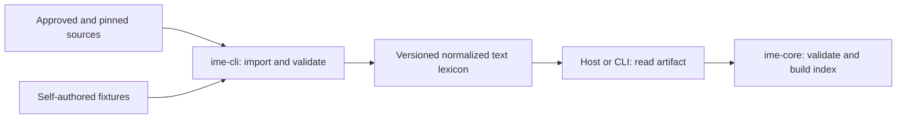

# Architecture

## Status and scope

本文件定義 bopomofo 的架構與責任邊界。Repository 已建立 Rust core、C ABI、replay CLI 與三平台 adapter。

Core regression tests 使用自製測試詞庫。macOS 預設開發 bundle 使用核准的 CNS11643 常用／次常用單字補充與五筆自製詞組；詳見 [CNS guide](../data/cns11643/README.md)。Build 與 contract tests 不代表 native desktop 驗收，實際結果見 [native-validation.md](native-validation.md)。

第一個跨平台版本使用 Traditional Chinese、標準 Dachen keyboard layout 與完全離線的輸入流程。組字狀態、Zhuyin parser、詞庫索引、斷詞與候選排序均自行以 Rust 實作，不使用 `chewing`、`librime` 或其他現成輸入引擎。

第一版不包含個人化學習、使用者詞庫、雲端同步、LLM 選字、reconversion 或自訂跨平台 candidate window。Linux 只接 Fcitx5，不直接實作 Wayland／X11 protocol。

## Components and dependencies

| 路徑 | 責任 | 限制 |
| --- | --- | --- |
| `crates/ime-core/` | 處理事件、組字、音節解析、詞庫查詢、斷詞與排序 | 不依賴 GUI、OS handle、網路或檔案路徑。 |
| `crates/ime-ffi/` | 提供 macOS／Linux 共用的 C ABI | 只轉換資料、管理 ownership 與回傳錯誤，不實作另一套輸入規則。 |
| `crates/ime-cli/` | 非互動 replay、詞庫匯入、建置與驗證 | 使用與 native adapter 相同的 core 行為。 |
| `platforms/macos/` | InputMethodKit host、marked text、native candidates 與 bundle | 透過 C ABI 呼叫 core。 |
| `platforms/windows/` | TSF COM DLL、key sink、edit session、composition 與 candidate UI | 透過 Rust API 呼叫 core。 |
| `platforms/linux/fcitx5/` | Fcitx5 addon、按鍵轉換、preedit、candidate 與 commit | 透過 C ABI 呼叫 core，由 Fcitx5 處理桌面協定。 |
| `fixtures/` | 自製且可散布的測試詞庫與事件序列 | 不使用授權不明的外部測試資料。 |
| `data/` | 記錄資料來源、授權、版本、checksum 與產物規則 | 正式資料未核准前，不匯入或散布。 |
| `docs/` | 保存輸入規格、架構、平台支援與 native 驗證結果 | 不以設計文件代替執行證據。 |

Core、FFI、CLI 與各平台使用獨立目錄。共用輸入規則只放在 core，不為未來需求建立空的抽象層。

## Rust core

### Internal responsibilities

| 責任 | 輸入與結果 |
| --- | --- |
| Dachen mapping 與 parser | 將標準化按鍵轉成 Zhuyin 符號與 canonical syllable，檢查音節合法性。 |
| Composition state | 保存音節、未完成音節、cursor、候選模式與已鎖定的選字 span。 |
| Lexicon | 驗證正規化詞庫資料，建立只讀的音節序列索引並提供查詢。 |
| Decoder | 使用詞頻分數與 dynamic programming 計算 segmentation、候選與排序。 |
| Engine | 協調事件轉換與上述狀態，產生可供 adapter 套用的結果。 |

這些是責任劃分，不要求每一項先建立獨立 crate 或來源檔。

### State ownership

- 每個 input context 各自持有一個 `Engine`，不得共用 composition、cursor 或選字狀態。
- 只讀詞庫可以由多個 `Engine` 共用，其存活時間不得短於使用它的 context。
- 同一個 `Engine` 的事件必須依序處理，不得由不同 native callback 同時修改。
- Core 以輸入／輸出介面運作，不主動 callback 到 native host。
- 呼叫端負責讀取詞庫檔案，再將資料交給 core 初始化；core 不開啟檔案，按鍵處理路徑不做 I/O。

### Events and outputs

Rust 型別見 `crates/ime-core/src/lib.rs`。C ABI signature 與 ownership 見 `crates/ime-ffi/include/bopomofo.h`。跨 C ABI 的事件與輸出使用 UTF-8 JSON，host 在初始化時檢查 header／library 的 ABI version。

| 事件 | 契約 |
| --- | --- |
| `KeyEvent` | Adapter 將 native key、modifiers 與 repeat 資訊轉成共用表示，由 core 決定是否 consumed。 |
| Lifecycle event | activate、deactivate、focus loss 與 reset 使用明確事件，不偽裝成按鍵。 |
| Candidate selection | 選取目前 context 與有效候選快照中的項目；過期 callback 不得提交文字或改變新的 composition。 |
| Key probe | 只判斷相同狀態下是否處理該按鍵，不修改狀態、不產生 commit，也不推進候選。 |

- 顯示結果包含 preedit、cursor、candidates 與候選顯示所需狀態。
- 按鍵結果包含 consumed，adapter 據此使用 native API 回報處理或透傳。
- Commit text 是該次事件的輸出，不是可重複提交的持續狀態。
  - 重讀顯示快照或重複 reset 不得再次提交相同輸出。
  - Adapter 不得因 UI 更新或 stale callback 重送 commit。
- 相同初始狀態、詞庫與事件序列必須產生相同結果。
- 同分排序使用固定 tie-break rule，並以 replay fixture 固定預期順序。

Space、Enter、Escape、Backspace、Shift、Caps Lock、快捷鍵透傳、不完整音節與 focus loss 的行為由 [input-spec.md](input-spec.md) 定義。Adapter 不得自行增加選字或提交規則。

Adapter 必須將透傳 key 的 press／release 與 modifier transitions 送入 core。這些事件可更新 chord 狀態，但 consumed 仍為 false。Windows TSF test callback 可要求後續 callback 以觀察事件，不能因此提前改變 core 狀態。

### Composition and decoding limits

- 單次 composition 最多 64 個音節。
  - 超限時保留既有內容、拒絕新增音節並回報狀態，不靜默丟棄內容或自動 commit。
- 每份候選快照最多 256 個項目，每頁 9 個；詞組最多 16 個音節。
  - 上限與單一 reading 的 lexicon 上限相同。CNS11643 的 `ㄧˋ` 有 154 個候選，不可沿用 128 上限隱藏其尾端單字。
- Decoder 每個位置最多查詢 16 個 span，不列舉所有 segmentation 組合。
- Decoder 先使用可解釋的詞頻分數與單字 fallback，不加入缺少語料支持的語意模型。
- 未知讀音不得被靜默刪除。
- 選字可以鎖定音節 span，其他區段可重新計算。
  - 編輯觸及鎖定 span 時先解鎖。
  - 未被編輯觸及的鎖定 span 不得因重新斷詞而改變。

### Text positions

- 音節位置與文字 offset 使用不同表示，不假設一個音節對應一個 Unicode scalar。
- Snapshot cursor 使用 UTF-8 byte offset，必須位於合法 char boundary。
- Candidate 的 start／end 是音節索引，不能當成文字 byte offset。
- Adapter 負責轉換平台所需的 range 單位；macOS／Windows 的相關介面使用 UTF-16 時，必須明確換算。
- 不得以 byte length 或 Unicode scalar count 代替 UTF-16 code unit length。
- Range 測試必須包含非 BMP Han character、emoji 與 combining sequence。

## Native event flow

- TSF test callback 只能呼叫 key probe，不得提前執行改變狀態的事件處理。
- Adapter 依各平台的 callback 與 edit session 規則套用結果，不假設三個平台可使用相同的呼叫時機。
- Adapter 管理 input context 建立、釋放、焦點與失活，並將相應事件送入所屬 `Engine`。
- Host 停用輸入法或限制敏感欄位時，不得使用其他路徑繞過限制。
- 不使用全域 keyboard hook、clipboard injection 或模擬按鍵代替正式 IME API。

## C ABI and failure handling

- C ABI 使用 opaque handle、固定表示的資料與明確 error code，不傳遞 Rust `String`、`Vec`、reference 或其他 Rust layout。
- 呼叫端傳入的 buffer 必須在呼叫期間有效；介面必須說明是否複製資料，以及長度與 UTF-8 要求。
- Rust 配置的輸出 buffer 必須由配對的 Rust free API 釋放，不由 Swift 或 C++ allocator 釋放。
- 每個 handle 與 buffer 的 ownership、有效期間及釋放責任必須記入 ABI 契約並測試。
- ABI 入口必須檢查可檢查的參數條件，包括 null、長度與文字編碼。
  - 呼叫端仍須保證非 null pointer 指向有效記憶體，不得將參數檢查視為能驗證任意 pointer。
- Rust panic 不得越過 C ABI 或 COM 邊界。
  - 發生不可恢復的 engine 錯誤時，adapter 取消受影響的 composition，並釋放或重建該 context。
  - 不自動重試可能已提交的文字，也不將錯誤文字當成輸入內容提交。
- C header 與 Rust library 必須來自一致的 ABI 版本，build／link 流程必須檢查此條件。
- Native package 附 `lexicon.sha256`。Host 在初始化時驗證詞庫 SHA-256，缺失或不符時拒絕載入。
  - C ABI 提供 `bpm_lexicon_verify`，Windows Rust adapter 直接使用相同 SHA-256 演算法。
  - Checksum 識別內容，不證明來源真實性或資料授權。

## Lexicon pipeline

- 來源紀錄保存於 `data/SOURCES.md`，每份來源必須有 URL、版本、checksum、授權、署名及允許的轉換／散布範圍。
- Importer 必須檢出非法音節、缺失欄位、重複紀錄與無效頻率，並保留詞組的明確讀音對應。
- 同一份已固定版本的來源，必須重建出相同排序與 checksum 的產物。
- 初期使用有版本的文字格式，於初始化時建立 in-memory index；沒有量測證據前不加入 binary format 或 mmap。
- 格式不相容、checksum 不符或內容無效時拒絕載入，不以錯誤資料繼續輸入。
- Rust lexicon parser 最多接受 64 MiB、250,000 筆資料、每個 reading 256 個候選與每筆文字 1,024 bytes。
- CLI 與 C ABI 的輸入檔上限為 32 MiB；C ABI event JSON 上限為 4,096 bytes。
- 自製 fixture 與已核准的 CNS11643 單字補充須分別保留驗證。正式 phrase／frequency 來源未解決前，不得宣稱已通過產品品質、代表性效能或資料散布驗收。
- 不自行更換 repository 的 AGPL v3 license；各套件 metadata 與詞庫資料授權仍須核對。

## Privacy and installation boundaries

- 不傳送按鍵、preedit 或 committed text，不使用網路服務處理輸入。
- 不記錄輸入內容；診斷只保留錯誤類型與不含文字的狀態資訊。
- 開發版使用獨立且固定的 input source／service identifier，不覆蓋系統或第三方輸入法。
- 安裝與移除工具只修改本專案登記的路徑，保留前一版 artifact 與還原方式。
- 實際安裝、註冊、啟用、移除、系統設定變更與外部發布均須取得明確授權；撰寫文件或腳本不代表已有執行授權。

## Validation boundaries

以下是驗證要求，不是已通過的結果。

| 層級 | 必須取得的證據 | 不能代替的證據 |
| --- | --- | --- |
| Core | Parser、state machine、decoder、key probe、context isolation 與 replay regression tests | Native UI 與應用程式相容性。 |
| Text and lifecycle | Unicode range、鎖定 span、stale callback、重複 reset 與不重複 commit 的測試 | 各平台實際 callback 行為。 |
| FFI | 重複建立／釋放、buffer ownership、錯誤回傳與 boundary tests | Swift／C++ host 的 native 整合。 |
| Platform build | macOS bundle、Windows native DLL、Linux addon 的 build／link 結果 | 安裝後的輸入行為；cross-compilation 不等於 native 驗證。 |
| Native integration | 各 OS／架構／應用程式組合的 marked text、candidate、commit、取消與焦點測試 | 未測試的其他組合。 |
| Performance | 固定詞庫、代表性 replay corpus、CPU／OS、初始化時間、記憶體與按鍵延遲 | 用極小 fixture 推論正式詞庫效能。 |

平台特定依賴必須使用 target gating，讓 core tests 不需要其他 OS 的 SDK。Native 結果日後保存於 `docs/native-validation.md`，每個組合分別標示 passed、failed 或 unverified。

初始效能目標是在最多 64 音節的代表性 replay corpus 上，core key handling p95 < 5 ms，不包含平台 UI rendering。目前只量測自製 fixture，代表性效能 gate 尚未驗證。

## Open decisions and prerequisites

- 平台支援範圍：最低 OS 版本、CPU 架構與必要的應用程式組合尚未確認，不預先宣稱支援。
- 詞庫來源與詞頻：須完成來源調查與授權核對，才可決定正式匯入與散布的資料。
- Native 驗證環境：macOS bundle 與 Linux headless build 已可在目前環境檢查。Windows 三架構 CI 已通過 build／load／非註冊 tests；各平台 installed desktop matrix 仍須獨立證據。

先以自製 fixture 建立 core 與 replay，再進行最小 macOS integration spike，之後完成 parser、decoder 與 macOS MVP，再接 Windows／Linux。開發順序不代表各平台已通過驗收或取得發布授權。
