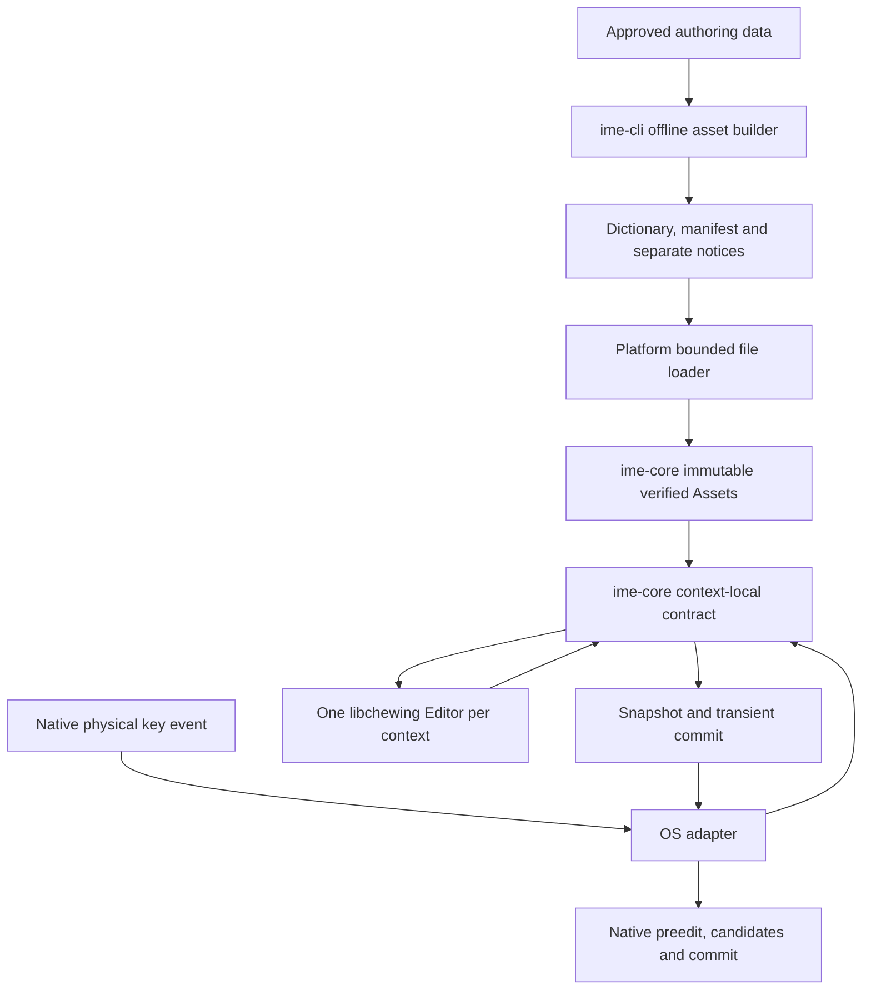

# Architecture

## Engine adoption policy

共用 Rust core 使用固定的 `chewing = 0.13.1` Rust API。上游 libchewing 負責 Dachen layout、syllable editing、composition、conversion 與 phrase selection。專案不維護第二個 parser、decoder、runtime lexicon index 或 backend selector。

Project code 保留 AGPL-3.0-only。Engine、embedded mini dictionary metadata 與所選資料的來源、LGPL grant、copyright、notices 和 exclusions 見 [data sources](../data/SOURCES.md) 與 [libchewing notice](../data/libchewing/NOTICE.md)。Adoption 不等於 release approval。

## Components and data flow

| Component | Responsibility |
| --- | --- |
| `ime-core/src/assets.rs` | Manifest、checksums、bounded upstream file-format validation 與 immutable dictionary ownership。 |
| `ime-core/src/engine.rs` | Editor initialization、event routing、mode／modifier state、limits、probe、snapshot units、candidate generation 與 commit ack。 |
| `ime-core/src/lib.rs` | 共用 Event／Output／Snapshot DTO 與固定限制。 |
| `ime-cli/src/source.rs` | 離線 authoring schema、normalization 與 upstream TrieBuilder；不是 runtime backend。 |
| `ime-cli/src/assets.rs` | 原始來源 identity、獨立 notices、atomic package build 與 CLI file loading。 |
| `ime-ffi` | C ABI v2、bounded memory descriptors、ownership、JSON serialization 與 panic containment。 |
| `ime-test-support` | Dev-only fixture compilation；不進入 production dependency graph。 |
| Platform adapters | Native keys、lifecycle、file loading、offset conversion、presentation 與 failure cancellation。不得實作輸入引擎。 |

CNS importer、TSV validation 與 canonical TSV export 保留為離線工具。Native runtime、replay 與 benchmark 都只接受編譯後的 asset package。

## Asset contract

Package 必須包含 `dictionary.dat`、`assets.json` 與六份 project／engine／data license、authors／notice files。Runtime 只載入前兩檔；package 與管理檢查保留 notices。Default build 的 source 固定為所選上游 `word.csv`／`tsi.csv`，不是自動搜尋 OS dictionaries。

Manifest format 為 `bopomofo-assets-v1`。它固定以下欄位：

- Engine `chewing-0.13.1` 與 builder format version。
- Data version 與 SHA-256 source identity。
- 恰好一個已知 filename、byte length 與 SHA-256。不得使用 absolute path、traversal、重複或額外 descriptor。

初始化先檢查 manifest，再檢查檔案與 dictionary。Manifest 最多 16 KiB，dictionary 最多 32 MiB。上游 DER format 0 的 index 必須為有界 BFS tree，沒有 cycle、重疊、孤立 record、空 internal node 或非法 range。每個 reading 最多 16 音節、256 個唯一候選，全部最多 250,000 entries。Phrase text 的 scalar count 必須等於 reading length；不得含 control character 或 persisted user-history extension。

這個檢查只驗證檔案結構，不實作 lookup 或輸入規則。之後由上游 Trie 解析與查詢。SHA-256 可發現混用或更動的 bytes，但不認證 producer；ad-hoc signature 也不是 distribution trust。

Builder 先在相同 parent 建立 staging directory。全部資料驗證成功後才 rename；既有 destination 不被覆寫。Builder 失敗會移除自己的 staging files。Unknown caller-supplied data 不會被改標為 AGPL 或自動取得 redistribution grant。

## Memory and privacy

Platform loader 只在初始化讀檔。Core 與 C ABI 接收 memory bytes，不接收 dictionary path。Core 建立 explicit `Layered` dictionary，**不使用 `Editor::chewing()` 或隱含檔案搜尋**。

- 只有 verified immutable system Trie 可跨 contexts 共用。
- 每個 context 有獨立 Editor、composition、mode、modifier、candidate index 與 generation。
- User dictionary 使用上游 memory-only store；沒有 path、SQLite、auto-learn、manual learning 或 persistence API。
- Abbreviation 與 symbol tables 明確為空。所有 shortcut chord 先由共用 routing 透傳，不呼叫上游加詞功能。
- 上游 logging 在 debug／release 都以 compile-time `max_level_off` 關閉。
- Auto-commit threshold 明確停用。Composition 上限由 wrapper 在輸入前檢查，不以丟棄或自動 commit 回復。
- 不保存輸入事件歷史，不依歷史 replay 重建 state，不記錄或傳送 keystrokes、preedit、candidates 或 committed text。

`scripts/check-engine-privacy.sh` 在受控 HOME 與無效 `CHEWING_PATH` 下，以 public synthetic input 檢查 debug／release 的 initialization、events、probe、selection、cancellation 與 drop。Trace 只在固定 markers 間判定 file／network／read／write syscalls。這是具體測試，不是所有可能路徑的形式化證明。

## Shared input contract

詳見 [input specification](input-spec.md)。Wrapper 保留所有平台共同需要的安全契約：

- Lifecycle 只取消，不隱含 commit。Ctrl／Alt／Meta shortcuts 透傳；mode 與 Shift chord 規則一致。
- Unknown reading 或 pending Enter 保留可編輯文字。不得送入會靜默清除未知文字的上游路徑。
- Composition 最多 64 音節，包含 pending。超限回報 `limit_reached`，不自動提交。
- 候選每頁 9 個，最多 256 個。上游提供一個 selection point；Tab 切換 span。
- UI selection 必須符合 context、generation 與 absolute index。過期 selection 不改 state、不 commit。
- 每次 output 最多包含本次事件的 transient commit。Wrapper 讀取後立即 ack；snapshot 不持有 commit。

`Snapshot.cursor` 是 Unicode scalar boundary 上的 **UTF-8 byte offset**。Core 將上游 syllable position 映射到對應 scalar 的 byte offset，包括 phrase 內部。`Candidate.start/end` 是 syllable indices，end exclusive，不是 bytes。macOS／Windows 轉換 cursor 到 UTF-16 code units；Fcitx 保留 byte offset。不得混用 scalar、grapheme、UTF-8 與 UTF-16 單位。

資料模型要求一音節對應一個 scalar。四音節仍可表示 `𠀀é😀` 四個 scalars；Unicode fixture 保留完整 emoji／combining／non-BMP replay，而不是以 clipping 隱藏不相容資料。

## Read-only probe

Windows test callback 與 actual callback 共用 routing predicate。Probe 只複製固定大小的 modifier bookkeeping。它不呼叫 Editor mutating API，不 clone Editor、不模擬輸入、不保留或 replay 輸入歷史。

Repeated probe 不改 snapshot、generation、候選、commit 或下一次 actual consumed 結果。Unit test 以 20,000 個 synthetic events 比對 probe／actual，另測實際 TSF dispatch gate。Probe 本身不授權 native event delivery；Windows adapter 仍須觀察 allowed context 的透傳 press／release，才能維護 held-key state。

## C ABI v2 and failures

Header 與 native library 的 `bpm_abi_version()` 必須相等。新版 constructor 為 `bpm_engine_new_v2`，只接受 bounded named buffers 與 manifest。`bpm_assets_verify` 可先驗證相同資料。C ABI 不保留 caller pointers；初始化完成後 caller 可釋放原始 bytes。

Host 必須依 header 使用 `bpm_engine_free` 與 `bpm_buffer_free`。Event JSON 最多 4,096 bytes。Invalid parameter／UTF-8／JSON 在 mutation 前拒絕。Rust panic 不可穿越 C ABI；受影響 handle 進入 poisoned state，不重試事件。Native failure 取消 presentation，不重送 commit。

V1 constructor 已移除；沒有 TSV fallback。V1 host 必須在 version check 拒絕 v2 library。回退時要整組回復 header、library、adapter 與 assets，不可混版。

Windows 直接連結同一 Rust core，保留 COM panic boundary、context epochs、ordered single-use output tickets 與 native restrictions。Swift 與 C++ 使用 C ABI。平台不得以 alternate engine 處理 initialization failure。

## Validation boundaries

Core tests、platform builds／headless contracts 與 installed native checks 分開提供證據。每組 replay 使用自己的 asset profile；wrong-profile negative test 必須保留。Expectations 依契約手寫，不從 actual output 產生。

Fixture-only latency、probe latency、asset initialization 與 RSS reports 不證明正式 corpus 的品質或 p95 < 5 ms。Native OS／CPU／app 支援只由對應的 native results 證明。

Fcitx DBus index-only `SelectCandidate` 缺少 rendered-list generation。Captured object guards 不足以修正這個 protocol gap；known-gap reproducer 的 exit 0 只表示重現成功，不能標為安全通過。詳見 [Linux guide](linux.md#known-dbus-selection-gap) 與 [validation register](native-validation.md)。
