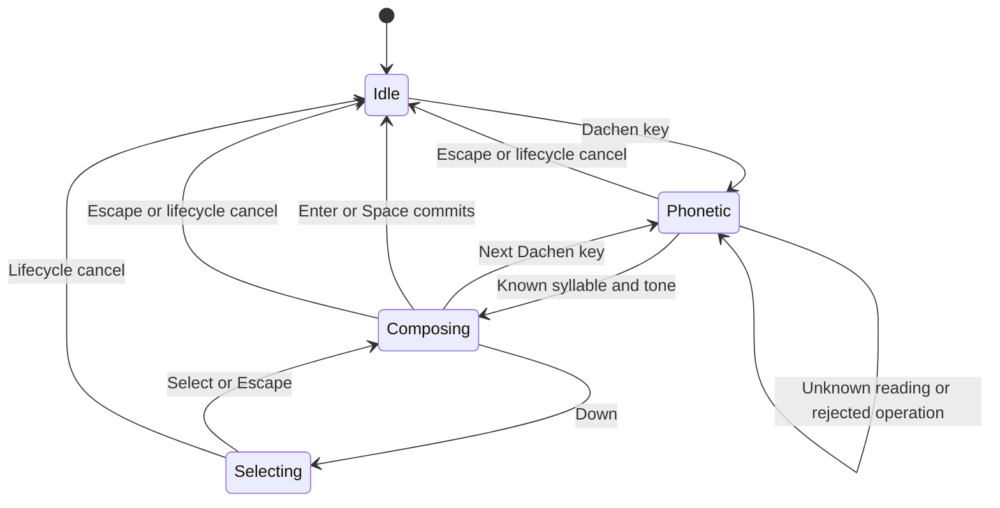

# Input specification

## Scope and state

所有 adapter 使用 Rust `ime-core` 封裝的 libchewing 0.13.1。第一版採 Traditional Chinese、標準 Dachen、完全離線與 context-local state。上游負責 parser、composition、conversion 與候選；wrapper 只處理共用安全契約、mode／modifier 與 UI selection 邊界。

新 context 為 active、Chinese mode。`Deactivate` 取消 composition 並停用 context。`FocusLost`／`Reset` 取消 composition、清除 held-key bookkeeping，但保留 mode。所有 lifecycle events 均不 commit。

## Key and probe contract

- Adapter 傳送標準化 key、`ctrl`、`alt`、`meta`、`shift`、`repeat`、`release`；Dachen 依 US physical position，不依 host text layout。
- KeyUp 不產生文字或 commit；post-event modifier flags、透傳按鍵的 press／release 與 modifier transitions 仍須傳入 core。
- Shift 單獨操作在最後一個 Shift release 切換 Chinese／Latin mode。Chord、held keys、repeat、左右 Shift 與 Return／keypad Enter aliases 不得誤觸 mode 切換。
- 非 repeat `caps_lock` 切換 mode。Mode 切換取消 composition，不 commit。
- Ctrl／Alt／Meta shortcuts 一律透傳，不呼叫上游加詞功能，不改 composition。Latin／inactive context 透傳一般按鍵。
- 空 composition 的非 Dachen key 透傳。Adapter 保留原始 native event，不模擬按鍵。
- `probe` 與實際事件使用相同的 routing predicate。Probe 只複製 bounded modifier bookkeeping，不呼叫 mutating Editor API、不執行事件、不保存或 replay 真實輸入歷史。
- Repeated probes 不改變 snapshot、generation、候選、commit、dictionary 或下一次實際 consumed 結果。Windows test callback 不得提前輸入或提交。

## Phonetic input and editing

- Dachen mapping 與 phonetic slot 操作使用上游 `Standard`，不維護第二份 layout 或自製音節 parser。
- First tone 使用 Space，其他 tones 使用 `6`／`3`／`4`／`7`。Tone 只能完成目前 pending syllable；空 buffer 的 tone key 回報 `invalid_syllable`。
- Tone 完成前先用上游 dictionary 查詢完整 reading；沒有對應單字時保留可編輯 pending buffer，回報 `unknown_reading`。不得使用會清除未知輸入的上游預設路徑。
- Pending 時 Enter 回報 `invalid_syllable` 並保留文字。Cursor、Delete、Down 等非 phonetic 操作不得丟失 pending text；Backspace 依上游刪除最後 phonetic component。
- Escape 清空 composition；候選模式的 Escape 只關閉候選。取消不 commit。
- 完成組字後 Enter／Space commit 整段文字一次並清空。沒有組字時透傳。
- 已完成音節的 Backspace、Delete、Home／End、Left／Right、conversion 與選字鎖定交由上游 Editor 處理。
- 單次 composition 最多 64 音節，包含 pending。達上限後拒絕新的音節、回報 `limit_reached`，不丟棄或自動 commit；上游 auto-commit threshold 明確停用。

## Candidates and Unicode

- Down 明確進入候選模式；非候選模式的 snapshot 不提供預覽 candidate list。
- 每頁 9 個候選，整份清單最多 256 個。Up／Down／Left／Right 移動 highlight，Page Up／Down 換頁，不循環。
- `1`…`9` 選取目前頁的項目；Enter／Space 選取 highlighted candidate。選字不 commit。
- Tab 在上游允許的 selection points 間切換詞組長度；沒有下一個時回到第一個。候選順序與可選 span 使用上游結果，不重做排序或斷詞。
- UI select event 使用目前 context、snapshot `generation` 與 absolute candidate index。Stale generation、失效 context 或越界 index 不改 composition、不 commit，回報 `stale_selection`。
- Snapshot cursor 為合法 UTF-8 byte offset。Candidate start／end 為音節位置，不是 byte offset；目前 dictionary 要求每音節對應一個 Unicode scalar，可含非 BMP character。
- 詞組內部的 cursor 映射到對應 scalar 的 byte offset；不得一律退到 interval 起點。macOS／Windows adapter 明確轉換成 UTF-16 code units，不能使用 grapheme count。
- 原單音節對應 `𠀀é😀` 的任意長度 mapping 不符合上游模型，asset build 明確拒絕。Unicode fixture 使用四個 `ㄧ` 對應四個 scalars，保留完整 `𠀀é😀`、11-byte／6-unit、選字、單次 commit 與取消測試。
- Commit 是該事件的 transient output；wrapper 讀取後立即 `ack`。Snapshot、重複 reset、過期 callback 或 UI 更新不得重送 commit。

## Migration differences

| 原自研行為 | libchewing 契約 |
| --- | --- |
| 自製合法音節表與 slot 前綴拒絕 | 使用上游 parser／Standard；slot 可編輯，tone completion 由字庫查詢確認。 |
| 未知音節成為可提交的 raw composition | 保留 pending spelling，回報 unknown，不讓上游靜默刪除；須改音或取消。 |
| 非選字模式亦列出候選預覽 | 僅在明確選字模式提供候選。 |
| 多種長度候選混列並自行排序 | 上游一次提供一個 selection point；Tab 改變詞組長度。 |
| 自製 Viterbi／tie-break／lock 細節 | 使用上游 conversion 與選字鎖定；不保證舊候選順序。 |
| 選字後移到 span end | 保留上游原 cursor，不啟用 auto-shift；需要移到結尾時明確使用 End。 |
| 單音節可對應任意長度字串 | Runtime dictionary 接受上游一音節／scalar 模型；adapter 的任意文字 range 安全仍獨立驗證。 |

## Validation

以手寫 regression expectations 驗證四組資料：baseline、CNS11643、quality、Unicode。每組先編譯成自己的 assets，wrong-profile replay 必須失敗。另驗證 probe／actual parity、held-key chords、context isolation、stale callbacks、limits、unknown input、resource integrity、FFI ownership 與一次性 commit。

輸入內容 logging、auto-learn、manual phrase learning 與 user dictionary persistence 均停用；測試只使用明確提供的 synthetic input。Host 的敏感欄位與停用輸入法限制優先，不得繞過。Core、platform build 與 installed native validation 分別提供證據；Fcitx index-only selection gap 仍依 validation register 保持 open。
