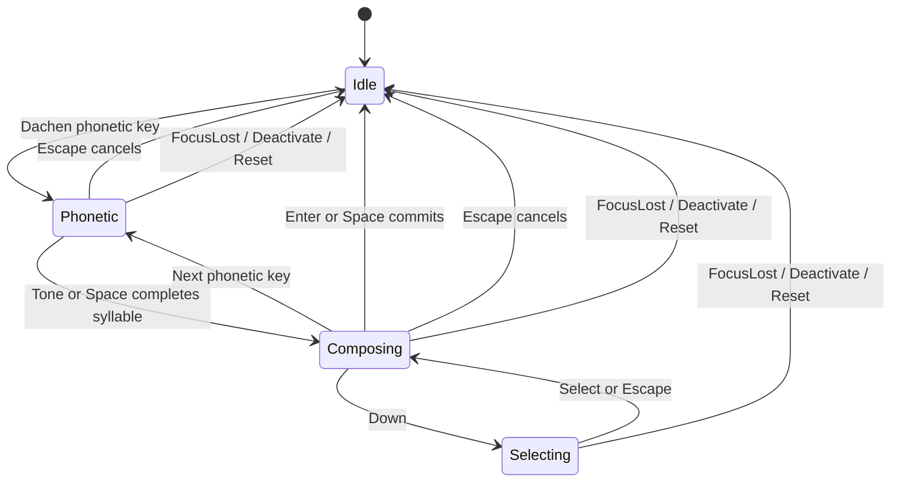

# Input specification

## Scope and state

本規格固定第一版的 Traditional Chinese、標準 Dachen 操作。所有 adapter 使用相同規則。

Idle 表示 composition 為空。Phonetic 表示有未完成音節。Composing 表示已有完整音節且沒有未完成音節。Selecting 是明確的候選選取模式。

`Engine` 新建後為 active、Chinese mode。`Activate` 啟用 context。`Deactivate` 取消 composition 並停用 context。`FocusLost` 與 `Reset` 只取消 composition。這些事件均不 commit。Mode 保留於同一個 context。

## Key contract

Adapter 傳送標準化小寫 key 名稱與 `ctrl`、`alt`、`meta`、`shift`、`repeat`、`release`。Dachen 使用 US keyboard 的 physical key，不依使用者目前文字 layout 產生的字元。特殊鍵名見下表。

- KeyUp 不產生字元或 commit。
- Modifier flags 表示事件完成後的狀態；adapter 必須將 XIM 等介面的 pre-release mask 正規化。
- 非文字 modifier key 使用 `control`、`alt`、`meta` 等固定名稱，press／release 均須送入 core。
- Shift 單獨按下後放開，切換 Chinese／Latin mode。
  - Shift 按住期間若有其他 key，或按下前已有其他 key 按住，放開時不切換。
  - 同時使用左右 Shift 時，最後一個 Shift 放開後才判定。
  - 第二個 Shift keydown 不重設既有 chord 狀態。
  - 重複 Shift keydown 不重複切換。
  - Adapter 必須將透傳按鍵的 press／release 也送入 core，以維護 chord 狀態。
  - Return 與 keypad Enter 等共用 logical key 的實體按鍵，各自計算 press／release；全部放開前不視為 Shift 單獨操作。
- `caps_lock` 非 repeat keydown 切換 mode。
- Mode 切換取消 composition，不 commit。
- `ctrl`、`alt` 或 `meta` shortcut 一律透傳，composition 保持不變。
- Latin mode、inactive context、空 composition 的非 Dachen key 一律透傳。
- 透傳時 adapter 保留原始 native event，不模擬按鍵。

## Dachen and syllables

Dachen phonetic mapping 為 `1/q/a/z/2/w/s/x/e/d/c/r/f/v/5/t/g/b/y/h/n/u/j/m/8/i/k/,/9/o/l/./0/p/;/\u002f/-`，分別對應 `ㄅㄆㄇㄈㄉㄊㄋㄌㄍㄎㄏㄐㄑㄒㄓㄔㄕㄖㄗㄘㄙㄧㄨㄩㄚㄛㄜㄝㄞㄟㄠㄡㄢㄣㄤㄥㄦ`。

同類 phonetic slot 可替換，但不得形成無法完成的音節。遭拒的輸入保留原有 buffer。Backspace 刪除最後一個 phonetic slot。合法音節與 slot 替換由 parser table tests 固定。

| Tone | Key | Canonical example |
| --- | --- | --- |
| 1 | `space` | `18 space` → `ㄅㄚ` → `八` |
| 2 | `6` | `186` → `ㄅㄚˊ` → `拔` |
| 3 | `3` | `183` → `ㄅㄚˇ` → `把` |
| 4 | `4` | `184` → `ㄅㄚˋ` → `爸` |
| 5 | `7` | `187` → `ㄅㄚ˙` → `罷` |

Canonical 第一聲不附符號。Parser 接受明示 `ˉ` 與前置 `˙` 並正規化。Tone key 只能結束目前音節，不把不完整聲母當成完整音節。

## Editing and selection

| State / key | Result | Replay example and expected output |
| --- | --- | --- |
| Phonetic / `space` | 結束第一聲音節，不 commit | `1 8 space` → preedit `八`、commit null。 |
| Phonetic / tone | 完成音節並查詞庫 | `s u 3 c l 3` → preedit `你好`、commit null。 |
| Phonetic / `enter` | 回報 InvalidSyllable，保留輸入 | `1 enter` → preedit `ㄅ`、commit null。 |
| Composing / `enter` or `space` | commit 整段文字並清空 | `1 8 space enter` → commit `八`、preedit 空。 |
| Idle / `enter` or `space` | 透傳 | `space` → consumed false、commit null。 |
| Composing / `down` | 開啟 Selecting | `1 8 space down` → selecting true。 |
| Selecting / `1`…`9` | 選取目前頁的候選並鎖定 span，不 commit | `1 8 space down 2` → preedit `巴`、selecting false。 |
| Selecting / `space` or `enter` | 選取 highlighted candidate，不 commit | `1 8 space down enter` → preedit `八`、commit null。 |
| Selecting / `up` or `down` | 移動 highlight 並同步 page | `1 8 space down down enter` → preedit `巴`。 |
| Selecting / `page_down` / `page_up` | 切換候選頁，邊界不循環 | `1 8 space down page_down 1` → preedit `豝`。 |
| Selecting / `escape` | 關閉候選，保留 composition | `1 8 space down escape` → preedit `八`、selecting false。 |
| Selecting / other key | consumed，保留候選模式 | 不將數字選字鍵再當 tone key。 |
| Phonetic or Composing / `escape` | 清空整個 composition，不 commit | `1 8 escape` → preedit 空。 |
| Phonetic / `backspace` | 刪除最後一個 phonetic slot | `1 8 backspace` → preedit `ㄅ`。 |
| Composing / `backspace` | 刪除 cursor 前一個完整音節 | `s u 3 c l 3 backspace` → preedit `你`。 |
| Composing / `delete` | 刪除 cursor 處完整音節 | `s u 3 c l 3 home delete` → preedit `好`。 |
| Composing / `left` / `right` / `home` / `end` | 以音節為單位移動 cursor | `s u 3 c l 3 home right` → cursor 在兩音節之間。 |
| Phonetic / cursor movement | consumed，不移動或丟棄未完成音節 | `1 left` → preedit `ㄅ`。 |
| Unknown reading | 顯示原始 canonical Zhuyin，不刪除 | `q 8 space` → preedit `ㄆㄚ`，status UnknownReading。 |
| Invalid syllable / tone | consumed，保留目前 raw buffer | `1 3` → preedit `ㄅ`，status InvalidSyllable。 |

每頁最多 9 個候選。Candidate index 是整份候選清單的 absolute index。候選總數與搜尋 span 有固定上限。Cursor 位於 composition 結尾時，候選 anchor 為最後一個音節；否則使用 cursor 處的音節。選詞組前可先用 `home` 移至起點。

選取事件必須帶目前 snapshot 的 `generation`。過期 generation 回報 StaleSelection，且不改變 composition。重新 reset 或重讀 snapshot 不得重送 commit。

## Locks, limits and Unicode

- 完成音節插入 cursor 處，之後重新計算未鎖定區段。
- 編輯或明確改選觸及鎖定 span 時先解鎖；其餘鎖定 span 保留並依插入／刪除位置平移。
  - 改選可使用不同長度的 span，不得因舊鎖定而隱藏有效候選。
- 插入點正好在 span 邊界時，不解除相鄰 span 的鎖定。
- 單次 composition 最多 64 個音節，包含目前未完成音節。
  - 已有 64 個完整音節時拒絕新的 phonetic key，回報 LimitReached。
  - 不自動 commit、不丟棄舊內容。
- 音節位置與 UTF-8 byte offset 不可混用。
- 多音節詞組的內部 cursor 位置映射到該 span 的文字起點，span 結尾映射到文字結尾。
  - 不假設每個音節恰好對應一個 Unicode scalar。
  - Native adapter 必須再轉換成平台要求的單位。

## Validation

Core regression tests 與 `fixtures/*.jsonl` 驗證本規格。Parser tests 驗證 Dachen mapping、五聲、ㄦ、可獨立成音節的聲母、合法／非法音節與 slot 刪除。Adapter tests 另驗證 physical key mapping、native range、stale callback 與重複 reset。

Host 的敏感欄位與停用輸入法限制優先於一般輸入流程，不得繞過。Native UI 行為仍須依平台 matrix 實測。
