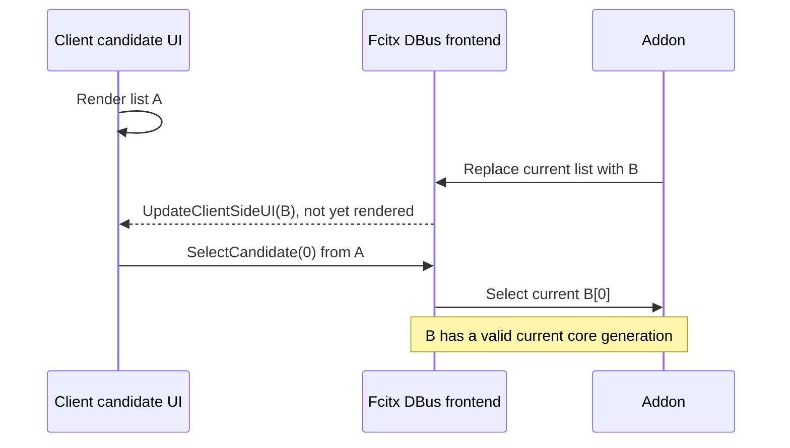

# Linux Fcitx5 addon

## Status

The addon builds on **Linux aarch64, Ubuntu 24.04, Fcitx5 5.1.7** in an isolated Docker container. C++ ABI, shared replay, and headless Fcitx API contract tests pass. This is **not** a desktop integration result.

No IME was installed, enabled, or removed. No host settings were changed. All X11, Wayland, application, and x86_64 desktop combinations remain **unverified**. The fixture lexicon is not a production lexicon. See [native-validation.md](native-validation.md) for the project evidence register.

**Open P6 blocker:** Fcitx5 5.1.7 DBus `SelectCandidate(int)` has no render generation. A delayed client-side UI index is resolved against the current list. Captured `CandidateWord` guards do not protect this path. The independent `known_gap_reproduced_dbus_stale_rendered_index` CTest reproduces the known gap; it is not a safety pass. Source checks of 5.1.23 and the pinned GTK/Qt clients found no generation-aware selection or sufficient ordering guarantee. See the [minimal upstream report](#known-dbus-selection-gap) below. P6 and native acceptance remain open.

## Adapter boundary

- `platforms/linux/fcitx5/src/addon.cpp` implements `fcitx::InputMethodEngine`.
  - A registered `FactoryFor<ContextProperty>` gives each input context its own Rust `Engine`. The property does not copy composition or mode to another context.
  - The addon reads the installed lexicon and its SHA-256 manifest once at creation. It verifies the checksum through the C ABI, validates the data, and keeps immutable source bytes. Missing, malformed, or mismatched data prevents addon creation. This checks pinned integrity, not authenticity. Each new context passes those bytes to Rust. Key handling does not open files.
- `src/keymap.cpp` loads a fixed US XKB map at addon creation.
  - Physical XKB keycodes select level 0 US printable characters. Actual native modifier/action symbols take priority. A US Caps/Control/action position does not override a remapped printable symbol. Fcitx XIM uses X11 keycodes. Its Wayland IM frontends add the evdev offset of 8 before creating a key event.
  - A code-less event has only a US keysym fallback. A non-US layout without physical keycodes is not verified.
  - Raw modifier flags preserve Ctrl, Alt/AltGr, Meta/Super/Hyper, Shift, repeat, and release. Control/Alt/Meta transitions and unknown keys also go to core. They can cancel a pending standalone-Shift gesture.
  - Native Shift state is context-local. The normalizer tracks both physical sides and delivers only the first aggregate press and final release to core. Other physical Shift transitions remain pass-through observations. This converts X11 pre-release masks without implementing gesture rules.
  - Composition reset, focus, and capability cancellation do not erase physical Shift state. Native release or a native no-Shift mask resynchronizes it. A second side pressed while another side remains held cannot rearm a gesture cancelled by Reset.
  - Shift-alone and Caps Lock mode changes are core rules. Caps Lock means the logical `caps_lock` key event, not the host LED state.
- Core alone parses Zhuyin, decodes text, moves candidates, pages, and selects digits.
  - The native candidate list displays the core page of at most 9 items. Its cursor is `candidate_index - page * 9`. Core indices are absolute.
  - Native page buttons send `page_up` or `page_down` to core. They do not change a local candidate page.
  - Selection through a captured `CandidateWord` sends its `generation` and absolute index to core. Core rejects a stale captured token. A context/engine lifetime guard also rejects callbacks after replacement or destruction. These checks do not supply the missing generation on the DBus index-only path.
  - Candidate lists appear only in core selection mode. The adapter does not intercept digits to implement a second selection rule.
- `Activate`, `Deactivate`, `FocusLost`, and `Reset` remain distinct events.
  - Fcitx calls `activate` on focus-in. A focus-out `deactivate` callback sends `focus_lost`; an input-method switch sends `deactivate`.
  - Preedit uses `TextFormatFlag::DontCommit`. This prevents Fcitx from committing client preedit before the focus-out callback. Only a transient core `commit` calls `commitString`, once.
  - A client with preedit capability receives client preedit. Otherwise, Fcitx displays panel preedit. Disabled, password, and sensitive contexts are not processed.
  - An `InputContextCapabilityChanged` watcher immediately sends `FocusLost` and clears an enabled context when it becomes restricted, even without another key or click. This covers Sensitive-only changes that do not make Fcitx switch the input method. Clearing a capability does not restore old composition or reactivate an inactive context.
- `src/core_client.cpp` checks the ABI version, return codes, buffer ownership, JSON types, UTF-8, byte cursor boundaries, candidate indices, spans, page bounds, modes, and status values.
  - Rust buffers use `bpm_buffer_free`; handles use `bpm_engine_free`. Outputs start as null/zero.
  - An ABI, output, or C++ failure discards the affected engine and clears native presentation. It does not retry a commit. Recovery occurs at the next activation.
  - The addon does not log input text, keys, or JSON errors. Do not enable Fcitx key tracing during private input.

### Fcitx cursor units and API sources

Fcitx `Text::cursor` and `Text::setCursor` use **UTF-8 bytes**, not Unicode scalar counts or UTF-16 units. Core already uses these units. The adapter validates a character boundary and the `int` range, then passes the byte offset unchanged. Contract tests include non-BMP Han, emoji, and a combining sequence.

Official Fcitx5 5.1.7 sources checked for this implementation:

- [text.h](https://github.com/fcitx/fcitx5/blob/5.1.7/src/lib/fcitx/text.h): cursor byte units.
- [inputmethodengine.h](https://github.com/fcitx/fcitx5/blob/5.1.7/src/lib/fcitx/inputmethodengine.h), [inputcontextproperty.h](https://github.com/fcitx/fcitx5/blob/5.1.7/src/lib/fcitx/inputcontextproperty.h): callbacks and per-context factory.
- [candidatelist.h](https://github.com/fcitx/fcitx5/blob/5.1.7/src/lib/fcitx/candidatelist.h): candidate and pageable interfaces.
- [instance.cpp](https://github.com/fcitx/fcitx5/blob/5.1.7/src/lib/fcitx/instance.cpp), [textformatflags.h](https://github.com/fcitx/fcitx5/blob/5.1.7/src/lib/fcitx-utils/textformatflags.h): focus-out commit order and `DontCommit`.
- [xim.cpp](https://github.com/fcitx/fcitx5/blob/5.1.7/src/frontend/xim/xim.cpp), [waylandimserver.cpp](https://github.com/fcitx/fcitx5/blob/5.1.7/src/frontend/waylandim/waylandimserver.cpp), [waylandimserverv2.cpp](https://github.com/fcitx/fcitx5/blob/5.1.7/src/frontend/waylandim/waylandimserverv2.cpp): XKB keycode convention.
- [dbusfrontend.cpp, lines 367–374 and 458](https://github.com/fcitx/fcitx5/blob/5.1.7/src/frontend/dbusfrontend/dbusfrontend.cpp#L367-L374): current-list lookup and index-only `SelectCandidate` signature.

## Development dependencies

The tested Ubuntu 24.04 build image installs these packages:

```text
build-essential ca-certificates cmake curl ninja-build pkg-config
libfcitx5core-dev libfcitx5config-dev libfcitx5utils-dev
libxkbcommon-dev nlohmann-json3-dev
```

Rust 1.92.0 comes from rustup. The repository toolchain file also requests rustfmt and Clippy. C++17, CMake 3.22 or later, Fcitx5 Core 5.1.7 or later, xkbcommon 1.0 or later, and nlohmann_json 3.11 or later are build requirements. `xkb-data`, installed with these dependencies, provides the US map at addon creation.

The runtime needs matching Fcitx5 Core/Utils/Config shared libraries, xkbcommon, C++ runtime libraries, and XKB data. The Rust library is statically linked. A desktop check also needs the Fcitx5 daemon, UI, the session frontend, and the matching GTK or Qt input module where that route is tested. They are not desktop-tested by the build image.

### Native Linux build

Run from the repository root on the target Linux CPU. Install development dependencies only on a machine where this is authorized.

```bash
cmake -S platforms/linux/fcitx5 -B target/fcitx5 -G Ninja \
  -DCMAKE_BUILD_TYPE=Release \
  "-DCMAKE_INSTALL_PREFIX=$HOME/.local/lib/bopomofo-fcitx5-dev"
cmake --build target/fcitx5 --parallel 2
ctest --test-dir target/fcitx5 --output-on-failure
```

CMake runs `cargo build --locked --release -p ime-ffi` into the build directory. It uses the C header from the same checkout. It rejects cross-compilation and runs an ABI version executable before it links the addon. The addon also compares `bpm_abi_version()` with `BPM_ABI_VERSION` at runtime.

Artifacts are `target/fcitx5/libbopomofo-dev.so`, the two generated `.conf` files, `lexicon.tsv`, and `lexicon.sha256`. The default source is `fixtures/lexicon.tsv`. To use different approved data, set `-DBOPOMOFO_LEXICON=/absolute/path/to/lexicon.tsv`. CMake copies it into the build directory and writes a manifest with 64 lowercase SHA-256 digits plus LF. The compiled runtime path is the configured prefix plus `share/fcitx5/bopomofo-dev/lexicon.tsv`; do not relocate an installed prefix without rebuilding.

If no prefix is supplied, CMake defaults to an isolated `bopomofo-fcitx5-dev` directory inside the build tree, not `/usr` or `/usr/local`. Build and CTest do not run an install target.

### Isolated container check

Docker availability was checked with `docker version`; the actual runner was OrbStack, Linux aarch64. These commands do not use a desktop or a writable source mount:

```bash
docker build -t bopomofo-fcitx5-check \
  -f platforms/linux/fcitx5/ci/Dockerfile platforms/linux/fcitx5/ci
docker run --rm \
  --mount "type=bind,source=$PWD,target=/src,readonly" \
  bopomofo-fcitx5-check
```

The base Ubuntu image is pinned by digest in `ci/Dockerfile`. The build downloads development tools and Cargo dependencies; input processing itself is offline. Outputs stay in the ephemeral container. `ci/check.sh` builds, runs CTest, and checks shell syntax. It does not run an IME daemon or installation command.

`ci/linux-headless.yml.in` is an inactive reference snippet. The active `.github/workflows/checks.yml` runs separate Ubuntu x86_64 and ARM64 jobs. Both passed at `f65a705` in [run 40652597435](https://github.com/narumiruna/bopomofo/actions/runs/40652597435). These are headless build/ABI/contracts, not desktop tests.

## Test evidence and limits

| Check | Actual result |
| --- | --- |
| Ubuntu 24.04 / Linux aarch64 / GCC 13.3 / CMake 3.28.3 / Rust 1.92.0 | Addon and contract executable built with warnings as errors. |
| Fcitx5 5.1.7 / xkbcommon 1.6.0 / nlohmann_json 3.11.3 | Linked into an ELF64 AArch64 addon with `--no-undefined`. Factory symbol exported; Rust ABI symbols remain private. |
| Build-time and CTest ABI version | Passed with header/library version 1. |
| C++ ABI/replay/headless Fcitx API contract | The nine shared fixture cases use the 39-entry lexicon; the CNS replay uses its own verified lexicon in a separate CTest. Includes checksum tampering/missing manifest, 100 repeated independent handle pairs, invalid event/UTF-8/null input, read-only probe, Unicode byte cursor, one-shot commit, native candidate page/digit/click, captured stale selection/pager, lifecycle, reset while Shift remains held, Enter aliases, remapped Ctrl/Escape/Caps positions, and immediate Sensitive-only capability cancellation without a key. |
| C++ AddressSanitizer + UndefinedBehaviorSanitizer | Current CNS rebase: clean Debug C++ build and CTest 7/7 passed with leak detection and halt-on-error. The independent known-gap case also reproduced the gap, 1/1. Rust staticlib and system SDK libraries were not sanitizer-instrumented. |
| Install/uninstall dry-run and Bash syntax | Passed. No apply operation ran. |
| DBus delayed rendered-index selection | `known_gap_reproduced_dbus_stale_rendered_index`: known gap reproduced by the existing controlled current-list lookup model. Not an end-to-end native test or safety pass; P6 remains blocked. |
| Linux x86_64 build | Passed: native Ubuntu 24.04 CI build/ABI/4 CTests at `f65a705`. No desktop checks. |
| Native addon load, X11/Wayland, toolkit/application integration | Unverified. No desktop session ran. |

CMake registers seven CTests: ABI version, the original adapter contracts, the independent known-gap reproducer, CNS replay, rejection of CNS replay with the wrong lexicon, and the two management dry runs. It removes `cns11643.jsonl` from the legacy fixture glob, not from coverage. Run the registered pairs with CTest:

```bash
ctest --test-dir target/fcitx5 --output-on-failure
```

The test-only `--replay-only` mode accepts a verified lexicon and its matching JSONL cases without running fixture-specific native API assertions. For a direct CNS replay check:

```bash
target/fcitx5/bopomofo_contract --replay-only \
  target/fcitx5/cns-lexicon.tsv target/fcitx5/cns-lexicon.sha256 \
  fixtures/cns11643.jsonl
```

Do not pass the complete `fixtures/*.jsonl` glob with one lexicon: the CNS case requires different data. The negative CTest is expected to reject the 39-entry lexicon.

Each record supplies `event` and an `expect` subset of the core output. The runner compares expected fields; it does not regenerate expectations. Its mock input contexts call real Fcitx library APIs. A capability test calls the exact registered watcher handler directly because the standalone manager has no Instance event bus. These tests do not exercise a frontend, compositor, daemon addon loader, or application. Core tests, this platform build, and native desktop checks are separate evidence classes.

### CNS replay pairing: 2026-10-29

PR #3 runs [40833956582](https://github.com/narumiruna/bopomofo/actions/runs/40833956582) and [40833931839](https://github.com/narumiruna/bopomofo/actions/runs/40833931839) failed on Linux x86_64 and ARM64 because the fixture glob paired the CNS case with the 39-entry lexicon. Builds and ABI checks had passed; the replay failed with the fixed diagnostic `Replay output mismatch`.

After separating the data pairs, the unchanged `ci/check.sh` path passed **6/6 CTests** in a local Ubuntu 24.04 aarch64 container with Fcitx5 5.1.7, GCC 13.3, CMake 3.28.3, and Rust 1.92.0. This preserves the original contracts, runs all 81 CNS events through the C++ ABI wrapper, and checks that the wrong-data pairing is rejected. Hosted x86_64/ARM64 results remain separate evidence in the PR checks. No native desktop check or install operation ran.

### Known DBus selection gap

#### Minimal upstream report (not submitted)

**Subject:** Index-only `SelectCandidate` can select a replacement list instead of the rendered list.

**Scope:** This is one controlled headless model, extracted from the existing contract suite. It uses the real addon and Fcitx candidate APIs, but models the frontend's current-list lookup without DBus. No DBus client, daemon, desktop, or application ran. No remote issue was created. Addon selection policy and native click behavior are unchanged.

Pinned source files were checked again for this report. The 5.1.23 and client checks are source inspection, not runtime results. These pins do not claim to be the latest releases.

| Component / pinned revision | Inspected source | File SHA-256 |
| --- | --- | --- |
| Fcitx5 5.1.7 / `8274ece8224c78d338b5773f8a035b2b8eeb80a3` | [dbusfrontend.cpp](https://github.com/fcitx/fcitx5/blob/8274ece8224c78d338b5773f8a035b2b8eeb80a3/src/frontend/dbusfrontend/dbusfrontend.cpp#L367-L376) | `a2aa51432a2d77f673653da3a9060f9d2ed1d091c661f80d8b4d53af4ecf1ebf` |
| Fcitx5 5.1.23 / `27cca6e0239938b2d53937061d0980c087856b22` | [dbusfrontend.cpp](https://github.com/fcitx/fcitx5/blob/27cca6e0239938b2d53937061d0980c087856b22/src/frontend/dbusfrontend/dbusfrontend.cpp#L403-L412) | `48c1bb1aa3e6446804fe906312488c07e0f5a066be0910440af9884281b51194` |
| fcitx5-gtk 5.1.7 / `3b18d2ab7401d4233daf38bbc5896f1703685a43` | [fcitxgclient.c](https://github.com/fcitx/fcitx5-gtk/blob/3b18d2ab7401d4233daf38bbc5896f1703685a43/fcitx-gclient/fcitxgclient.c#L560-L571) | `f56801ef951b007c674828fb0cfc73e7f82c8dec7a2db2ee5909e9199049bd96` |
| fcitx5-qt 5.1.16 / `115750044f3d0db16ca5859808c7da830fd1ff52` | [Qt5 fcitxqtinputcontextproxyimpl.h](https://github.com/fcitx/fcitx5-qt/blob/115750044f3d0db16ca5859808c7da830fd1ff52/qt5/dbusaddons/fcitxqtinputcontextproxyimpl.h#L109-L114) | `6c0b55eda4abe66289644d7d75d4997d51a08452aa1963943034f006cf9b8f26` |

Both framework files resolve the index through the **current** `inputPanel().candidateList()` with `nthCandidateIgnorePlaceholder`. This addon's lists have no placeholder rows, so the model uses `candidate(index)`. Their DBus input signature is `i`. Their `UpdateClientSideUI` signature is `a(si)ia(si)a(si)a(ss)iibb`, without a view generation or render acknowledgement. The GTK and Qt5 methods send asynchronous index-only calls. `KeyEventOrderFix` wraps key-event processing; it does not bind candidate clicks to a rendered list. Upgrading to the checked 5.1.23 source does not establish stale rendered-click safety.

#### Independent reproduction

From the repository root, use the existing headless image. This builds in an empty container directory and runs only the known-gap case; no replay arguments are needed.

```bash
docker run --rm \
  --mount "type=bind,source=$PWD,target=/src,readonly" \
  bopomofo-fcitx5-check bash -euo pipefail -c '
    cmake -S /src/platforms/linux/fcitx5 -B /tmp/fcitx5-gap -G Ninja \
      -DCMAKE_BUILD_TYPE=Release
    cmake --build /tmp/fcitx5-gap --target bopomofo_contract --parallel 2
    ctest --test-dir /tmp/fcitx5-gap \
      -R "^known_gap_reproduced_dbus_stale_rendered_index$" --verbose
  '
```

The same CTest command works with the normal build directory in place of `/tmp/fcitx5-gap`. The executable also accepts `--known-gap-reproduced lexicon-path checksum-path`.

1. Open `ㄅㄚ` candidates and advance to page 1. Capture the rendered list and page-relative index 0, whose text is `豝`.
2. Reset the context. Open the new `ㄅㄚ` list at page 0. Current index 0 is now `八`.
3. Call the captured old `CandidateWord`. It has the old generation and must not change the current composition or list.
4. Resolve the old rendered index 0 against the current list, as the DBus frontend does. The new `CandidateWord` has a valid current generation. It selects `八` and closes the current candidate list. Selection does not commit text.

| Path | Required stale-action result | Observed model result |
| --- | --- | --- |
| Captured old `CandidateWord` | Reject; current composition/list unchanged; no commit. | Rejected. The current page, cursor, first candidate, and preedit stay unchanged; no commit. |
| Old rendered index resolved against current list | Reject the old UI action; do not select a replacement row. | **Known gap reproduced:** selects current `八`, not rendered `豝`; current list closes; no commit. |

Expected reproducer output:

```text
Captured old CandidateWord: rejected; current composition/list unchanged; no commit
known gap reproduced: old rendered index selects CURRENT list; native safety remains blocked
```

Exit 0 means that the known gap was reproduced, not that stale rendered clicks are safe. The CTest name and `known-gap` label retain this distinction.

#### Responsibility and required contract

| Owner | Responsibility |
| --- | --- |
| Framework / DBus frontend | Define which published list a selection addresses. Reject stale actions before current-list lookup, or provide an equally testable contract. Preserve context and list identity across reset, paging, and focus changes. |
| Client / candidate UI | Bind each action to the list that supplied the rendered row. Define when updates become visible and what happens to queued and in-flight actions. Do not attach the newest identity to an old action. |
| Addon / Rust core | Validate captured generation, absolute candidate index, context, and engine lifetime. Preserve core selection and commit rules. A fresh current `CandidateWord` cannot reveal which older UI generated an index-only request. |

The following interleaving needs no out-of-order DBus delivery. It is a model of the risk, not a captured native trace.



The framework/client owner must supply a verifiable contract before the safety gate can close:

1. A generation-aware contract must identify the **rendered** view used by the action, not only the last update sent or received. It must define stale rejection across list, context, and lifecycle changes.
2. A render acknowledgement must define when rendering is complete and how queued or in-flight old actions are rejected. A message receipt or key-event reply alone is not a render acknowledgement.
3. An ordering-only alternative must prove the relation between server list replacement, actual client rendering, and action delivery in both directions. FIFO transport alone is insufficient.

A native delayed-click regression must then verify the agreed contract on each tested frontend route. Until then, P6 and Linux native acceptance remain blocked. This report does not change the protocol, replace old actions with new tokens, disable clicks, or add a custom candidate window.

### C++ sanitizer check

The Section E recheck used a clean Debug C++ build in the same Linux image. All 5 CTests passed, including 9 shared replay files / 358 records and the independent known-gap reproducer. The reproducer also ran alone. The Rust archive is still a normal release build; system SDK libraries are also uninstrumented. This is not a desktop result.

```bash
cmake -S platforms/linux/fcitx5 -B target/fcitx5-sanitized -G Ninja \
  -DCMAKE_BUILD_TYPE=Debug \
  '-DCMAKE_CXX_FLAGS=-fsanitize=address,undefined -fno-omit-frame-pointer' \
  '-DCMAKE_EXE_LINKER_FLAGS=-fsanitize=address,undefined' \
  '-DCMAKE_SHARED_LINKER_FLAGS=-fsanitize=address,undefined'
cmake --build target/fcitx5-sanitized --parallel 2
ASAN_OPTIONS=detect_leaks=1:halt_on_error=1 \
UBSAN_OPTIONS=halt_on_error=1:print_stacktrace=1 \
  ctest --test-dir target/fcitx5-sanitized --output-on-failure
```

### CNS rebase checks — 2026-11-04 UTC

The combined source/data snapshot is `9e8344caf48aabfa4019df000d232a2be6304e264aeb128a95b7bff4fdc4f415`, 112 paths. A clean Release build and a clean Debug C++ ASan/UBSan build each passed **7/7 CTests**. This retains all nine shared fixture replays / 358 records, the 81-record CNS replay with its own verified lexicon, wrong-lexicon rejection, and the independent known-gap reproducer. Both command modes also rejected invalid argument counts. The known-gap case ran separately, **1/1 per profile**; no stale rendered-click safety pass is claimed.

The source snapshot stayed unchanged during the checks. Docker/SDK versions match the Section E environment below. Rust and system SDK libraries remain uninstrumented. Current artifact hashes and build evidence are in the [CNS rebase validation record](native-validation.md#cns11643-rebase--2026-11-04-utc); raw logs and CTest XML are ignored under `target/cns11643-rebase-evidence/linux/`. These are headless checks, not installed addon, DBus/client timing, X11/Wayland, or desktop evidence.

### Section E evidence — 2026-11-04 UTC

This section retains the pre-CNS-rebase snapshot and its 5-test evidence. It does not replace the current 7-test recheck above.

- Source: base `23d14acf2439baba1da01fc1f9f0cc6a60e0e4fb` plus shared working-tree changes. The tested Linux/Rust/header/root-fixture input hashes were unchanged before and after all checks. Input-list SHA-256: `945111e218e6b541bb8d846f85b2f182ecba6c40f19795059f9d46f5688da38f`. Unrelated documents/scripts and separate-lexicon fixtures are outside this build's scope.
- Tested `contract.cpp` SHA-256: `cf4fc1a5d945177f0339a8fa3f7eb3a0d60bea58dcf01bf8cfbc6258e7d4a987`; `CMakeLists.txt`: `83338569d2650cf65bcd1ba6fa6d52f675a8a0dfc7d3a4ebaecaaa4207b2e78e`.
- Runner: Docker 29.4.0 / OrbStack on macOS arm64; container Ubuntu 24.04.5 LTS / Linux aarch64. Dockerfile rebuild succeeded with cached dependency layers. Image ID: `sha256:edc8a252f7acadb512ae73fe5fa84deacfd8055cb5bd0a5b56bb76d534356ffb`. Each source build started in an empty temporary directory with a read-only source mount.
- Tools/SDK: GCC 13.3.0, CMake 3.28.3, Cargo/rustc 1.92.0 (`ded5c06cf`), Fcitx Core/Config/Utils dev `5.1.7-1build3`, xkbcommon dev `1.6.0-1build1`, nlohmann_json `3.11.3-1`. ASan/UBSan runtime packages: `14.2.0-4ubuntu2~24.04.1`.
- Results: clean Release **5/5**; clean Debug C++ ASan/UBSan **5/5**; independent known-gap run **1/1 in each profile**. The documented minimal Docker reproducer also reproduced the gap, **1/1**. The unchanged `ci/check.sh` entry point passed **5/5** and Bash syntax checks. Each full adapter contract replayed **9 files / 358 records** and checked 100 independent handle pairs. Build-time and runtime ABI version checks passed, version 1. No agent check failed or was blocked.
- Sanitizer scope: C++ adapter and test translation units used `-fsanitize=address,undefined -fno-omit-frame-pointer`; ELF dependencies include `libasan.so.8` and `libubsan.so.1`. Leak detection and halt-on-error were enabled. **The Rust archive and system SDK libraries were not instrumented.** No sanitizer error was reported.
- Not run: native addon load, DBus client/render timing, X11/Wayland, installed IME, application matrix, or a new x86_64 build. **Blocked:** stale rendered-click safety and Linux native acceptance. No install, activation, removal, desktop, or system-setting operation ran.

| Artifact / record | SHA-256 |
| --- | --- |
| Clean Release `libbopomofo-dev.so` | `482eaf5174622ccd52912c14c6528d38a04249f3b2bd07a817e30953ea8a632c` |
| Clean C++ ASan/UBSan `libbopomofo-dev.so` | `699163a6c788d18470e01d36c1dcba96767fd45a3fd41f8dfbe72073f487b421` |
| Rust release `libime_ffi.a`, both profiles | `0c7e94cf93b9674b1d3f6a6e55aa2456894d46c109d75692b47fe7e37f10c1ab` |
| C ABI header `bopomofo.h` | `6a2480cbae7000618cba390a3932998595570a90f1a5729f4baab3bb93ff3167` |
| Fixture `lexicon.tsv` | `c54ced5e1e44472337f9bb5c5b8fe41e7a692a33dbfa8d360991704888f11dcd` |
| Generated `lexicon.sha256` | `214a4ecdd73e1f785995dacaaad733b7796cd765819a159bb0524c0482e59f84` |
| Clean-build/sanitizer log `e2-clean.log` | `54c6b3e3877fc0d40e02df4092d426042107056b4ba2ba382b3fe5711e983a63` |

The addon files are ELF64 AArch64, with `fcitx_addon_factory_instance` exported and Rust ABI symbols private. These hashes identify individual builds, not reproducible paths or native acceptance. Raw logs, input manifests, CTest XML, and full executable hashes stay in ignored `target/ime-readiness-evidence/linux-section-e/`. No binary is retained in Git.

## Scoped install, update, and removal

Actual native installation, activation, removal, and settings changes need explicit user authorization. The following default commands only show paths:

```bash
bash platforms/linux/fcitx5/scripts/install.sh target/fcitx5
bash platforms/linux/fcitx5/scripts/uninstall.sh target/fcitx5
```

Only an authorized operator may append `--apply`. The scripts refuse root, symlinks, a prefix outside `HOME`, or a prefix whose final component is not `bopomofo-fcitx5-dev`. Installation refuses overwrites. Removal needs the project ownership marker and deletes only these five files and that marker:

```text
lib/fcitx5/libbopomofo-dev.so
share/fcitx5/addon/bopomofo-dev.conf
share/fcitx5/inputmethod/bopomofo-dev.conf
share/fcitx5/bopomofo-dev/lexicon.tsv
share/fcitx5/bopomofo-dev/lexicon.sha256
.bopomofo-dev-owned
```

The prefix is deliberately not a system addon directory. These scripts do not edit a Fcitx profile, enable an input method, set toolkit environment variables, or restart Fcitx. To test this prefix, an authorized operator must make its `lib/fcitx5` and `share/fcitx5` visible to a separate test Fcitx process using Fcitx's `FCITX_ADDON_DIRS` and `FCITX_DATA_DIRS`, retaining the distribution paths. Do not change the current desktop session without authorization.

For an update, first switch to another input method and stop the test process. Preserve a copy of the old isolated prefix and its matching build before the scoped removal. Then install the new build at the same compiled prefix. To roll back, stop the test process, remove the new build with the scoped script, and restore the preserved prefix at that exact path. Keep unknown files and the normal Fcitx profile unchanged. If a copy fails partway, stop and inspect the listed paths; do not run a broad recursive deletion.

## Native validation handoff

### Required matrix

Record each CPU separately: **aarch64** and **x86_64**. Start with Ubuntu 24.04 and Fcitx5 5.1.7. For each row, record the exact OS image, CPU, compositor/window manager, Fcitx version, application version, toolkit version, input route, and launch flags. All rows below are currently **unverified**; none is an advertised support combination.

| Session | Client under test | Explicit route / separate result required |
| --- | --- | --- |
| X11 | GTK3: Mousepad | X11 GTK Fcitx input module. |
| X11 | GTK4: GNOME Text Editor | X11 GTK Fcitx input module. |
| X11 | Qt5: KWrite | XCB platform and Qt5 Fcitx input module. |
| X11 | Qt6: Qt Creator editor | XCB platform and Qt6 Fcitx input module. |
| X11 | Firefox | Native X11 window; verify GTK input route. |
| X11 | Chromium | Ozone X11; record the actual input route and flags. |
| X11 | Electron: Visual Studio Code | Ozone X11; record Electron version and flags. |
| Wayland | GTK3: Mousepad | Native Wayland window and GTK Fcitx input module. |
| Wayland | GTK4: GNOME Text Editor | Native Wayland window and GTK Fcitx input module. |
| Wayland | Qt5: KWrite | Wayland platform and Qt5 Fcitx input module. |
| Wayland | Qt6: Qt Creator editor | Wayland platform and Qt6 Fcitx input module. |
| Wayland | Firefox | Native Wayland window; record GTK module or compositor text-input route. Test each used route separately. |
| Wayland | Chromium | Native Ozone Wayland with supported Wayland IME flags; record text-input protocol and compositor. |
| Wayland | Electron: Visual Studio Code | Native Ozone Wayland; record Electron IME flags, text-input protocol, and compositor. |
| Wayland session / XWayland client | Each GTK, Qt, browser, and Electron client above | Run each as an X11 window. Results do not validate its native Wayland row. |

A Wayland result is specific to its compositor and protocol. A GTK module result does not validate compositor text-input. A browser result does not validate Electron. A Qt5 result does not validate Qt6. Verify the actual window backend; a Wayland session alone is not evidence of a native Wayland client.

### Unicode fixture staging

Use the self-authored [Unicode lexicon](../fixtures/unicode/lexicon.tsv) and [11-record replay](../fixtures/unicode/cases.jsonl) for the Unicode native check. Keep this staging build separate from the default lexicon build:

```bash
cmake -S platforms/linux/fcitx5 -B target/fcitx5-unicode -G Ninja \
  -DCMAKE_BUILD_TYPE=Release \
  "-DBOPOMOFO_LEXICON=$PWD/fixtures/unicode/lexicon.tsv"
cmake --build target/fcitx5-unicode --parallel 2
```

These commands only build artifacts. They do not install or activate an IME. The normal `adapter_contract` uses the default lexicon's replay expectations; do not run that suite with this one-entry Unicode lexicon. An authorized native tester must record and use the matching Unicode build and lexicon hashes for the check below.

### Checks in every matrix cell

Use only public, self-authored fixture input. Do not capture private keystrokes, preedit, or committed text in diagnostics.

1. Load the addon through Fcitx's native loader. Select **Bopomofo Development** in the isolated test profile. Record build identity and library versions.
2. Type `1 8 Space`: show `八` as preedit, with a byte-correct end cursor. Type Enter: commit once and clear preedit. Repeat Enter: no second commit.
3. Type `1 8 Space Down`: show candidates 1–9. Page Down: show candidates 10–12 with page-relative labels. Press `1`: select `豝`, without commit. Enter commits it once. Repeat with native mouse selection and native page buttons.
4. Type `s u 3 c l 3`: show `你好`. Use Home, Right, Backspace, and Delete. Verify caret, native rendering, and the same core replay results. In the separate [Unicode staging build](#unicode-fixture-staging), type `u Space Home End Down 1 Enter Enter`. After Space, expect `𠀀é😀`; Home sets cursor 0 and End sets cursor 11 **UTF-8 bytes**. This text is 6 UTF-16 code units, not 6 Fcitx cursor units. Down shows the candidate; `1` selects it without commit. The first Enter commits the exact text once; the second produces no additional IME commit. Type `u Space Escape` to cancel without commit. Check native rendering of the non-BMP Han character, combining sequence, and emoji.
5. Hold a key: verify repeat. Release it: no extra syllable or commit. Test Ctrl/Alt/Meta shortcuts, shifted letters and punctuation, Shift-alone, Shift plus another key, Shift plus Control transition, and Caps Lock. Check the physical US Dachen positions under a non-US host layout.
6. Switch fields, windows, applications, and input methods during partial and complete composition. Expect cancellation with no commit and no state transfer. Repeat reset, including while one or both Shift keys remain physically held. Reopen candidates and test captured old callbacks separately from a delayed DBus `SelectCandidate(index)` from the old rendered UI. The DBus path remains an open protocol gap and blocks native acceptance.
7. Check password, sensitive, and IME-disabled fields. Change an existing field to Sensitive-only while preedit and candidates are visible, without pressing another key. Presentation must clear immediately with no commit. Clear Sensitive and check that Enter and old candidate callbacks cannot restore the old composition. No input UI must appear in a restricted field. Do not override the host restriction.
8. Check candidate position near each screen edge, scale changes, and multiple monitors. Verify both client preedit and the panel fallback where the client supports each mode.
9. Switch away, stop the test process, and use the authorized scoped removal. Verify that only project-owned paths were removed and that the normal input method still works. Restore the preserved version to test rollback.

Report passed, failed, blocked, and not-run checks separately. Attach non-sensitive build/test output and explicit observations for each matrix cell. Do not replace missing native results with container, replay, or cross-build results.
