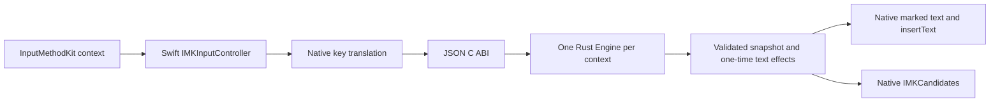

# macOS development host

The development bundle builds with Command Line Tools (CLT). Native IME behavior is **unverified**. No installation, registration, input-source selection, or native UI test was performed.

This host implements the P1 bundle spike and the P4 adapter. It uses the shared Rust engine, not a second input engine. The default bundle uses the CNS11643 Taiwan common/less-common character supplement and five self-authored phrases. This is not a production phrase lexicon.

## Build and checks

Run from the repository root:

```bash
bash platforms/macos/scripts/build.sh
bash platforms/macos/scripts/test.sh
```

To use a different approved lexicon:

```bash
bash platforms/macos/scripts/build.sh /absolute/path/to/approved-lexicon.tsv
```

Confirm its source and license before use. The default is `data/cns11643/lexicon.tsv`; see the [CNS11643 guide](../data/cns11643/README.md) and [data sources](../data/SOURCES.md). The default data has 13,052 characters, 16,496 character-reading pairs, and five self-authored phrases. Scores are artificial, not measured phrase frequencies.

The build includes the default data attribution and OGDL-Taiwan-1.0 text as `Lexicon-NOTICE.txt` and `Lexicon-LICENSE.txt`. It also includes `Project-LICENSE.txt`. CNS notices are included only when the selected bytes match the default CNS lexicon. A different external lexicon still needs its own approved notices before distribution.

- The build uses `xcrun --sdk macosx swiftc` and the CLT SDK. It does not use `xcodebuild`.
- Rust builds `target/release/libime_ffi.a`. Swift imports `crates/ime-ffi/include/bopomofo.h` as its bridging header.
- A standalone Foundation program checks the header/library ABI version, verifies the lexicon SHA-256 against `lexicon.sha256`, loads the lexicon, and decodes a Rust JSON snapshot before the host links.
- The build produces `platforms/macos/build/Bopomofo Development.app` for the current host architecture.
- The deployment target is macOS 13.0. This is a compiler setting, not evidence of macOS 13 support.
- The build validates `Info.plist`, applies an offline ad-hoc signature, and verifies the bundle signature. It does not launch the IME.
- `platforms/macos/build/build-evidence.txt` records the architecture, SDK, compiler, and executable/lexicon SHA-256 values. Build files are ignored by Git.
- Signing with a distribution identity, notarization, universal builds, and publication are outside this task.

`test.sh` runs noninteractive Swift logic tests, builds a fixture bundle and saves its checksum, then rebuilds the default CNS bundle. Swift-to-C-ABI tests use both datasets independently. The script also checks Bash syntax and runs management-script dry runs. Test executables use Foundation only. They do not create an `IMKServer`, open native windows, or register an input source.

### Evidence

Recorded on 2026-10-28 with macOS 26.6.2 (25G83), arm64, Apple Swift 6.4, and `/Library/Developer/CommandLineTools/SDKs/MacOSX.sdk`:

| Check | Result |
| --- | --- |
| P1 fixed-text bundle, before decoder replacement | Passed: Cargo release static library, native Swift link, and plist validation. A separate main-task C ABI check verified `1` → preedit `測試`, then Enter → one commit `測試` and empty preedit before decoder replacement. Native text handling was not exercised. |
| Full-engine bundle | Passed: CLT `swiftc`, plist validation, ad-hoc signing, and `codesign --verify --strict`. |
| Standalone adapter logic | Passed: 125 assertions. Wire encoding, UTF ranges, physical keys, modifier-only chords, candidate tokens, stale callbacks, reset, and one-time text effects. |
| Swift-to-C-ABI integration | Passed: 96 assertions. Real fixture lookup, phrase commit, candidate pages, context isolation, reset/lifecycle cancellation, stale selection, Shift/Caps Lock/held-key chords, Unicode output, and manifest/tamper rejection. |
| Management scripts | Passed: `bash -n` for all scripts and 16 dry-run safety cases, including signed bundles with missing or mismatched manifests. No `--apply` test ran. |
| Core unit/replay tests | Separate evidence owned by the Rust implementation. Swift checks do not replace them. |
| Installed native IME checks | Not run. No authorization to install, register, enable, update, or remove an IME was used. |

No remaining build failure was observed. Native loading, native callback delivery, and application/display compatibility remain blocked on authorized manual validation.

### CNS11643 checks: 2026-10-29

Recorded on macOS **26.4.1 (25E253)**, **arm64**, Rust **1.92.0**, and Apple Swift **6.3.3** with the CLT SDK:

| Check | Result |
| --- | --- |
| Default CNS bundle | Passed: Rust release archive, Swift link, plist, lexicon checksum, ad-hoc signature, and strict signature verification. |
| Standalone adapter logic | Passed: 127 assertions, including the 256-candidate bound and final-page indices. |
| Swift-to-C-ABI integration | Passed: 122 assertions across fixture and actual CNS data, including new rimes, `我`, `國`, all 154 `ㄧˋ` candidates, final-page `齸` selection, one-time commit, and bundled notices. |
| Management checks | Passed: Bash syntax and 16 sandbox dry-run cases. No `--apply` command ran. |
| Installed/native UI | Not run. No installed-bundle update, registration, activation, or settings change was performed by this task. |

Default lexicon SHA-256: `f279ff2faa8bc40814e300253cda97c162003a0b6650fdfa0484f4075d0b300a`.

Built executable SHA-256: `3deb61e089bc2b5fb867e192164f9161cf471516cd80045223818066986564ee`.

Rebuilding does not update the installed bundle. An authorized tester must follow the management steps separately and record native results for this source/data snapshot. Prior fixture-only evidence does not establish acceptance of the new data.

## Adapter boundary



- `Sources/Adapter.swift` defines the Foundation JSON contract and UTF conversion.
- `Sources/CoreEngine.swift` verifies initialization data, owns one opaque C handle per context, and frees each Rust output buffer with `bpm_buffer_free`.
- `Sources/KeyTranslation.swift` converts native events without parsing Zhuyin.
- `Sources/Presentation.swift` validates ranges and manages candidate publication tokens and one-time host effects.
- `Sources/InputController.swift` connects those helpers to `IMKInputController` and `IMKCandidates`.
- `Sources/main.swift` reads the connection name and bundle identifier from `Info.plist` and retains one `IMKServer`.

### Identity

| Item | Fixed development value |
| --- | --- |
| Bundle | `Bopomofo Development.app` |
| Bundle identifier | `org.bopomofo.inputmethod.Development` |
| Input-source identifier | `org.bopomofo.inputmethod.Development.zhuyin` |
| Connection name | `BopomofoDevelopment_Connection` |
| Objective-C controller class | `BopomofoInputController` |

These identifiers do not replace a system or third-party IME identifier. `IMKServer` reads the same connection identity as InputMethodKit reads from the plist.

### Keys and lifecycle

The controller requests key-down, key-up, modifier-change, and mouse-down events from InputMethodKit. It does not install a global event monitor or keyboard hook.

- Dachen keys use native virtual key codes for the physical US layout. Native Shift, Control, Option, Command, repeat, and release state are preserved in the engine event.
  - Unconsumed events return `false`; the original native event passes through. No replacement event is generated.
  - Ordinary key releases are sent even when their press was unconsumed. The press identifier is reused when a release has no characters. All unmapped physical keys use a stable native key-code identifier; keypad characters cannot become Dachen keys.
  - Control, Option, Command, and Fn modifier-only transitions are sent to the core. A Shift chord must not become a Shift tap when the other modifier is released first.
  - Left and right Shift are combined into logical first-press/final-release events. The core decides whether a Shift tap changes mode.
  - macOS Caps Lock `flagsChanged` reports latch transitions. Each observed on/off transition becomes one non-repeat logical `caps_lock` press. It is not treated as an ordinary release. The core owns the mode change.
- Activation, deactivation, and context close use explicit engine events. Each context owns its own engine and composition.
- Native `commitComposition`, `cancelComposition`, and client mouse-down events map to cancellation/reset. They do not simulate Enter or commit text.
  - This policy prevents a hidden commit on a focus/caret change. Only core commit outputs can insert text.
- Lifecycle cancellation and repeated reset clear marked text without replaying a previous commit.
- Callbacks run serially on the main run loop. Reentrant engine dispatch is rejected.
- An FFI/decoding/range failure, `internal_error`, or unknown output status discards the affected engine, hides candidates, and cancels its marked text. Activation can create a new engine from cached data. Failed events are not retried.

See [input specification](input-spec.md) for the core input rules. Native mouse, focus, and callback ordering still require manual tests.

### Text and candidates

Core cursor positions are UTF-8 byte offsets at Unicode scalar boundaries. The adapter converts them to UTF-16 code units for native marked-text selection. It does not use byte counts or grapheme counts as native ranges. Tests cover non-BMP Han, emoji, a ZWJ emoji sequence, and combining marks, including a cursor inside a combining sequence.

A commit is an event output, not snapshot state. The adapter consumes each delivery once, then calls native `insertText` once. It does not clear existing marked text before a commit replaces it. Unchanged snapshots produce no repeated native text effect.

Candidate display uses the system `IMKCandidates` panel. The snapshot contains up to 256 candidates; the adapter displays the current page of up to nine entries. Selection indexes remain absolute indexes into the snapshot.

Each attributed candidate carries a publication UUID, the exact UInt64 generation, and its absolute index. A final callback must match the active context, current publication, generation, index, and text. The token is invalidated before dispatch. Old, duplicate, missing-attribute, or modified callbacks are ignored. There is no fallback that matches text alone. Native highlight callbacks do not select or commit.

Whether InputMethodKit retains the custom candidate attributes in each target application is **unverified**. A stripped callback is rejected rather than allowed to select stale text.

### Data and privacy

The process reads `Contents/Resources/lexicon.tsv` and `lexicon.sha256` once during initialization, before key callbacks. The manifest contains exactly 64 ASCII hex digits and one newline. `bpm_lexicon_verify` must succeed before the host can construct a `VerifiedLexicon` or call `bpm_engine_new`. Missing, malformed, or mismatched manifests fail closed with a text-free error type. Contexts initialize engines from that verified in-memory data. Key processing does not read files or use network services.

The build generates the manifest from the selected lexicon. This check detects mismatched artifact bytes; it does not establish authenticity. Replacing both data and manifest can produce a new matching pair. The local ad-hoc signature does not establish developer provenance or distribution trust.

Diagnostics contain error types only. They do not include event JSON, keystrokes, preedit, candidates, or committed text. The host has no custom candidate window, clipboard access, text injection, simulated keys, or network input path. It does not bypass secure-field or disabled-input-method restrictions imposed by the host.

## Installation management: authorization required

The following commands are documentation, not a record that they were executed. Do not use `--apply` without explicit authorization. First switch to a system input source and close active compositions. Do not use `sudo`.

All default commands are read-only dry runs:

```bash
bash platforms/macos/scripts/manage.sh install
bash platforms/macos/scripts/manage.sh update --dry-run
bash platforms/macos/scripts/manage.sh uninstall --dry-run
```

The script uses only these current-user paths:

| Path | Authorized `--apply` effect |
| --- | --- |
| `~/Library/Input Methods/Bopomofo Development.app` | Install or replace this exact bundle; uninstall moves it to a backup. |
| `~/Library/Input Methods/.bopomofo-development.XXXXXX` | Temporary copy during install/update/restore; removed when the operation exits. |
| `~/Library/Application Support/Bopomofo Development/Backups/<UTC timestamp>-<pid>.app` | Retain the previous installation or removed bundle. Existing backup paths are not overwritten. |

Missing parent directories can be created under `~/Library`: `Input Methods`, `Application Support`, `Application Support/Bopomofo Development`, and its `Backups` directory. No other user's directory or system-wide installation directory is used.

The source is the local build bundle. The script rejects root execution, symlink path components, symlinks inside the bundle, unexpected identifiers, incomplete bundles, lexicon checksum mismatches, and invalid signatures. `install` refuses any existing destination. `update`, `uninstall`, and `restore` refuse an unrelated destination. A corrupt bundle is also refused; it requires an authorized manual inspection instead of a broad cleanup command.

After authorization, append `--apply` to the required action. The script copies and verifies the replacement before moving the installed version to its backup. If the final installation move fails, it tries to restore that backup. Uninstall preserves the removed bundle as a backup rather than deleting it.

The script does not call `defaults`, `lsregister`, `launchctl`, or `killall`. It does not stop apps, change input-source settings, or select an input source. The OS can discover a bundle copied into `Input Methods`; registration/loading is therefore part of the authorized native handoff, not part of dry-run validation. A logout/login or manual settings action can be needed. This has not been tested.

### Recovery

1. Switch to a working system input source. Close active compositions. Do not keep the development source selected during recovery.
2. Find the retained backup name under `~/Library/Application Support/Bopomofo Development/Backups/`.
3. Check the proposed restore without writes:

   ```bash
   bash platforms/macos/scripts/manage.sh restore 20260101T000000Z-123.app --dry-run
   ```

4. With explicit authorization, repeat the command with `--apply`. It copies that backup to the exact development path and retains the current installation as a new backup if present.
5. Manually inspect Input Sources in System Settings. Do not select the development source until the authorized test is ready.

Use the actual backup name; the example is not an existing artifact. Restore does not change the active input source. If automatic rollback fails, keep the system source active and preserve both paths for manual inspection. Do not remove a parent Input Methods directory or another IME.

## Authorized native smoke test

No row below is passed. Record the OS/build, CPU architecture, app/version, executable and lexicon hashes from `build-evidence.txt`, display arrangement, steps, and outcome in the native-validation record. Do not record private input content. Use only the public fixture text below.

1. Authorize and inspect installation separately. Manually add/enable `Bopomofo Development` in Input Sources. Do not assume a successful bundle build proves it loads.
2. In a new document, type `1`, `8`, then Space. Expected: marked `八`, no commit yet. Press Enter. Expected: one `八`, no marked text. A second Enter must reach the app and must not insert a second `八`.
3. Type `s u 3 c l 3`. Expected: marked `你好`. Move Home/Right/End. Check the caret and native range. Press Escape. Expected: no committed text and no remaining mark.
4. Type `1 8 Space Down`. Expected: native candidate panel. Use Down/Up and Page Down/Page Up, then numeric selection. Expected: the selected text remains marked; Enter then commits it once.
   - Repeat using the mouse on a final candidate. Check native callback selection and attribute retention.
   - Open a list, reset/switch focus, and open another list. A delayed callback from the old list must not change the new composition.
5. Compose text, then change field, app, input source, or caret with the mouse. Expected: cancellation, hidden candidates, and no hidden commit. Return and verify the new context starts without old composition.
6. Press and release Shift alone twice. Check Chinese/Latin mode changes. Repeat with Shift plus a letter and with Shift → Control press/release → Shift release. A chord must not toggle mode.
   - Repeat for Option, Command, and Fn. Check both Shift keys and a held ordinary key.
   - Press Caps Lock through both latch changes. Each transition must change mode once, not twice.
   - Check repeat and key-up behavior. Shortcuts such as Command+A/C/V must pass through unchanged; the IME must not access the clipboard itself.
7. Test a secure/password field and an app field that disables IME. Respect the app restriction; do not use a fallback input path.
8. For Unicode checks, build with an approved self-authored test lexicon containing non-BMP Han, emoji, and combining output. Check marked text, caret movement, candidate selection, reset, and single commit. The default CNS supplement does not contain that Unicode coverage.

With the default CNS data, also test `j i 3` → marked `我`, and `u 4 Down` → 154 candidates. Page Down 17 times, then press `1`: expected marked `齸`. Enter must commit it once. Check the tail page with the mouse as a separate native callback test. These results remain unverified.

### Pending application and display matrix

| App class | Example target | Mark/caret | Candidates/commit | Focus/reset/shortcuts | Display checks |
| --- | --- | --- | --- | --- | --- |
| Native text app | TextEdit, plain-text document | Pending | Pending | Pending | Pending |
| Browser | Safari editable field and contenteditable | Pending | Pending | Pending | Pending |
| Browser | Chrome editable field and contenteditable | Pending | Pending | Pending | Pending |
| Electron | Visual Studio Code editor and search field | Pending | Pending | Pending | Pending |
| Secure/restricted field | Native password field | Pending restriction check | Must not bypass restriction | Pending | Not applicable |

For each applicable row, test all of the following separately:

- Focus: same-app field changes, app changes, input-source changes, window close, mouse caret relocation, and return to the original context.
- Displays: one display, two displays, candidate panel near each screen edge, different scaling factors, and moving the active window between displays.
- Text: completed and incomplete syllables, candidate paging, mouse selection, non-BMP/emoji/combining output, repeat, release, and repeated cancellation.

A result for one architecture, OS, or app does not establish support for another. Intel, macOS versions other than the build host, and all installed native application/display combinations remain unverified.
