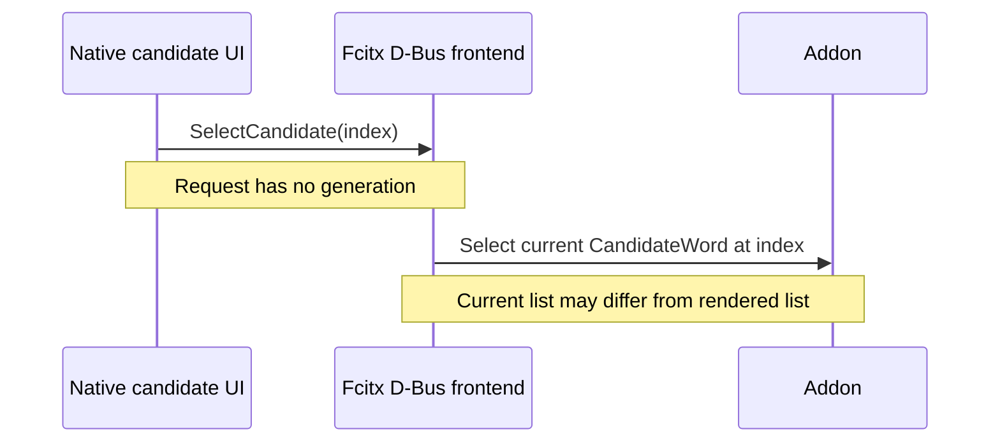

# Validation register

## Status

本專案仍是開發版本，**尚未完成 PLAN.md，也未通過任何 installed native IME 驗收**。

Rust tests、platform build、headless contract tests 與 desktop checks 是不同證據。不得用其中一項代替另一項，也不得將未測的 OS／架構／應用程式列為支援。

首次本機驗證日期為 2026-10-28 UTC。其實作起始 Git revision 為 `14f08344f510179d64060fef603610ab238bc719`，內容以下列 source snapshot 識別。已取得推送 source 與執行 native CI 的授權，但不包含 IME 安裝、註冊、啟用或 artifact 發布。Artifact hashes 識別實際建置，不是簽章信任或產品認證。

首次本機驗證與 CI commit `c6d2e2c` 的 source/build/fixture snapshot 包含 87 個路徑，SHA-256 為 `6de256861cf932740b1f0874e7b14133aae70737541c6823f05709f07145b2b8`。計算法為：以 `git ls-files --cached --others --exclude-standard -z` 列出 `.gitattributes`、Cargo manifests／lock、toolchain、`crates/`、`platforms/`、`fixtures/`、`.github/`，依路徑排序後，逐筆串接 `path + NUL + contents + NUL` 再取 SHA-256。

## IME readiness checks — 2026-11-04 UTC

本次 coding work 以 `origin/main` commit `23d14acf2439baba1da01fc1f9f0cc6a60e0e4fb` 為 base，branch 為 `narumi/feat/ime-readiness`。相較 plan 原定的 `7b20300`，base 只新增 `.gitignore` 規則。起始 working tree 只有使用者提供、尚未追蹤的本次 plan；未丟棄其他變更。下列紀錄與歷史證據分開，不沿用舊 run 作為本次 source 的驗收。

### Environment and baseline

| Item | 本次結果 |
| --- | --- |
| Host | macOS 26.6.2 (25G83)，arm64，Apple M4，16 GiB RAM。 |
| Rust | `rustc 1.92.0 (ded5c06cf 2025-12-08)`，LLVM 21.1.3；Cargo 1.92.0 (344c4567c)。 |
| Swift / SDK | Apple Swift 6.4 (swiftlang-6.4.0.34.1)，CLT macOS SDK 27.0。`xcodebuild -version` 因未安裝完整 Xcode 而失敗；bundle check 使用 CLT，不依賴 Xcode。 |
| Tools | uv 0.9.26、gh 2.101.0、jq 1.7.1-apple。未保存 credentials 或使用者輸入。 |
| Docker | OrbStack Docker client/server 29.4.0；daemon 可用，Linux arm64。既有 headless image `sha256:edc8a252f7acadb512ae73fe5fa84deacfd8055cb5bd0a5b56bb76d534356ffb` 可用；依 repository Dockerfile 重建。 |
| Baseline format / Clippy | A2 的 `cargo fmt --all -- --check`、workspace Clippy `--locked -- -D warnings`，各 exit 0。 |
| Baseline debug / release | A2 的 workspace `--all-targets --locked` tests，各 profile 80 passed：CLI 19、core 39、FFI 6、Windows portable 16；Windows DLL tests 在本 host 為 0，不是 TSF runtime 結果。 |

本次只建立本機 build outputs、synthetic data、tests 與 source PR。不執行 IME 安裝／註冊／啟用／移除、系統設定變更、tag push、workflow dispatch、remote draft creation 或 publication。

### Final source and agent checks

G1 在本次最終 source 上重跑。100 個 source/build/fixture/script paths 的 snapshot SHA-256 為 `a731bd22999df61da7e3a8a381d8de3d4a26c30b08a717a7f100bb72d658f60a`；計算法與排除範圍見 [synthetic benchmark method](benchmarks/README.md#retained-reports)。所有三份 reports 均核對此 snapshot。`docs/` 文件與 reports 不參與該 hash，避免自我相依；`fixtures/` 內的 README 仍屬於 fixture inputs。

| Check | Result / evidence | Scope / limit |
| --- | --- | --- |
| Format / Clippy | A2 原指令重跑，各 exit 0。 | Workspace、all targets、locked、warnings-as-errors。 |
| Workspace debug / release | 各 **84 passed**：CLI 22、core 40、FFI 6、Windows portable 16；各 exit 0。 | 新增 250,000／250,001 entries 與 256／257 candidates 邊界、品質及 Unicode fixtures；runtime policy 不變。 |
| Repository fixtures | Focused tests 各 profile **3/3**。11 corpora／386 records 的 debug/release stdout 逐檔 `cmp` 相同；含原先漏列的 `ui-abort.jsonl`。 | 9 個 baseline corpora、quality 17 records、Unicode 11 records。Expectations 由人工推導，不由 engine output 生成。 |
| Generator / full stress | Offline unittest **9/9**；三個 profiles 均完成 validate、兩次 canonical build、debug/release/repeated replay，以及兩次 100-repetition release benchmark；exit 0。 | 固定 10,000／100,000／250,000 entries；最大 8,828,716 bytes、16-syllable phrase、256 candidates per reading。只證明 synthetic 容量與壓力行為。 |
| macOS arm64 | `bash platforms/macos/scripts/test.sh` exit 0；bundle／Swift link、plist／ABI／lexicon digest／ad-hoc signature checks，**125** pure assertions、**96** actual C ABI assertions、**16** management dry-run cases。 | 未啟動 IMKServer session，未安裝／啟用或驗證 native callback attributes。 |
| Windows portable | `cargo test -p ime-windows --all-targets --locked` exit 0，**16 passed**。 | 本機不是 Windows；DLL loader tests 0。不能當作 live TSF 或 candidate UI 證據。 |
| Windows cross-check | x64／x86／ARM64 各自 `cargo check` 與 Clippy `--all-targets --locked` exit 0。 | 不 link 或執行 Windows DLL。當前 native-build CI 另列於 PR，不沿用歷史 run。 |
| Linux arm64 clean build | Dockerfile 重建 exit 0；空目錄 Release build、build-time ABI v1、CTest **5/5**。Root replay **9 files／358 records**；source manifest 前後相同。 | Image／SDK 與本次來源範圍見 [Linux evidence](linux.md#section-e-evidence--2026-11-04-utc)。沒有 desktop／daemon／native loader。 |
| Linux C++ ASan/UBSan | Clean Debug build，CTest **5/5**；leak detection、halt-on-error，無 sanitizer error；exit 0。 | C++ adapter/test translation units 有 instrumentation；**Rust release archive 與 system SDK 沒有 instrumentation**。 |
| Fcitx known gap | 獨立 CTest 在兩個 profiles 各 **1/1 reproduced**，輸出明列 old Word rejected 與 old rendered index selects current list。 | 這是已知 correctness gap 的重現，**不是 safety pass**；Linux native acceptance 仍 blocked。 |
| Offline Release | Bash syntax／stub suite **20/20**，exit 0；tag validation 與 draft script 與原 workflow Bash 相同。 | Temporary Git repo、fake token、stub cargo/gh、無 network／remote write／assets。Hosted Release 與 draft path 未執行。 |
| Workflow lint | PyYAML **6.0.3** parsing **3/3**；actionlint **1.7.9** exit 0。下載 archive SHA-256 `855e49e823fc68c6371fd6967e359cde11912d8d44fed343283c8e6e943bd789` 已核對上游 versioned checksums。 | Optional ShellCheck／Pyflakes 未執行；local lint 不代替 hosted run。 |
| Review | Main agent 與獨立 read-only review 均檢查 correctness、security、lifecycle、compatibility、regressions 與 scope；未發現 blocking defect。 | 新增的文件 handoff 不解除正式資料、native、Fcitx safety 或 Release gates。 |
| Documentation / scope | 9 份 retained Markdown、38 個 local links/anchors、20 個 Bash blocks syntax checks，以及 `git diff --check` 均通過。 | 未納入 credentials、外部詞庫、binary、大型 generated data 或 logs。 |

最終本機 artifacts 的 SHA-256：

| Artifact | SHA-256 |
| --- | --- |
| Release `ime-cli` | `17980ac7fe4bdbab31cd09a5b82cf1f863a8e14512023e3404d51dae9de0c005` |
| macOS executable | `61cf0838d64a91a6359e8ae853a1bc8c98c447bba9bff801a34a18c4b2b532ca` |
| Linux clean Release addon | `0482cc4636fdcbab7e8fe0a9abe356fe608dd9273f93cd2f9fafa025b2cb950c` |
| Linux C++ ASan/UBSan addon | `6efe02fc4bf133b72d25396fb00d5d9b06111b5e8d15c847949735ab4587cad9` |
| Linux Rust archive, both profiles | `0c7e94cf93b9674b1d3f6a6e55aa2456894d46c109d75692b47fe7e37f10c1ab` |
| Baseline packaged lexicon, all local builds | `c54ced5e1e44472337f9bb5c5b8fe41e7a692a33dbfa8d360991704888f11dcd` |
| Baseline manifest | `214a4ecdd73e1f785995dacaaad733b7796cd765819a159bb0524c0482e59f84` |
| Separate Unicode fixture lexicon | `fb064cc2a15d749eca43085379c8bdc7eb0de6e99481e1377fd0d7e47056b7c4` |

Linux addon 內含 build-local prefix，因此重新選取 temporary build path 可改變 binary hash；不宣稱 byte-reproducible native build。最終 Linux log SHA-256 為 `b3cac7b27695e70e5a657149298ac9e1e49a34eeb2efa8c425f5e63cb7e3b7c1`。Raw logs、CTest XML 與 manifests 留在 ignored `target/ime-readiness-evidence/`；binary 與大型資料不納入 Git。

### Synthetic measurements

[方法與完整兩次 reports](benchmarks/README.md) 保留 generated/canonical lexicon、corpus、replay-output hashes、source/build IDs、實際 compiler、OS／CPU 與分布。Host 為上述 Apple M4／macOS arm64；shared development host 未固定 CPU affinity／frequency，且同時執行其他 checks。以下每格依 run 1／run 2 列出：

| Entries | Initialization ns | p50 ns | p95 ns | p99 ns | Process RSS sample bytes |
| --- | --- | --- | --- | --- | --- |
| 10,000 | 6,653,500 / 11,808,292 | 81,750 / 92,916 | 215,958 / 318,459 | 334,750 / 527,958 | 7,372,800 / 7,634,944 |
| 100,000 | 80,407,500 / 74,814,916 | 82,542 / 87,458 | 201,833 / 221,250 | 231,833 / 350,292 | 45,613,056 / 45,596,672 |
| 250,000 | 205,634,084 / 206,933,166 | 83,125 / 77,542 | 203,417 / 189,125 | 220,250 / 203,500 | 105,398,272 / 105,168,896 |

每 run 各 100 repetitions，總 events 分別為 29,500／29,500／29,600，均低於 1,000,000。RSS 是 process sample，**不是 peak memory**。所有 reports 均保留 `fixture_only`，不將這些數字當成代表性 Taiwan corpus 的 p95 < 5 ms 證據。

**失敗／受阻／未執行：** 本次必要 agent gates 無失敗或受阻。`xcodebuild` 的環境探測失敗已在上表說明，不是 CLT build gate。正式來源專用 importer／artifact／真實 phrase frequency、代表性 corpus gate 與 Fcitx safety fix 受外部前置條件阻擋，未實作。Installed native matrix、首次 hosted Release、remote draft inspection、signing／notarization／publication 均未執行。責任與所需證據保留於下方 External handoff、`data/SOURCES.md`、`docs/linux.md` 與 `docs/releases.md`。

本次 coding plan `docs/plans/2026-11-05_ime-readiness-plan.md` 的 A–G 與 Completion Checklist 完成後已移除。其未解外部條件保留在上述 retained documents；這不代表 root `PLAN.md`、產品驗收或 release readiness 已完成。

### Native result record

沿用下方既有 Native matrix，不建立另一份支援矩陣。所有 installed rows 仍為 **unverified**；實際操作是 `not-run`，等待 External handoff 的環境與 scoped authorization。Tester 每次執行須填下列欄位：

| Field | 必填內容 |
| --- | --- |
| Tester / scope | 負責角色、UTC 日期、授權範圍及所測 matrix row。不保存 tokens。 |
| Environment | OS/build、CPU、app/version/process architecture、toolkit/version。Linux 另列 X11/Wayland、compositor、frontend route 與 module。 |
| Identity | Source commit／snapshot、build ID、實際 executable/DLL/addon SHA-256、lexicon SHA-256。Unicode package 另列其獨立 hashes。 |
| Case | 平台指南步驟、fixture 路徑／hash、固定事件、expected result。不得使用私人文字。 |
| Observation | Actual result、非敏感錯誤類型、是否單次 commit，以及相關 callback／range／focus 狀態。不記錄日常輸入。 |
| Result | `passed`、`failed`、`blocked` 或 `not-run`。未取得對應結果的 matrix row 保持 `unverified`；build/headless 結果不可填為 native passed。 |
| Blocker / recovery | 未執行或失敗的原因、負責角色、所需證據與 release restriction；授權測試後的 scoped recovery 結果。 |

先由 macOS tester 驗證 native text app，再擴到 browser／Electron／display cases。Windows 三個 process architectures 與 Linux 各 frontend 分開執行。共用 [`Unicode fixture`](../fixtures/unicode/cases.jsonl) 的 core cursor 是 11 UTF-8 bytes；macOS／Windows 預期為 6 UTF-16 code units。平台步驟見 [macOS](macos.md#authorized-native-smoke-test)、[Windows](windows.md#native-smoke-matrix) 與 [Linux](linux.md#native-validation-handoff)。

## CNS11643 supplement: 2026-10-29

本輪僅核准 CNS11643 資料補充與本機 build／tests。沒有安裝、更新、註冊、啟用、移除輸入法，也沒有修改系統設定或發布 artifact。McBopomofo 只更新來源紀錄，不匯入資料。

Host：macOS **26.4.1 (25E253)**、**arm64**、Rust **1.92.0**、Apple Swift **6.3.3**、CLT SDK `/Library/Developer/CommandLineTools/SDKs/MacOSX.sdk`。

| Check | Result | Scope / limit |
| --- | --- | --- |
| Rust formatting / Clippy | Passed: `cargo fmt --all -- --check`；`cargo clippy --locked --workspace --all-targets -- -D warnings`。 | 不是 native 平台驗收。 |
| Rust debug workspace | Passed: 91 tests，含 core 40、CLI 29、FFI 6、Windows portable 16。 | Windows DLL tests 在 macOS 不執行；portable tests 不是 Windows build。 |
| Rust release workspace | Passed: 91 tests；core／CLI／FFI 共 75，另有 Windows portable 16。 | 同一 CNS snapshot 的 debug／release importer 與 replay 均通過；不是 Windows native build。 |
| Reproducible data | Passed: 兩次 importer 產物與 summary 相同，與 retained `lexicon.tsv`／`build.json` 完全一致。 | Source manifest 是完整性檢查，不是來源簽章。 |
| CNS replay | Passed: 81 events，涵蓋新增字音、`我`、`國`、`你好`、新 rimes，以及 index 153 的 `齸` 選取與一次 commit。 | 這是固定 regression corpus，不是代表性效能量測。 |
| macOS arm64 bundle | Passed: release Rust archive、Swift link、plist、SHA-256、ad-hoc signature 與 strict signature verification。 | Deployment target 13.0 不是最低 OS 支援證據。 |
| Swift contracts | Passed: 127 pure adapter assertions、122 actual C ABI assertions、16 management dry-run cases。 | Foundation-only tests，不建立 IMKServer session、不啟動輸入法、不執行 `--apply`。 |
| Windows native build / Linux addon build | Not run for this source snapshot. | 不沿用先前 CI 結果宣稱本次 native build 已通過。 |
| Installed native IME checks | Not run; requires separate authorization and manual native validation. | 候選上限改為 256；實際候選 rendering、mouse callback 與各 app／display 組合均未驗證。 |

本次 source/build/data snapshot 為 99 個路徑，SHA-256 `2226dd2476b38ab027b2a5ce395bad21f99e27114a720e80538ad0e11a1ea363`。計算法：以 `git ls-files --cached --others --exclude-standard -z` 取得 `.gitattributes`、Cargo manifests／lock、toolchain、`crates/`、`platforms/`、`fixtures/`、`data/cns11643/`，排除 `.DS_Store`，按路徑排序，逐筆串接 `path + NUL + contents + NUL` 後取 SHA-256。

Data：CNS version `20261028`，指定第一、第二字面中文字區。13,052 characters、16,496 character-reading pairs，加五筆自製 phrases，共 16,501 entries。上游不完整的 `2-3378 / ˙ㄑ` 保留在 source snapshot 並明確排除一筆，不猜讀音。

| Artifact | SHA-256 |
| --- | --- |
| Default lexicon | `f279ff2faa8bc40814e300253cda97c162003a0b6650fdfa0484f4075d0b300a` |
| Bundled lexicon manifest | `5a23a538e9f6e20ba5690225b2ac2a8cada5cb97ff78070dcf82436a5dac14e5` |
| macOS executable | `3deb61e089bc2b5fb867e192164f9161cf471516cd80045223818066986564ee` |

來源、授權、保留的原始字區、輸出 checksum、人工分數與已知限制見 [CNS guide](../data/cns11643/README.md)。Native tester 須另行取得 installed update／activation 授權，驗證實際候選面板、`ㄧˋ` 尾頁、focus 與 app 相容性。Data maintainer 可在授權後向 upstream 回報不完整讀音；本次未對外提交。

正式 Taiwan phrase lexicon、實測 phrase frequency、代表性效能與產品 native acceptance 仍未通過。下方舊 snapshot 的證據保留作歷史紀錄，不覆蓋本節的限制。

## CNS replay CI correction: 2026-10-29

PR #3 的 commit `e6371c5` 在 [PR run 40833956582](https://github.com/narumiruna/bopomofo/actions/runs/40833956582) 與 [push run 40833931839](https://github.com/narumiruna/bopomofo/actions/runs/40833931839) 的 Linux x64／arm64 jobs 均失敗。失敗項目是 `adapter_contract` 的 `Replay output mismatch`，不是 build 或 ABI version。CMake 的 fixture glob 將 CNS replay 配到原有 39-entry 詞庫；Rust、macOS 與 Windows jobs 均通過。

修正後，原有九份 shared fixture 與完整 adapter contracts 不變。CNS replay 改用自己的 lexicon 與 SHA-256 manifest，另加 `WILL_FAIL` CTest，驗證 CNS case 不接受錯誤的 39-entry 詞庫。只修改 test routing 與 test executable mode，不修改 runtime input behavior，不停用失敗的 regression。

| Check | Result | Scope / limit |
| --- | --- | --- |
| Local Linux arm64 build / headless checks | Passed: 原有 `ci/check.sh` 路徑，6/6 CTests。 | Ubuntu 24.04、GCC 13.3、CMake 3.28.3、Fcitx5 5.1.7、xkbcommon 1.6.0、nlohmann_json 3.11.3、Rust 1.92.0；read-only source mount，無 desktop。 |
| CNS C++ replay | Passed: 81 events，含 index 153 的尾端候選。 | 只驗證 C ABI／C++ decoder，不證明 native candidate rendering。 |
| Wrong-lexicon regression | Passed: 錯誤配對被拒絕，與原 CI failure 對應。 | 這是預期失敗的 negative test，不是被忽略的失敗。 |
| Rust checks | Passed: format、workspace Clippy warnings-as-errors、workspace debug 91 tests。 | 本次未修改 Rust source；不代替 Linux build。 |
| Installed native IME / desktop checks | Not run. | 沒有安裝、註冊、啟用、移除或系統設定變更。Fcitx stale rendered-index gate 仍未通過。 |

本機 Linux addon SHA-256：`d51afc8997aaef97159a35ddb59695ff21efa4a513c868ce131508fc02944248`；Rust release archive：`ea8b1aed85cfe3b64febe924f330943b5dbe9caf148e95f0258d7b09e1826fe5`。兩者識別本機 headless build，不是 signature trust 或 desktop support 聲明。修正後的 hosted CI 結果須以 PR 對應 source commit 的 checks 獨立確認。

## Reproducible checks

在 repository root 執行。Windows clean checkout 先執行 `cargo build -p ime-windows --locked`；DLL loader test 需要同一 target／profile 的 DLL：

```bash
cargo fmt --all -- --check
cargo clippy --workspace --all-targets --locked -- -D warnings
cargo test --workspace --all-targets --locked
cargo test --workspace --all-targets --release --locked
cargo run -p ime-cli -- replay fixtures/lexicon.tsv fixtures/basic.jsonl
bash platforms/macos/scripts/test.sh
```

Windows source/API cross-check：

```bash
for target in x86_64-pc-windows-msvc i686-pc-windows-msvc aarch64-pc-windows-msvc; do
  cargo check -p ime-windows --target "$target" --all-targets --locked
  cargo clippy -p ime-windows --target "$target" --all-targets --locked -- -D warnings
done
```

這些 Windows 指令只做 type check，不會 link 或執行 Windows DLL。

Linux headless check：

```bash
docker build -t bopomofo-fcitx5-check -f platforms/linux/fcitx5/ci/Dockerfile platforms/linux/fcitx5/ci
docker run --rm --mount "type=bind,source=$PWD,target=/src,readonly" bopomofo-fcitx5-check
```

Container 只建立暫存 build directory，不安裝或啟用 IME，不連接 desktop session。Image 的 Ubuntu 24.04 base digest 已固定；實際 SDK／compiler package versions 仍須隨結果記錄。

## Verified evidence

| Check | 已取得的證據 | Scope / limit |
| --- | --- | --- |
| P1 early integration spike | 在 decoder 接入前完成 Swift bundle；以 ctypes 呼叫 C ABI，確認固定 `測試` preedit 與一次性 Enter commit。 | 固定測試路徑已被正式 engine 取代；未安裝或操作 native UI。 |
| Rust workspace | Debug／release 各 80 tests 通過：core 39、CLI 19、FFI 6、Windows portable 16；含 20,000-event bounded smoke、Unicode、locks、checksum 與單次 commit。 | 自製 fixture 與 deterministic generated cases，不代表正式詞庫品質。 |
| Rust format / Clippy | 本機 workspace format、Clippy warnings-as-errors 已通過。 | 最終 source 變更後仍須重跑；以 command exit status 為準。 |
| macOS arm64 bundle | CLT Swift 6.4 + Rust 1.92.0，plist／ABI／SHA-256／ad-hoc signature checks 通過。 | Deployment target 13.0 不是已驗證最低 OS。 |
| macOS standalone contracts | 125 pure adapter assertions、96 actual C ABI assertions、16 management dry-run cases 通過。 | 不建立 IMKServer session，不啟動輸入法，不執行 `--apply`。 |
| Windows x64 / x86 / ARM64 source | 三個 MSVC targets 均通過 pinned Rust 1.92.0 `cargo check` 與 target Clippy。 | 這是本機 cross-check；三架構 native build／load 的獨立 CI 證據見下節，installed TSF 仍未驗證。 |
| Windows portable contracts | 在 macOS 執行的 16 tests 通過，含 physical scan codes、post-event modifiers、offsets、checksum、probe、stale tickets 與 dispatch gate。 | 不是 COM／TSF native runtime 證據。 |
| Linux arm64 headless | Initial source snapshot clean build、ABI／C++ contracts 4/4 及 C++ ASan／UBSan 4/4 通過；含 Shift reset、native remap、Sensitive 與八份 fixture。 | ASan／UBSan adapter test 230.79 s；Rust archive 為正常 release，未使用 sanitizer instrumentation；不證明 desktop 或 index-only UI 安全。 |
| Native CI preparation | `.github/workflows/checks.yml` 與 `.github/workflows/windows.yml` 已啟用，3 份 YAML parse 通過。 | 已推送並觸發，首次 run 的失敗與重驗狀態見下節。 |
| PowerShell source | 官方 PowerShell 7.5.0 Linux amd64 container 解析 4 份 `.ps1` 成功。 | 此項僅為 AST parsing；`Build-Test.ps1` 的 Windows runtime 證據另列於 CI，註冊／移除腳本仍未執行。 |
| Documentation | 12 份 Markdown 的 whitespace／fences／local links 通過；8 份 Mermaid diagrams 已用 Mermaid CLI 11.12.0 + local headless Chrome render。 | Renderer outputs 在 ignored `target/diagram-check/`，不納入 Git。 |

## GitHub Actions

首次 [run 40651450673](https://github.com/narumiruna/bopomofo/actions/runs/40651450673) 對應 commit `c6d2e2cd330643832731221d8f45170cff8cb88e`：

| Job | Result | Scope |
| --- | --- | --- |
| `rust (ubuntu-24.04)` | Passed | Workspace format、Clippy 與 tests。 |
| `rust (macos-14)` | Passed | Workspace checks、bundle 與 standalone adapter／C ABI contracts。 |
| `fcitx5 (ubuntu-24.04)` | Passed | x64 build／ABI／4 headless CTests，沒有 desktop session。 |
| `fcitx5 (ubuntu-24.04-arm)` | Passed | arm64 build／ABI／4 headless CTests，沒有 desktop session。 |
| `rust (windows-2022)` | Failed | 19 Windows unit tests 通過；DLL loader test 回傳 `0x8007007E`。Workflow 未先 build 預期的 host DLL，後續 target-specific script 未執行。 |

修正加入 Windows host `cargo build -p ime-windows --locked` 前置步驟，並讓 loader test 先檢查 DLL 是否存在。

重驗 [run 40652597435](https://github.com/narumiruna/bopomofo/actions/runs/40652597435) 對應 commit `f65a705ea598fc20368851f8fe63096408df6a2d`，**5/5 jobs 全部通過**。此版本的 87-path source snapshot SHA-256 為 `50644afad0c8a97c14edd19c02e2c9cbbf236c8eea248b25a7581611ff4d180c`，計算法同上。

- Windows Server 2022 x64：workspace 84 tests 通過。Target-specific script 再次通過 19 unit tests 與 1 DLL loader test，完成 debug／release DLL build。Loader 驗證四個 exports、factory／service 建立及 unload count；沒有註冊或啟用 TSF。
- macOS 14.8.9 arm64，runner image `macos-14-arm64/20260831.0302.1`：workspace 80 tests、bundle、125 pure assertions、96 actual C ABI assertions 與 16 dry-run cases 通過。
- Ubuntu 24.04：workspace 80 tests 通過；x64 與 arm64 Fcitx5 jobs 各完成 build／ABI 與 4/4 headless CTests。
- 此 run 沒有 installed IME、真實 document edit session、UI-less app、native candidate rendering 或 desktop 相容性證據；這些 gate 保持 open。

Commit `084517df55c064015ff32249ceaa7c15eb0a382d` 的 [common run 40654797765](https://github.com/narumiruna/bopomofo/actions/runs/40654797765) **5/5 jobs 通過**，[Windows run 40654797923](https://github.com/narumiruna/bopomofo/actions/runs/40654797923) **3/3 jobs 通過**。此版本的 87-path source snapshot SHA-256 為 `03c9ebae5e5c141365c39921baca152238aec4917d177e03767eed9b811016be`。

| Windows target | Actual environment | Result / build job ID |
| --- | --- | --- |
| `x86_64-pc-windows-msvc` | Windows Server 2022，NT 10.0.20348.0，x64 | Debug／release build、19 unit tests、1 debug DLL loader test passed；job `122703118889`。 |
| `i686-pc-windows-msvc` | 相同 x64 OS，實際執行 WOW64 x86 test executables | 相同 19 + 1 tests passed；job `122703118421`。 |
| `aarch64-pc-windows-msvc` | Windows 11，NT 10.0.26200.0，Rust host `aarch64-pc-windows-msvc` | 相同 19 + 1 tests passed；job `122703118971`。 |

Logs 已確認三個 target directory 的 test executables 實際執行，不是只 cross-check。三列都未註冊、啟用或進行 desktop input。不能將 WOW64 結果推論到 x86 app integration，或將 native ARM64 結果推論到 ARM64 上的其他 emulated apps。

### Review and release-profile verification

Commit `be12f4804683a270932c484e5d0fce6dad304b26` fixes candidate Abort key balance, dynamic document restrictions, and context-pop focus restoration. [Common PR CI 40678543301](https://github.com/narumiruna/bopomofo/actions/runs/40678543301) passed 5/5 jobs. [Windows PR CI 40678543330](https://github.com/narumiruna/bopomofo/actions/runs/40678543330) passed 3/3 jobs. Each Windows target ran 25 unit tests and one debug DLL loader test. Its 89-path source snapshot SHA-256 is `d49cdd4337a3a6e19f0d3ec4a7b8cd90d7245fa1359f450f157f3a1e7c3b9308`.

Commit `64b6b5a8678660ac3b1ee2754b55bc17d08a68d0` adds release-profile tests and DLL hash logging. [Common PR CI 40681626779](https://github.com/narumiruna/bopomofo/actions/runs/40681626779) passed 5/5 jobs. [Windows PR CI 40681626909](https://github.com/narumiruna/bopomofo/actions/runs/40681626909) passed 3/3 jobs. Each Windows target ran 25 unit tests and one DLL loader test **in each debug and release profile**. Its 89-path source snapshot SHA-256 is `15576e969ebb7d4b9e087e55e9306350f236b92a0ec829a07861f5cbd423b9c0`.

Commit `6fe241f86dd72ccaa9c9e02828dc687fb986df35` fixes focus recovery after previous-context cleanup fails. It also rejects stale activation after native reentry. [Common CI 40684779243](https://github.com/narumiruna/bopomofo/actions/runs/40684779243) passed 5/5 jobs. [Windows CI 40684779204](https://github.com/narumiruna/bopomofo/actions/runs/40684779204) passed 3/3 jobs. Each target ran 27 unit tests and one DLL loader test in each profile. The 89-path source snapshot SHA-256 is `b4285a8b7bdc87110fee83c0dfbfb6d0aa8f34a6ac31e622c2252c339c064fbe`.

The eight Windows regressions use COM mocks. They cover dynamic flags, balanced Abort, held keys, error recovery, and context-stack focus. They do not test an installed TIP, a live text store, or candidate rendering.

The shared replay now has nine files and 358 records. Debug and release CLI replay checks passed. A Linux arm64 C++ ASan/UBSan follow-up passed the new 16-record `ui-abort.jsonl` case and the adapter contracts. It used `RelWithDebInfo`, `-fsanitize=address,undefined -fno-omit-frame-pointer`, leak detection, and halt-on-UB. The Rust archive was a normal release build. The contract executable SHA-256 was `851b4796dfc2ffc97062957bef1968ea4cb9730cb19ffe83e84df9c596520a60`. No desktop or stale rendered-click safety pass is claimed.

## Artifact identity

macOS executable：

```text
platforms/macos/build/Bopomofo Development.app/Contents/MacOS/BopomofoDevelopment
SHA-256 61cf0838d64a91a6359e8ae853a1bc8c98c447bba9bff801a34a18c4b2b532ca

Bundled lexicon.tsv
SHA-256 c54ced5e1e44472337f9bb5c5b8fe41e7a692a33dbfa8d360991704888f11dcd

Bundled lexicon.sha256
SHA-256 214a4ecdd73e1f785995dacaaad733b7796cd765819a159bb0524c0482e59f84

C ABI header
SHA-256 6a2480cbae7000618cba390a3932998595570a90f1a5729f4baab3bb93ff3167
```

每次重建後，以 `platforms/macos/build/build-evidence.txt` 的新 hash 核對本節。Build 輸出與 binary 不納入 Git。

Windows DLL hashes below identify the actual builds in run `40684779204` at commit `6fe241f`. Both profiles passed loader tests. No Windows binary was downloaded, installed, or published.

| Windows target | Debug DLL SHA-256 | Release DLL SHA-256 | Build job ID |
| --- | --- | --- | --- |
| `x86_64-pc-windows-msvc` | `281d6641b0e16e40ba7b7e0056589d12a70165d16472d6a836c4ec8b3f92cff3` | `4d71b12b459690e1896ef5f939fdc92aa3ac538e81bb1341c61009f64de10063` | `122804214089` |
| `i686-pc-windows-msvc` | `003a04062a5200466bf3197ba2cedcb2057baff0f3d9ad6ca1c0baf2e92007cb` | `3fa72c811e6dfc758267c81972bd3eabcae10274353afd928bdcdfc36e8b75cf` | `122804213500` |
| `aarch64-pc-windows-msvc` | `f40e3610711343e45b4ac9470983bb7b0e2368033983b7f27c006acd978efabf` | `3a954b8de51a1228f4aaf08184544ff24e605015935f1f43a19adceafad1518f` | `122804213832` |

Each target used the self-authored lexicon SHA-256 `c54ced5e1e44472337f9bb5c5b8fe41e7a692a33dbfa8d360991704888f11dcd`. Hashes identify these builds, not a signature trust chain or product acceptance.

Linux 最終 clean container build：

```text
libbopomofo-dev.so
SHA-256 c1a9c527f9394a79120ded43c66d290c6008abe1a0e56752b494d8185d254eb7

release libime_ffi.a
SHA-256 0c7e94cf93b9674b1d3f6a6e55aa2456894d46c109d75692b47fe7e37f10c1ab

C++ ASan/UBSan libbopomofo-dev.so
SHA-256 5dad9d2c1838f05f1f35870feb1ad8d448304b6d1081fe46345c2023b2e36630

Ubuntu 24.04 base multiarch digest
sha256:24737cef17f4e22b1977df7d9a05e77c4e28b7da5b8911f8d8ccda136bf3573c

PowerShell 7.5.0 Linux image digest (AST parsing only)
sha256:042240d57ec9e47e511033b92625a8d95875ee5860af3015992c248b58a8be81
```

Linux 使用 GCC 13.3.0、CMake 3.28.3、Fcitx5 5.1.7、xkbcommon 1.6.0、nlohmann-json 3.11.3。獨立 release build 與 C++ sanitizer build 使用的 Rust archive hash 相同。兩者均使用相同 lexicon 與 header hashes。驗證用 container 已移除。

## Performance evidence

原始 report 保存在 [benchmarks/fixture-64.json](benchmarks/fixture-64.json)。可重跑：

```bash
cargo run --release -p ime-cli -- benchmark fixtures/lexicon.tsv fixtures/limit-64.jsonl 100
```

- Host：Apple M4、macOS 26.6.2、aarch64、Rust 1.92.0。
- Lexicon：39 entries、696 bytes，自製人工 frequency。
- Corpus：201 events，含最多 64 音節、超限、候選翻頁、刪除與 commit。
- 100 repetitions，共 20,100 timed key events。
- 初始化：87,208 ns，其中 lexicon parse 74,208 ns，Engine 建立 13,000 ns。
- Key handling p50／p95／p99：12,542／24,792／33,667 ns。
- Process RSS sample：3,506,176 bytes；不是 peak memory 或 allocation cost。
- 量測包含完整 `Engine::handle` 回傳 snapshot，不含 native UI、fixture I/O、expectation checks 或 event cloning。

**此 report 只證明 benchmark 工具與人工 stress case 可執行。正式詞庫與具代表性 corpus 的 p95 < 5 ms gate 仍為 unverified。** 不用這份小型 fixture 結果代替產品效能結論。

## Known Fcitx5 selection boundary

Core 與 captured CandidateWord callback 會驗證 generation。但 Fcitx5 5.1.7 D-Bus frontend 的 `SelectCandidate(index)` 只帶 index，並查詢當下的 candidate list。

另查核 [Fcitx5 5.1.14 pinned source](https://github.com/fcitx/fcitx5/blob/7688bd73249f4fc880baaa520c2240a2579dc0b9/src/frontend/dbusfrontend/dbusfrontend.cpp)：`selectCandidate` 仍取 current list，D-Bus method signature 仍為 `i`，沒有 generation。該檔 SHA-256 為 `32755f97fa606353f11d49301e1d628f8d346c60e2ec3053b5d3c0505316b1c5`，因此不能假設只升級此版本就能解除限制。


A follow-up audit on 2026-10-28 UTC checked the newest official release found, **Fcitx5 5.1.23**. The [tag](https://github.com/fcitx/fcitx5/tree/27cca6e0239938b2d53937061d0980c087856b22) resolves to commit `27cca6e0239938b2d53937061d0980c087856b22`. The [official release archive](https://download.fcitx-im.org/fcitx5/fcitx5/fcitx5-5.1.23.tar.zst) SHA-256 is `d287119db9dc3113bb3a2b0e78ce8670e064b744c14d3aaec69799374aadb00b`.

- [SelectCandidate](https://github.com/fcitx/fcitx5/blob/27cca6e0239938b2d53937061d0980c087856b22/src/frontend/dbusfrontend/dbusfrontend.cpp#L403-L412) still resolves the index against the current list.
- Its input signature remains `i`. `UpdateClientSideUI` has no generation or render acknowledgement. The file SHA-256 is `48c1bb1aa3e6446804fe906312488c07e0f5a066be0910440af9884281b51194`; the archive copy matches it.
- The checked [GTK 5.1.7 client](https://github.com/fcitx/fcitx5-gtk/blob/3b18d2ab7401d4233daf38bbc5896f1703685a43/fcitx-gclient/fcitxgclient.c#L560-L571) and [Qt 5.1.16 client](https://github.com/fcitx/fcitx5-qt/blob/115750044f3d0db16ca5859808c7da830fd1ff52/qt5/dbusaddons/fcitxqtinputcontextproxyimpl.h#L109-L114) send asynchronous index-only requests.
- `KeyEventOrderFix` applies to key-event output. It does not bind a candidate click to a rendered list. FIFO delivery alone cannot prevent the server from replacing a list before the client displays it.

The audit found no sufficient generation or ordering guarantee. P6 remains blocked. No framework or client code was executed or imported.



因此，舊 CandidateWord 物件被拒絕的 headless test，不能證明延遲的舊 UI index request 也會被拒絕。這是已知的 protocol-level integration gap，不只是缺少 desktop 截圖。

在取得 framework／client ordering 或 generation 保證，或經授權完成相應設計變更前，不得宣稱已符合 stale rendered-click 要求。不得用新 token 掩蓋舊 UI request，也不自行加入被 scope 排除的 custom candidate window。

## Native matrix

以下各列均為 **unverified**。沒有執行安裝、註冊、啟用、移除或系統設定變更。

| OS / architecture | Application / frontend | 必須驗證的行為 |
| --- | --- | --- |
| macOS arm64 | Native text app | marked text、UTF-16 cursor、候選、一次 commit、取消、focus、secure fields。 |
| macOS arm64 | Browser | 同上，另測表單、快捷鍵、input-source 切換。 |
| macOS arm64 | Electron | 同上，記錄 app／Electron version。 |
| macOS arm64 | Scaling / multi-monitor | 候選定位、縮放、螢幕邊界與切換。 |
| macOS x86_64 | 各類 app | Build 與 native 行為均獨立驗證；不沿用 arm64 結果。 |
| Windows x64 | Native text / browser / Electron | DLL load、COM lifetime、probe、edit sessions、UI-less 與 native listbox、focus、restrictions。 |
| Windows x86 | WOW64 / x86 app | 相應 DLL build／load 與上述操作；不能沿用 x64 app 結果。 |
| Windows ARM64 | Native / emulated app | 相應 build、process architecture、candidate 與 lifecycle。 |
| Linux arm64 | X11 GTK / Qt / browser / Electron | Addon load、preedit、candidate、commit、focus、Sensitive／Password 與移除。 |
| Linux arm64 | Wayland GTK / Qt / browser / Electron | 同上，另記 compositor、protocol、frontend 與 toolkit module。 |
| Linux x86_64 | X11 / Wayland 各組合 | Headless build、desktop 與 app 各自驗證；不沿用 arm64 結果。 |
| All | Delayed native callback / selection | Reset、換 context／candidate list 後不可提交或修改新 composition；Fcitx index-only gap 保持 open。 |

每筆結果須包含 OS／app／toolkit version、CPU architecture、source/build ID、artifact／lexicon SHA-256、固定 fixture、預期、實際結果與 passed／failed／blocked／not-run。尚無 native 結果的 row 保持 unverified。只使用自製測試文字，不收集使用者日常輸入。

## External handoff and release restrictions

| Responsible role | Prerequisite / required action | 尚未通過的 gate |
| --- | --- | --- |
| Windows tester / CI owner | 三架構 build／load／非註冊 tests 已通過；提供已授權的 installed TSF／app 環境。 | Registration、activation、實際 document edit session、candidate rendering 與各架構 desktop matrix 仍未驗證。 |
| macOS tester | 授權使用 scoped 管理腳本安裝／啟用 bundle，依 macOS guide 操作與保存結果。 | 所有 installed native app／display checks 未驗證。 |
| Linux tester / framework owner | 提供 X11／Wayland session，驗證各 frontend，並解決或證明 candidate request 的 generation／ordering 契約。 | Desktop matrix 與 stale rendered-click 正確性未通過。 |
| Data owner / rights holder | 依 `data/SOURCES.md` 提供逐檔 license chain、固定 snapshots、conversion／redistribution grants、notices 與來源選定。一般批准不能補足 rights-holder grant。 | 正式 importer、phrase lexicon、真實 phrase frequency 與資料散布保持 blocked。 |
| Corpus / validation owner | 提供有權使用、符合 Taiwan 選樣標準的 corpus、人工核對的 reading／replay，以及獨立 benchmark partition。 | Synthetic reports 不解除正式資料與代表性 corpus 的 p95 < 5 ms gate。 |
| Fcitx framework / client owner | 依 `docs/linux.md` 的最小報告提供可驗證的 generation／render acknowledgement／ordering 契約或修正；替代設計須 project owner 另行核准。 | Stale rendered-click safety 是已知 correctness gap；headless reproducer 通過不解除 Linux acceptance gate。 |
| Release owner | 依 `docs/releases.md` 取得指定 commit／version／tag、runner 使用與 remote writes 的 scoped authorization，再保存 hosted run／jobs／source-only draft／notes 證據。 | 首次 hosted Release 與 draft inspection 保持 unverified。本輪不 dispatch、推 tag 或建立 release。 |
| Release owner | 在適用 gates 通過後另行授權 native binary distribution、signing／notarization 及 publication。 | 不發布，也不提供產品支援聲明；source PR 與 coding plan 完成不代表產品驗收。 |

這些限制未解除前，保留 PLAN.md 的未完成項目，不以文件完成代替實作與驗收。
