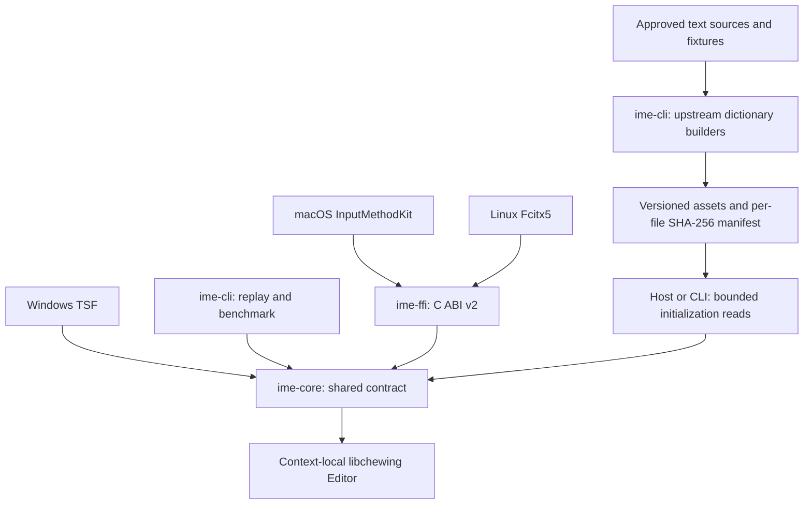

# libchewing migration plan

## Goal

將 bopomofo 的 runtime 全面改用 libchewing。Rust `ime-core` 封裝唯一輸入引擎，CLI、C ABI、macOS、Windows 與 Linux 均使用同一套實作。移除自製 parser、composition engine、lexicon index 與 decoder，不保留第二套 runtime backend。

遷移包含資料建置、預設開發 package、replay、benchmark、平台資源載入、測試與 CI。保留已核准資料的來源紀錄，不把「全面改用」解讀為刪除合法資料或改用其他平台 framework。

本文件只規劃實作。建立計畫不代表已開始遷移，也不授權 IME 安裝、註冊、啟用、移除、系統設定變更、remote writes 或 artifact 發布。

## Context

- 規劃基準為 commit `46da8ac`；[AGENTS.md](../../AGENTS.md) 與 [Engine adoption policy](../architecture.md#engine-adoption-policy) 已允許採用 libchewing，目前尚無該 dependency。
- [`ime-core`](../../crates/ime-core/src/lib.rs) 匯出自製 `Lexicon`、parser 與 decoder。[`Engine::probe`](../../crates/ime-core/src/engine.rs) 以 `self.clone().handle(...)` 模擬按鍵；libchewing `Editor` 不能假定可複製。
- [C ABI](../../crates/ime-ffi/include/bopomofo.h) 目前為 v1，初始化接受單份 TSV bytes。三平台 resource loader、build scripts 與管理工具均依賴 `lexicon.tsv`／`lexicon.sha256`。
- [CLI](../../crates/ime-cli/src/main.rs) 的 lexicon、CNS11643 importer、replay 與 benchmark 均使用自製 `Lexicon`；只替換 `engine.rs` 不足以完成遷移。
- [Fixture pairing](../../fixtures/README.md#replay-pairing) 包含 baseline、CNS11643、quality 與 Unicode 四組資料，不可混用。既有候選順序與任意音節／文字長度對應不一定符合 libchewing。
- 規劃環境為 Linux x86_64。Rust 1.92.0 與 Docker daemon 可用；host 未發現 CMake、Swift 或 PowerShell。Linux SDK 可依既有 Dockerfile 在隔離容器準備；macOS SDK 與 Windows native runner 不在目前環境。
- [Validation register](../native-validation.md) 尚無 installed native IME acceptance，並保留 Fcitx index-only stale selection correctness gap。更換引擎不會解除這些限制。

### Upstream evidence and initial selection

規劃時查閱上游文件與 source，未執行 libchewing、匯入上游詞庫或量測輸入品質。

| 項目 | 已查核內容與執行限制 |
| --- | --- |
| Engine version | [穩定版 v0.13.1](https://codeberg.org/chewing/libchewing/src/tag/v0.13.1/Cargo.toml) 提供 Rust crate `chewing`，MSRV 1.88.0，license 為 `LGPL-2.1-or-later`。先以精確版本 `=0.13.1` 驗證，保留專案 Rust 1.92.0。 |
| Development branch | `master` 已有 0.14 prerelease、不同 API 與資料格式；不以開發分支文件代替所選穩定版契約。 |
| Initialization | [Editor source](https://codeberg.org/chewing/libchewing/src/tag/v0.13.1/src/editor/mod.rs) 的便利 constructor 會初始化 user dictionary，並可能 fallback 到內嵌 mini dictionary。必須改用明確建構的 `Editor::new` 與經驗證資料。 |
| Memory loading | [Trie source](https://codeberg.org/chewing/libchewing/src/tag/v0.13.1/src/dictionary/trie.rs) 提供從 `Read` 建構的 `Trie::new`；可先驗證以 bounded bytes 載入，避免 key path 檔案 I/O。 |
| Privacy | `EditorOptions` 預設開啟自動學習，source 有按鍵、composition 與 commit logging。只是不設定 logger，不足以完成隱私驗證。 |
| Data candidate | v0.13.1 的 [data submodule metadata](https://codeberg.org/api/v1/repos/chewing/libchewing/contents/data?ref=v0.13.1) 指向 `libchewing-data` revision `bfba418ea8a4bd2fe10b9bf80b4bf81ec01af5f4`。這是相容性調查起點，不是資料採用或散布核准。 |

## Architecture



- `ime-core` 保留共用 event、lifecycle、mode／modifier 邊界、snapshot、generation 與一次性 commit 契約。Zhuyin parsing、組字、候選與 conversion 交由 libchewing，不另寫相同演算法模擬舊結果。
  - 只有 `ime-core` 建立 runtime `Editor`；`ime-cli` 可直接使用上游資料建置 API，但 replay／benchmark 一律呼叫 core。平台 adapter 不直接依賴 `chewing`。
- 每個 input context 擁有獨立 `Editor`。只有不可變的 asset bytes 可共用；不以 `unsafe Send`／`Sync` 繞過上游型別限制，也不跨 context 共用學習或候選狀態。
- Host／CLI 在初始化時讀取明確指定的 assets，以名稱、長度與 manifest 交給共用驗證流程。Core 從已驗證 bytes 建立上游型別；按鍵與 probe 不讀寫檔案、不連網。
- Manifest 固定 schema、engine／data／builder 版本、file allowlist、長度與 SHA-256。Missing、混版、損毀或不相容資料均拒絕載入；不搜尋使用者目錄、系統詞庫或 environment-defined fallback。
- C ABI 升為 v2，以只讀 asset buffer descriptors 與 manifest 取代單一 TSV 初始化。初始化複製所需資料，保留 opaque handle、配對 free、長度限制、panic isolation 與 ABI mismatch rejection；不跨 ABI 傳遞 Rust layout。
- `Event`／`Output` JSON 先保留。若候選 span 或 snapshot 語意必須改變，須在切換前同時更新 Rust、Swift、C++ 與 tests，不讓同名欄位承載未記錄的新單位。
- 第一版停用自動學習、user dictionary mutation／persistence 與輸入內容 logging。若上游需要 user dictionary 物件，只使用空白、無檔案 backing 的記憶體物件，並阻止手動加詞捷徑。
- 配套詞庫只採用逐檔核准的來源，不通配載入上游所有 dictionaries；不得因 `DEFAULT_DICT_NAMES` 包含某檔就推定其授權有效。內嵌 mini dictionary 與 symbols 等附屬資料也須納入權利查核。
- TSV 可保留為 fixture／已核准來源的 authoring format，但不再經過自製 runtime parser／index／decoder。Binary assets 在 build directory 產生，不提交至 Git。

## Non-Goals

- 不新增 backend switch、第二套 fallback engine、configuration framework 或其他輸入引擎。
- 不在本次開啟 personalization、user dictionary、雲端同步、LLM、額外 keyboard layout、Pinyin、reconversion 或 custom candidate window。
- 不保證逐筆保留自研候選排序；必須保留安全契約，並明確記錄一般操作與資料排序的變更。
- 不把 synthetic benchmark、cross-check、DLL loader test 或 headless CTest 當成 native desktop acceptance。

## Plan

主線順序為 P0 → P1 → P2 → P3 → P4 → P5 → P6。P1 的上游預設資料支線可與 P2／P3 的 fixture 整合並行；P4 的上游預設 package 與最終完成仍依賴該資料支線通過。各階段先執行受影響套件的 checks，完整 workspace gates 在全部 caller 更新後執行。本輪已取得執行、commit、branch push 與 PR 的明確授權；不包含 tag、release dispatch、publication 或 native IME／系統設定變更。以下依實際證據追蹤。

### P0 — 驗證相容性與阻擋條件

- [x] 保存目前實作的 baseline，執行下方可在 Linux／隔離容器完成的 checks；將 commands、source／data hashes、通過、失敗與未執行項目記入 `docs/native-validation.md`。不得沿用舊 host 的成功紀錄。 本次證據：baseline Rust debug/release 各 95、Python 9、Linux CTest 7/7；缺 jq 的 release stub 已在隔離容器重跑 20/20，見 validation register。
- [x] 查核 engine 與配套資料的逐檔權利及版本，將 file allowlist、來源、checksum、license／notices、轉換與散布範圍寫入 `data/SOURCES.md`；證據為可查核的來源與條款。先確認 dependency 內嵌資料的權利，再進行整合試驗；未取得的 grant／資料採用核准列入 External Handoff，依賴該資料的預設 package 任務保持 blocked。 本次證據：保留逐檔 LGPL headers、engine/mini metadata、source hashes 與 notices；default profile 兩次 build 相同，無未解的所選 file grant。
- [x] 以固定版 Rust API 與自製資料建立最小整合試驗，驗證 `Editor::new`、memory dictionary、candidate selection、commit／ack、cursor／span、非 BMP 文字與取消操作；證據為可重跑的 focused tests 與對應 API 紀錄。 本次證據：獨立 upstream spike 3 tests、core 16 tests 與四組 replay；memory initialization、scalar model、selection／commit／ack 均已驗證。
- [x] 驗證不改變狀態的 `probe` 實作方式，證明 repeated probe 後 snapshot、候選、commit、generation、詞庫與實際下一次按鍵結果均未改變，且 probe 與 actual consumed 一致；不得用保存真實 keystroke history 後 replay 的方式重建 editor。若上游 API 不足且無可驗證的最小整合方式，停止依賴此結果的切換工作並記錄 blocker，不以 mutating test callback 或第二套引擎替代。 本次證據：20,000-event randomized route/probe test，逐次重複 probe 驗證 snapshot 不變及 actual consumed 相同；沒有 Editor clone 或輸入歷史。
- [x] 建立新舊行為差異表並修訂 `docs/input-spec.md` 的目標契約，涵蓋 Space／Enter／Escape、tone、候選翻頁與 span、Shift／Caps Lock、shortcuts、unknown reading、Unicode、64 音節與候選上限；證據為每項差異的上游 API／focused case 與明確 disposition。安全契約不能藉修改 expectations 解除，無解的文字遺失或錯誤 commit 問題阻擋切換。 本次證據：input-spec migration table、手寫 Tab/preview/Unicode cases、unknown/pending 與 64-syllable tests 通過。

Engine dependency 及其內嵌資料的權利查核通過後，上游配套詞庫的採用 gate 不阻擋使用自製 fixture 的整合試驗，但 fixture-only 成果不代表預設產品資料已完成遷移。`probe`、Unicode／span、privacy 或限額的實作正確性未解時，不得刪除原引擎後宣稱全面切換完成。

### P1 — 建立唯一資料建置與載入流程

- [x] 在 `ime-cli` 以所選上游 `TrieBuilder`／Zhuyin 型別實作可重建的 asset build／validate 流程，轉換既有 fixture 與核准的 CNS11643 資料；證據為兩次 build 的相同 bytes／hashes、讀音 round-trip 與非法來源拒絕 tests。CNS source、license 與 notices 保留，不重新猜測 phrase readings。 證據：CLI asset tests 4 passed；四 profiles 与兩次 build equality。
- [x] 在共用 Rust 邊界實作 bounded asset／manifest 驗證與記憶體初始化，固定每檔及總量上限；證據包含缺檔、額外檔、重複名稱、長度溢位、checksum、錯誤版本、損毀 dictionary、path traversal 與空資料的 negative tests。不得採用會靜默 skip 或 fallback 的便利 loader。 證據：Core schema tests 5 passed；另有 checksum-valid cycle／empty node／bad range negatives。
- [x] 將已核准的 libchewing 配套詞組資料接入預設開發 asset profile，保存獨立 notices 與固定來源；證據為離線重建、明確字詞／讀音查詢及預設 package 不再只含單字補充。此項依賴 P0 資料 gate；未解決時保持 blocked，不以更換 engine 或 CNS fixture 通過代替。 證據：160,440 entries／pinned LGPL source；兩次 build identical，`你好` passed。

### P2 — 替換 Rust core

- [x] 在 workspace 與 `ime-core` 固定 `chewing` dependency、features 與 lockfile，以 `Editor` 取代自製 composition／parser／decoder 路徑；證據為 core tests 與 dependency tree。預設不啟用 SQLite；任何 toolchain／features 變更均須有實際相容性理由。 證據：Cargo.lock 與 dependency tree 固定 0.13.1、無 SQLite；core 16 tests。
- [x] 實作共用 event／mode／modifier、lifecycle、generation、候選索引與 UTF-8 snapshot 邊界，按 P0 結果實作只讀 probe 與單次 commit／ack；證據為 context isolation、連續 probe、stale callback、重複 reset、取消、limits、unknown／invalid input 與 Unicode regressions。 證據：20,000-event parity、四組 478 replay events、Unicode 11-byte／6-unit 與 transient commit passed。
- [x] 封鎖輸入內容 logging、auto-learn、手動加詞與 user dictionary 寫入，驗證只使用 memory-backed state；證據為 debug／release feature 檢查、synthetic sentinel log-capture tests、受控 HOME／XDG／系統搜尋路徑、唯讀資源測試，以及隔離容器的 syscall trace 或等效 I/O 觀測。初始化、handle、probe、select、reset 與 drop 均不得產生使用者資料檔或不預期的檔案／網路 I/O。 證據：Debug／release logger sentinel 與 final Docker syscall markers 均 passed；controlled HOME 空白。

### P3 — 更新 CLI、C ABI 與共享回歸資料

- [x] 將 `ime-cli` 的 replay、benchmark、validate／build 與 CNS importer 改接新 assets／upstream 型別，更新 help、CLI tests 與 `scripts/benchmark-synthetic.py`；證據為 CLI success／failure tests、atomic output failure tests 及 synthetic generator unit tests，不保留呼叫舊 `Lexicon` 的入口。 證據：CLI 36 tests、Python 9、三個 full profiles及 default corpus benchmark passed。
- [x] 實作 C ABI v2 並更新 `bopomofo.h`、Rust FFI tests、ABI gates 與錯誤契約；證據為 null／length／UTF-8／asset bounds、初始化失敗、重複建立釋放、ownership、panic poison、舊版 header／library rejection 與一次性 commit tests。 證據：FFI 6、Linux legacy host guard、11/11 CTests passed；v1 constructors removed。
- [x] 依 P0 規格人工更新並擴充四組 fixture／expected results，保留 tone、mode chords、held-key aliases、locks、尾頁候選、Unicode 與 lifecycle coverage；證據為 Rust replay、C ABI 輸出一致及 debug／release 重播穩定。若上游不接受原任意 Unicode mapping，保留 adapter 層 synthetic Unicode range tests，另提供合法的 engine case；不得刪除安全 coverage 或以實際輸出批次重寫 expectations。 證據：12 corpora／478 events；四-reading Unicode保留完整emoji／combining；無 actual-output rewrite。

### P4 — 更新三平台 adapter 與 package

- [ ] 修改 macOS `CoreEngine.swift`、resource loader、build／test／manage scripts 與 Swift／FFI tests，使用 v2 assets、manifest 與 engine／data notices，保留 marked text、candidate token、context 與 commit 邊界；本機驗收為可檢查的 source／fixture 對照與 Bash syntax，`scripts/test.sh` 的 SDK build／執行交由有 macOS runner 的 External Handoff，不標為已通過。 證據：Source／fixture對照、Bash syntax與 resource rules已檢查；SDK test仍為明列handoff，待本輪 CI。 重新開啟：review fixes 後須重跑；macOS main.swift 舊 resource reference 已修正，待 SDK CI。
- [x] 修改 Windows `resource.rs`、`session.rs`、TSF initialization、`Build-Test.ps1` 與 DLL tests，替換 `Arc<Lexicon>` 與單檔 TSV package；證據為 Linux portable tests、三個 MSVC target 的 `cargo check`／Clippy 及 script／資源契約檢查。真正 MSVC link／DLL load／runtime tests 須在對應 native runner 另行取得證據。 證據：Portable 16、三 target check／Clippy及 PowerShell AST 5＋preflight negatives 5 passed；native CI另記。
- [x] 修改 Fcitx5 `core_client`、CMake、config、ABI tests、resource／install dry-run scripts 與 headless contracts，使用同一 asset profile 與 v2 ABI；證據為乾淨 Docker Release build、CTest、錯誤 profile negative test、管理 dry-run 與 C++ ASan／UBSan。保留 stale-rendered-index reproducer，不把其成功重現標成安全修正；未 instrumentation 的 Rust／system libraries 仍分別註明。 證據：Fresh Release 11/11、C++ ASan／UBSan 11/11與gap-only1/1；Rust/system libraries未instrumented。

### P5 — 移除舊 runtime 與更新自動化

- [x] 刪除自製 `parser.rs`、`decoder.rs`、runtime `Lexicon`／index 與不再使用的 engine code，移除暫時的 migration bridge；證據為全 repository source reference 搜尋與 workspace build，runtime `Editor` 僅由 `ime-core` 建立，平台 adapter 無直接 `chewing` dependency，且無第二套 backend 或舊 runtime constructor。合法 fixture／CNS 來源不因此刪除。 證據：已刪除3個舊runtime檔；source reference search、workspace build及dependency reviewpassed。
- [x] 更新 `.github/workflows/checks.yml`、`windows.yml`、`release.yml`、Docker build 與 release offline tests，納入新資料建置、notices、ABI 及 data／manifest path filters；證據為本機 workflow／script checks、fresh Linux container tests 與 source-only draft stub tests。不可依賴工作目錄殘留的舊 asset，也不新增自動發布或 IME 安裝步驟。 證據：Actionlint／Bash syntax、fresh container及release offline20/20 passed；無自動安裝或發布。

### P6 — 完成驗證與保留交接

- [x] 執行全部可在本機安全準備的 quality gates、四組 replay、privacy／resource negative tests、FFI 與 adapter portable／headless tests；將逐層結果及 source／asset／binary hashes 保存於 `docs/native-validation.md`，所有 change-caused failures 均須修正後重跑。 證據：Final Rust 74＋74、FFI6、Linux11/11、C++ASan11/11、privacy2profiles及cross-target6commands；register保存hashes。
- [ ] 更新 release-mode benchmark，量測 asset 初始化、每個 context 建立成本、handle／probe 延遲、p50／p95／p99 與記憶體；證據為固定 source／asset／corpus／環境的可重跑 reports。Synthetic 與正式詞庫分開標記；無有權使用的代表性 corpus 時，不宣稱已符合產品 p95 < 5 ms 或優於舊引擎。 證據：三個synthetic profiles各兩次100repetitions與default-data8-event corpus reports；p95>5ms風險明列，不宣稱產品達標。 重新開啟：review fixes 後須重跑；macOS main.swift 舊 resource reference 已修正，待 SDK CI。
- [x] 同步 README、architecture、input spec、data sources、fixture notes、三平台與 benchmark 文件，移除把自研設計當成現行實作的描述；證據為連結／指令／path／engine version／manifest schema 一致性檢查與 diff review。 證據：已逐檔review、actionlint／Bash／local file links／staged whitespace checks；保留原樣upstream AUTHORS。
- [x] 將尚未完成的 native build、installed IME、資料／corpus、Fcitx correctness 與 release 限制及可執行操作步驟保留在 `docs/native-validation.md`／`data/SOURCES.md`，準備一致的 asset profiles 與 synthetic smoke cases；證據為每項責任角色、前提、未驗證行為及發布限制均有固定位置。 證據：Retained handoff已更新；所有installed／corpus／Fcitx／release gates保持open，matching profiles與manual smoke已準備。

### 可直接使用的現有檢查入口

以下 commands 已存在；資料相關 CLI arguments、script inputs 與預期結果必須隨遷移更新，不把舊引擎測試通過當成新引擎證據。

```bash
cargo fmt --all -- --check
cargo clippy --workspace --all-targets --locked -- -D warnings
cargo test --workspace --all-targets --locked
cargo test --workspace --all-targets --release --locked
uv run --offline --no-project python -m unittest discover -s scripts/tests
bash .github/tests/release-workflow.sh

docker build -t bopomofo-fcitx5-check \
  -f platforms/linux/fcitx5/ci/Dockerfile platforms/linux/fcitx5/ci
docker run --rm \
  --mount "type=bind,source=$PWD,target=/src,readonly" \
  bopomofo-fcitx5-check
```

Windows cross-check 在透過 rustup 準備對應 target 後執行，不能當作 MSVC link 或 Windows runtime 證據：

```bash
for target in x86_64-pc-windows-msvc i686-pc-windows-msvc aarch64-pc-windows-msvc; do
  cargo check -p ime-windows --all-targets --locked --target "$target" || exit
  cargo clippy -p ime-windows --all-targets --locked --target "$target" -- -D warnings || exit
done
```

Native runner 的既有入口為 macOS `bash platforms/macos/scripts/test.sh` 與 Windows `Build-Test.ps1 -Target <target>`。Windows workspace DLL tests 執行前，須先 build 對應 host DLL；這些 commands 不授權 IME registration 或 activation。新 asset build／validate 命令由 P1／P3 實作後再記入使用文件，不預先宣稱存在。

## Risks

- **API／契約差異：** 非複製的 editor、候選 span、任意 Unicode mapping 與 auto-commit threshold 可能無法直接符合現行契約。P0 必須先證明整合方式，不能在刪除舊引擎後才將缺失交給 native tester。
- **詞庫權利與隱含資料：** Engine license 不證明每份配套詞庫、symbols 或內嵌資料的權利。未解資料 gate 阻擋對應預設 package 與全面資料遷移，不以較新 snapshot 的 notices 追溯代替所選版本證據。
- **隱私：** 關閉 auto-learn 不代表沒有手動 user dictionary mutation，空 HOME 也不證明沒有 I/O。須檢查實際 constructor、features、事件與 teardown 路徑。
- **相容性與效能：** 上游完整 dictionary 與每 context 的資料配置可能改變初始化、記憶體與延遲；測量後才能判斷，不新增未經需求支持的快取或共享執行緒架構。
- **Linux selection：** 已知 Fcitx index-only gap 仍保留 release restriction。若遷移新增或惡化 generation／commit 問題，屬本次 correctness failure，不能只列為外部未測項目。

## Rollback / Recovery

- 以 migration 前 source revision、lockfile 與 matching asset manifest 保留可重建基準；必要時以可審查的 Git revert 回復本次變更，不使用 destructive reset 丟棄其他工作。
- ABI v2、library、adapter 與 assets 必須整組回復；拒絕 v1 host 搭配 v2 library，或舊 manifest 搭配新 dictionaries。
- 新 build 使用獨立 staging directory，不覆寫既有 bundle、已載入 DLL、native addon 或使用者詞庫。失敗時丟棄 staging outputs，不把損毀檔案當作 fallback。
- 目前沒有 native IME 安裝授權；若日後另行核准部署，依各平台管理工具保留前一版 artifact 與還原路徑。實際 rollback 的安裝／註冊／設定動作同樣須另行授權。

## External Handoff

以下不是目前 agent 可完成的核取項目。取得對應環境與授權後，可將實際能執行的檢查轉入本計畫；未取得前維持明確的限制，不索取 secrets。

| Responsible role | Prerequisite | Action / expected result | 未驗證行為與發布限制 |
| --- | --- | --- | --- |
| Data owner／rights holder | P0 的逐檔證據與待補 grant／來源決策 | 提供缺少的轉換／散布權利與明確資料採用範圍，使對應 asset profile 可依法建置。 | 證據不足的 upstream data 不匯入／散布；依賴該資料的 agent 任務保持 blocked，不能宣稱全面資料遷移完成。 |
| macOS build owner | macOS SDK、matching source／assets 與 runner 使用授權 | 執行 `platforms/macos/scripts/test.sh`，保存 Swift／C ABI assertions、bundle、signature、notices 與 hashes。 | Linux 靜態檢查不證明 macOS 可編譯，成功 build 也不證明 installed IME 行為。 |
| Windows build owner | x64／x86／ARM64 native Windows runner、MSVC／SDK 與 runner 使用授權 | 各 target 執行更新後的 `Build-Test.ps1`，保存 debug／release DLL build、load、runtime tests 與資源 hashes。 | Cross-check 不能證明 DLL link／load；x64 結果不代表 x86 或 ARM64。 |
| Native IME testers | Matching artifacts／assets、桌面環境與個別安裝／啟用授權 | 依三平台 smoke matrix 驗證 marked text、candidate、commit、cancel、focus、secure fields 與 Unicode，只使用 synthetic text。 | 未驗證的 OS／architecture／app／display 組合不得列為支援；主觀選字品質另記結果。 |
| Fcitx framework／client owner | Generation-aware request 或可驗證的 rendered-list ordering 契約；替代設計另須核准 | 提供並驗證 protocol／client fix，或證明足以拒絕 delayed stale rendered index。 | 已知 correctness gap 不因換引擎解除；reproducer 通過不是 Linux acceptance pass。 |
| Corpus／validation owner | 有權使用且具 Taiwan 代表性的 corpus 與獨立 gold cases | 提供固定來源、選樣、checksum 與品質標準，再量測正式資料的延遲與候選品質。 | Synthetic 數據不證明產品選字品質、正式 phrase frequency 或代表性效能 gate。 |
| Release owner | 必要 evidence、license／source obligations 與指定 remote actions 的授權 | 決定 hosted CI、source-only draft、signing／notarization 與發布範圍，分別保留結果。 | 本計畫不授權 push、dispatch、tag、release creation 或 publication；保留既有 source-only release 邊界。 |

## Completion Checklist

- [ ] P0 的技術 blockers 均有可執行且已驗證的解法；無尚未處置的文字遺失、probe mutation、隱私或錯誤 commit 問題。
- [ ] Core、CLI、C ABI、三平台 adapter、resource loaders、預設開發 profiles 與 CI source 均使用唯一 libchewing 路徑，無自製 runtime engine 或長期相容 backend。
- [ ] 所採用的 engine／data／builder／manifest 版本、逐檔權利與 notices 均可查核，預設資料可離線重建；資料採用 gate 未完成時，此項保持未完成。
- [ ] 所有可在本機安全準備的 checks 通過，change-caused failures 已修正；Core、FFI、portable／headless、cross-check 與 native 證據分開，未執行或外部受阻項目未被標成通過。
- [ ] 新 spec 與手寫 replay expectations 一致，四組 fixture、Unicode、stale callback、一次性 commit、privacy 與資料完整性 coverage 保留；benchmark 限制與實測結果明確。
- [ ] 外部 handoff、既有 Fcitx correctness gap 與發布限制已保留於 `docs/native-validation.md`／`data/SOURCES.md`，文件與 rollback 說明一致。

所有 agent tasks 與 completion checks 取得有效證據後，先確認 unresolved external items 已寫入上述 retained documents，再刪除此 plan。Agent-plan 完成不代表 native acceptance、OS support、輸入品質或 release readiness；不得刪除或改動其他未完成的 plans。
