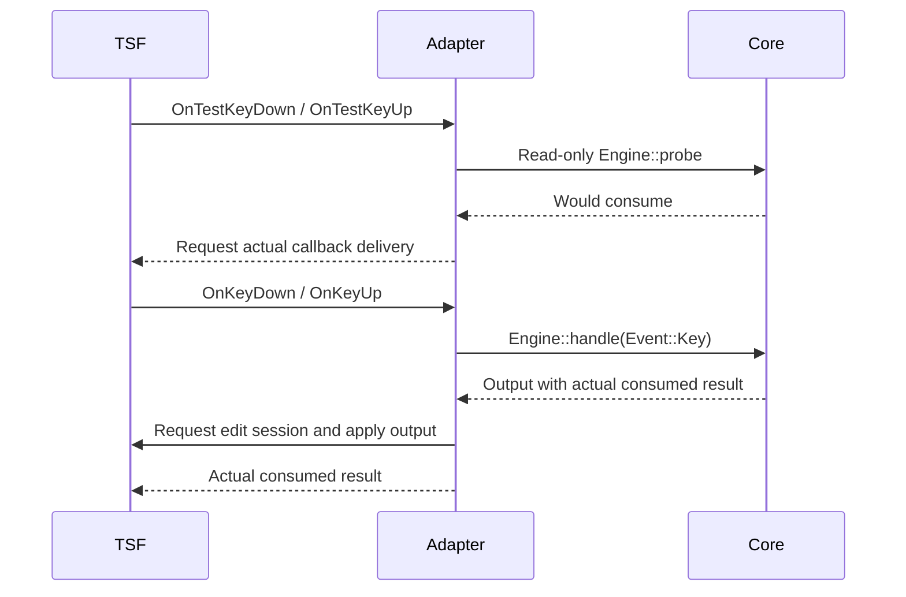

# Windows TSF adapter

## Status

The Windows x64, x86, and ARM64 DLLs passed native build, COM unit tests, and non-registration loader tests. Installed TSF and desktop input remain **unverified**.
A successful cross-target `cargo check` does not validate a DLL link, TSF registration, or desktop input.

| Target | Compile/type check on macOS | Windows DLL build and tests | Registered TSF and apps |
| --- | --- | --- | --- |
| x64 (`x86_64-pc-windows-msvc`) | Passed with Rust 1.92.0 | Passed: debug/release build, 19 unit tests and 1 loader test | Unverified |
| x86 (`i686-pc-windows-msvc`) | Passed with Rust 1.92.0 | Passed: debug/release build, 19 unit tests and 1 loader test under WOW64 | Unverified |
| ARM64 (`aarch64-pc-windows-msvc`) | Passed with Rust 1.92.0 | Passed: debug/release build, 19 unit tests and 1 loader test on Windows 11 ARM64 | Unverified |

The development host is macOS ARM64. GitHub Actions provided Windows Server 2022 x64/WOW64 and Windows 11 ARM64 runners. [Run 40654797923](https://github.com/narumiruna/bopomofo/actions/runs/40654797923) passed all three targets at commit `084517df55c064015ff32249ceaa7c15eb0a382d`. This does not validate a live document edit session or candidate window. No DLL was installed, registered, enabled, removed, or published. A Windows release is blocked until the applicable native checks pass. An x64 result must not be used as an x86 or ARM64 result.

## Implementation

`platforms/windows/Cargo.toml` defines package `ime-windows` and library `bopomofo_tsf`, with `cdylib` and `rlib` outputs. Windows APIs use target-gated `windows` and `windows-core` dependencies. macOS workspace tests do not require Windows headers, libraries, or an SDK. `ime-core` is the only input engine dependency.

| Path under `platforms/windows/` | Responsibility |
| --- | --- |
| `src/tsf/mod.rs` | Class factory, DLL exports, COM object and server-lock counts. |
| `src/tsf/service.rs` | Activation, focus, context ownership, TSF restrictions, key sinks. |
| `src/tsf/edit.rs` | Ordered edit sessions, composition update, commit, cancellation. |
| `src/tsf/candidate.rs` | TSF UI-element interfaces and generation-checked selection. |
| `src/tsf/window.rs` | Windows-only, non-activating native `LISTBOX` fallback. |
| `src/keys.rs` | Physical US scan-code mapping, post-event modifiers, aggregate Shift edges, repeat and release. |
| `src/session.rs` | Context epochs, output ordering, read-only probe, panic boundary. |
| `src/text.rs` | Checked UTF-8 byte to UTF-16 unit conversion. |
| `src/resource.rs` | Bounded, activation-time lexicon and checksum loading. |

### COM identity

- Service CLSID: `{FADF9E21-04BB-4D07-B7A4-A4ED8FF4123C}`.
- Profile GUID: `{83C941D1-D8E3-45DC-95A9-73AD918EFEF7}`.
- Candidate UI GUID: `{01D4F1CB-8C22-441E-A421-99173B25AE96}`.
- Language ID: `0x0404`.
- COM threading model: `Apartment`. Service, edit, composition, and UI objects are not agile.
- Categories: `GUID_TFCAT_TIP_KEYBOARD` and `GUID_TFCAT_TIPCAP_UIELEMENTENABLED`.
- Exports: `DllGetClassObject`, `DllCanUnloadNow`, `DllRegisterServer`, `DllUnregisterServer`.
- The service implements `ITfTextInputProcessor`, `ITfKeyEventSink`, and `ITfThreadMgrEventSink`.
- This implementation does not register immersive or secure-mode capability categories.

`DllCanUnloadNow` checks live COM objects, context/window lifetimes, pending edit sessions, and server locks. All implemented COM methods and DLL exports contain Rust panic boundaries. Native window callbacks also contain a panic boundary. No input text is written to a diagnostic log. The DLL does not replace the host's process-wide panic hook.

### Activation and context lifetime

Activation loads `lexicon.tsv` and `lexicon.sha256` from the DLL directory. It checks the SHA-256 digest, validates the versioned lexicon, and builds one immutable `Arc<Lexicon>`. Each native context has a separate `Engine`. Key callbacks do not read files or rebuild the lexicon index.

The SHA-256 file contains 64 lowercase hexadecimal digits and a final newline. The loader bounds both files and rejects missing, changed, empty, invalid, or incompatible data. A digest identifies an artifact; it does not authenticate its source. No production data is embedded in the DLL. The build script copies only the repository's self-authored fixture.

Focus loss, context removal, and deactivation invalidate the context epoch before cancellation. A context pop restores the focused document's new top context without a document focus change. Candidate callbacks carry the original epoch and core generation. A stale callback cannot select a new composition. Edit sessions retain their context until cancellation can finish, but they cannot commit an invalidated output.

Each output has an ordered, single-use ticket. Queued outputs are applied in order so an asynchronous edit cannot discard an earlier commit. A refused synchronous lock can be requested asynchronously. An executed edit is never retried. Host calls run without a mutable context borrow. Errors reset the affected engine and cancel the native composition. The pending-output queue has a fixed limit of 256 entries.

### Key delivery and probe



TSF test callbacks request delivery for **all keys in an allowed, focused context**, not only consumed keys. The core must observe pass-through key-down and key-up events for held-key and Shift bookkeeping. Each test callback that produces a logical key still calls the read-only core probe. Intermediate physical Shift transitions with no aggregate edge pass through without an engine event. It does not handle an event, change a generation, create a context, update a candidate, or commit text. The actual callback returns the core's real `consumed` value. Shortcuts remain pass-through.

Virtual-key names use lowercase strings, including `caps_lock`, `page_up`, and `page_down`. Modifier transitions are delivered with modifier state. Repeat uses native `lParam` bit 30; release callbacks set `release` and do not set `repeat`. Printable keys use the physical US Set 1 scan code from `lParam`, not letters produced by the current text layout. Native modifier/action remaps retain their virtual-key meaning; code-less events use the virtual-key fallback. Left/right modifier samples are corrected to post-event state, so final releases do not retain a pre-release flag. Only the first aggregate Shift press and final release reach core. `TF_STATUS.dwDynamicFlags` read-only/loading status and disabled/empty-context compartments prevent processing. An asynchronous edit checks these restrictions again before it can insert preedit or commit. There are no global hooks, clipboard operations, or injected keys.

### Composition, offsets, and candidates

- `ITfContext::RequestEditSession` supplies the write cookie for document changes.
- `ITfInsertAtSelection` and `ITfContextComposition::StartComposition` create the native composition.
- `ITfRange::SetText` updates preedit. `SetSelection` uses the validated UTF-16 cursor.
- Commit replaces the active range and ends the composition once. Cancellation removes preedit without implicit commit.
- `ITfCompositionSink` handles external composition termination. Stale termination callbacks are ignored.
- `Snapshot.cursor` is a UTF-8 byte offset. The adapter rejects interior or out-of-bounds offsets before a document change.
- `Candidate.start` and `Candidate.end` are **syllable indices**, with an exclusive end. They are not UTF-8 offsets and are never passed to a UTF-16 range API. Selection uses the core's absolute candidate index and generation.

The candidate object implements `ITfUIElement`, `ITfCandidateListUIElement`, and `ITfCandidateListUIElementBehavior`. A UI-less host can read strings, selection, and the canonical nine-item page map. `SetSelection` changes UI highlight; `Finalize` sends the generation and absolute index to the core. `Abort` sends a balanced logical Escape press and release through the core.

`ITfUIElementMgr::BeginUIElement` does **not** create a default system candidate window. If the host requests service-owned UI, the DLL uses a native Windows `LISTBOX` in a non-activating popup. It does not use a cross-platform window toolkit. Mouse selection also goes through the core. Focus loss and deactivation close both presentations. Position comes from the TSF caret rectangle within an edit session and is bounded by the monitor work area. A transient `TS_E_NOLAYOUT` uses the native view origin until a later update. DPI sizing uses the host window's DPI; the DLL does not change the host's DPI-awareness settings. Visual correctness remains a native gate.

## Checks available on macOS

From the repository root:

```bash
cargo test -p ime-windows --all-targets
cargo clippy -p ime-windows --all-targets -- -D warnings
rustup target add x86_64-pc-windows-msvc
cargo check -p ime-windows --target x86_64-pc-windows-msvc --all-targets
cargo clippy -p ime-windows --target x86_64-pc-windows-msvc --all-targets -- -D warnings
```

The portable suite covers non-BMP Han characters, emoji, combining sequences, invalid offsets, candidate syllable spans, immutable probes, shared `fixtures/basic.jsonl` replay, context isolation, focus/deactivation cancellation, stale tickets, duplicate output rejection, checksum failures, and panic containment. It also simulates TSF test/actual dispatch, including pass-through keys, releases, and Shift shortcuts.

All three MSVC targets passed `cargo check` and target Clippy with warnings denied on macOS. The x86 check found and fixed pointer-width conversions around `GetWindowLongPtrW`/`SetWindowLongPtrW`; x64 checks alone did not detect that error.

The Windows-only tests are type-checked by cross-target checks but are not executed on macOS. They test COM interfaces, non-agile identity, aggregation rejection, server locks, idempotent deactivation, candidate strings/pages, stale callbacks, and panic HRESULTs. `tests/dll.rs` loads the real DLL and checks exports and unload behavior without registration. Build the DLL before running that test.

## Windows native build and CI preparation

Prerequisites are a Windows runner, Rust 1.92.0 with the selected target, MSVC C++ build tools, Windows SDK libraries, and PowerShell. Verified OS builds are recorded in `docs/native-validation.md`; minimum supported Windows and SDK versions are not yet selected. Use a process architecture that can execute the selected target; ARM64 requires an ARM64 runner. x86 tests on x64 use a distinct WOW64 process and do not validate x86 desktop apps by themselves.

Run one target at a time from the repository root:

```powershell
./platforms/windows/scripts/Build-Test.ps1 -Target x86_64-pc-windows-msvc
./platforms/windows/scripts/Build-Test.ps1 -Target i686-pc-windows-msvc
./platforms/windows/scripts/Build-Test.ps1 -Target aarch64-pc-windows-msvc
```

The script checks formatting, runs target Clippy, builds a debug DLL, runs non-registration tests, and builds a release DLL. It validates and copies the fixture and its digest beside `target/<target>/release/bopomofo_tsf.dll`. It writes only repository build outputs. It does not install tools, register the DLL, change input settings, or publish artifacts.

`.github/workflows/windows.yml` runs the target-specific native checks for x64 and x86 on `windows-2022`, and ARM64 on `windows-11-arm`. These standard runner labels are available for this public repository. All three targets passed build and non-registration tests. Logs show that each target's test executables ran. `.github/workflows/checks.yml` retains the Windows host build and workspace tests. Neither workflow registers, enables, or publishes the IME. Native build/test CI does not replace desktop smoke tests.

All four PowerShell scripts passed AST parsing in an isolated official PowerShell 7.5.0 Linux amd64 container. `Build-Test.ps1` then passed on Windows x64 CI. The three registration/removal helper scripts were not invoked. Registry changes, registration, activation, and desktop input remain unverified.

## Registration requires explicit authorization

Registration and removal are **system changes**. Do not run the following commands without separate, explicit user approval. Script creation is not approval. Enabling or selecting the input method also requires approval.

The scripts require an elevated PowerShell process with the same architecture as the DLL. They check the DLL PE architecture, the exact existing registration path, and the fixture digest. They never overwrite an existing installation. They do not copy or delete DLL/data files or select an input source. These are single-target development scripts, not a combined x64/x86/ARM64 installer. The fixed TSF identities are shared; do not remove one target while using another registration of the same service.

Authorized registration example:

```powershell
./platforms/windows/scripts/Register.ps1 `
  -DllPath ./target/x86_64-pc-windows-msvc/release/bopomofo_tsf.dll `
  -AuthorizeSystemChange
```

The exports write only this service's registration:

- `HKLM\SOFTWARE\Classes\CLSID\{FADF9E21-04BB-4D07-B7A4-A4ED8FF4123C}\InprocServer32` in the matching registry view, with the DLL path and `ThreadingModel=Apartment`.
- TSF service/profile registrations for the fixed CLSID, profile GUID, language ID, and two capability categories through `ITfInputProcessorProfiles` and `ITfCategoryMgr`.
  - Windows controls the corresponding `Microsoft\CTF` registry representation and user preference caches.
  - The DLL does not choose a default input profile or call `EnableLanguageProfile`.

Retain the previous DLL, lexicon, and digest before an update. Switch to another IME and close processes that loaded this DLL before removal or replacement. Use the exact registered DLL path:

```powershell
./platforms/windows/scripts/Unregister.ps1 `
  -DllPath ./target/x86_64-pc-windows-msvc/release/bopomofo_tsf.dll `
  -AuthorizeSystemChange
```

Removal refuses a different path and removes only this service's COM/TSF identities. It does not remove files. Repeated or partially failed registration/removal must be inspected by the authorized tester; do not broadly delete `CTF`, `CLSID`, or other input-method keys. If rollback is needed, register the retained previous files with a separate approval. Registration scripts are not a general installer or updater. Test-signing, production lexicon distribution, signing, and publication are outside this change.

## Native smoke matrix

All rows are currently **unverified**. Record OS build, SDK/MSVC/Rust versions, target, DLL build ID/hash, lexicon hash, app name/version/process architecture, steps, and result. Store the result in `docs/native-validation.md` through the repository's validation owner. Use only synthetic fixture text. Do not collect normal user input.

| Native check | Expected result |
| --- | --- |
| Registration and authorized enabling | Profile appears once; a system IME remains available; no unrelated profile changes. |
| `1`, `8`, Space, Down, Page Down, `1`, Enter | Preedit follows `fixtures/basic.jsonl`; second page selects `豝`; commit occurs once. |
| UI-less host | Host receives UI-element updates; service popup is hidden; selection and Finalize use absolute index and generation. |
| Desktop fallback | Native listbox appears at caret without stealing focus; click selects through core; page keys keep core ordering. |
| Backspace, Delete, arrows, Home/End, Escape | Preedit/cursor match replay; cancellation does not leave committed phonetic text. |
| Shift alone, Shift repeat, two Shift keys, held ordinary key, Ctrl/Alt/Windows shortcuts | Test callbacks do not mutate; actual releases are observed; shortcuts pass through; no accidental mode switch. |
| Key auto-repeat and repeated TSF test callbacks | One actual callback causes one engine event; probes do not duplicate preedit or commit. |
| Two document contexts, focus loss, app switch, context pop | Composition is context-local; old preedit and UI cancel; no delayed commit in the next context. |
| Deactivate during queued edit; external composition termination | Pending callbacks cannot revive text or UI; cancellation is safe and does not retry a commit. |
| Read-only, disabled, empty, and password/sensitive fields | TSF restrictions are respected; no alternate input path is used. |
| Non-BMP/combining fixture selected text and cursor | Host uses valid UTF-16 positions; no split surrogate, invalid range, or duplicate commit. Use separately approved test data. |
| 100/150/200% DPI, two monitors, screen edges, delayed layout | Native UI stays usable and on screen; no focus transfer or stale popup. |
| Missing/changed lexicon or digest before activation | Activation fails safely; another IME remains usable; no invalid data is used. |
| Close host apps, authorized removal, restore previous version | Exact service keys are removed; other IMEs and retained files are unchanged. |

Run the applicable rows separately for x64, x86, and ARM64 processes in native text controls, a browser, and an Electron application. Record each app/version/architecture result separately. No result from a single application establishes support for the other combinations.
